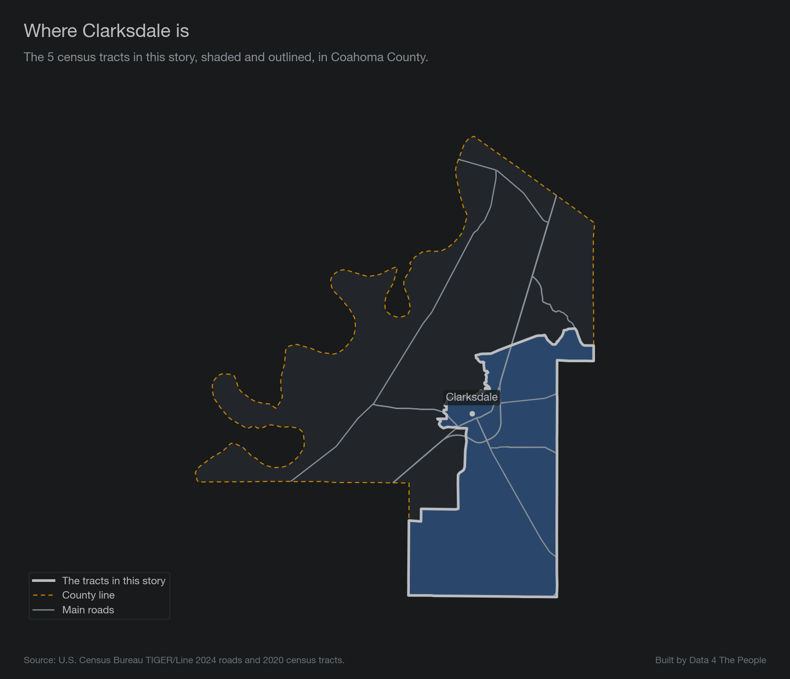
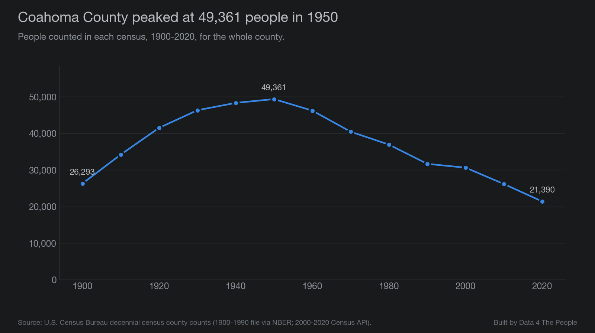
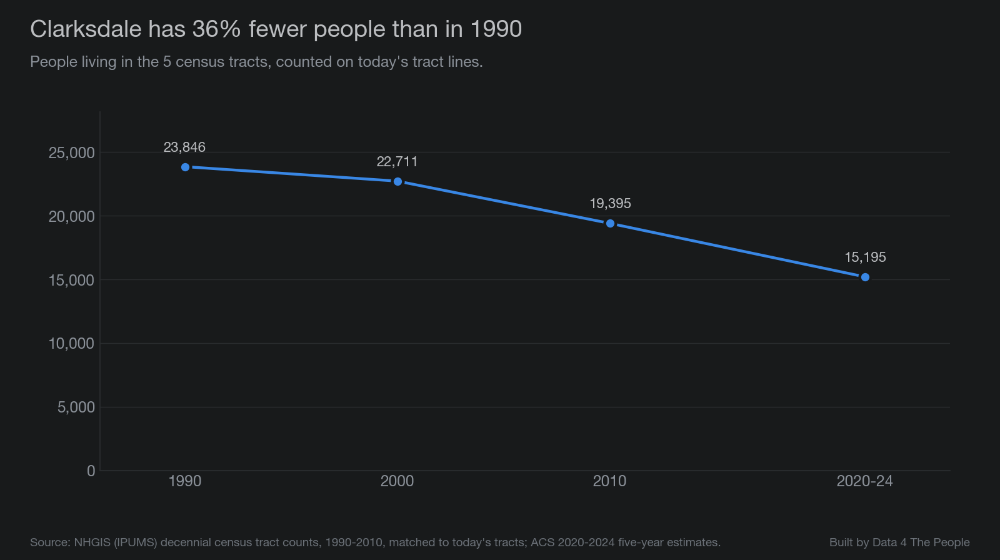
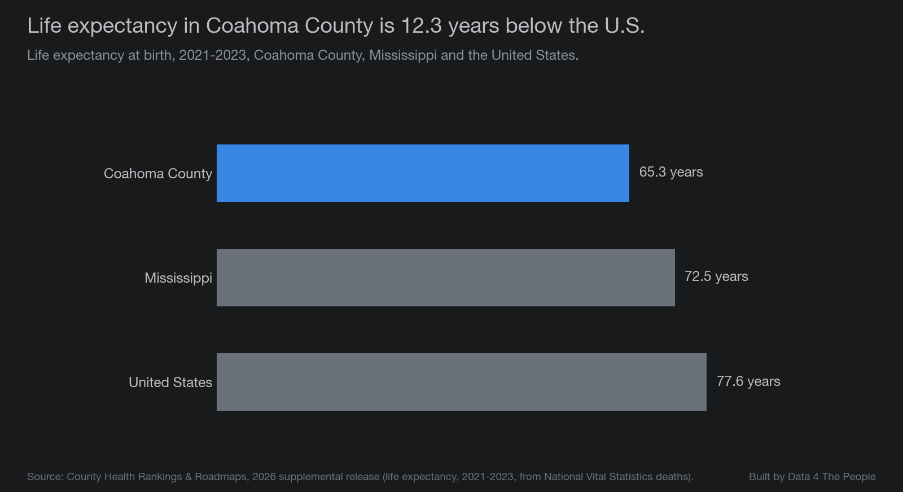

::: blurb Stories of a Forgotten American Community
The connection between a community's economy and its health seems logical, and our [recent work](https://www.data4thepeople.com/p/income-health-viz) shows the two are closely linked. Yet, in the policy world, we tend to treat a community's economy and its physical and mental health as separate goals.

Maybe we do this because we rarely learn how communities end up in this position. This series tries to fill that gap. We selected 10 communities, out of thousands across the country with low incomes and poor health, five in cities and five in rural areas. And we have gone back over the past century to tell the story of how they got here.

What we have found challenges the way you may think about America. If you tend to believe that people's circumstances are mostly the result of their own choices, this series may challenge that view. What you will see is that decisions made decades ago, some of them openly racist, set these communities on a path that has been very hard to leave. Just like a good investment can compound wealth over many years, a decision, like redlining a neighborhood or tying a county's jobs to a single industry, can compound the other way.

When you read this series, try to put yourself in the shoes of people in these communities. If you don't live here, or in an area like this, you may not live in the shadow of past decisions. But people in these communities do.

Ask yourself one question: What would your life be like if you had grown up here?

Then ask a second: Is it fair to ignore what this community faces now? Or should we do something about decisions made decades ago that held this community back?
:::

::: spacer 20px

Here is how Clarksdale compares with the country today.

*Census Bureau, CDC PLACES and USALEEP. Health figures are model estimates for adults.*

::: spacer 20px

::: dropcap
Clarksdale is the seat of Coahoma County, in the Mississippi Delta. This story covers five census tracts: the town itself and the farmland just south of it, around the old Hopson plantation. About 15,200 people live there. Most are Black, about 79% in the latest census survey. Median household income is about $36,600, 45% of the U.S. figure. Life expectancy is 71.3 years, 7.4 years shorter than for the country as a whole.

Clarksdale took a long series of hits over more than a century. This post walks through them in order, with a link to the source for each one. Our census numbers for these tracts start in 1990, so the early chapters come from county records and historical sources.

The map below shows the five tracts inside Coahoma County.

*Tract and road lines from the Census Bureau.*

## Land worked by people who did not own it

::: spacer 5px

In 1900, Coahoma County had 26,293 people ([U.S. Census Bureau county counts, via NBER](https://data.nber.org/census/population/cencounts/cencounts.csv)). Only 235 of its 3,797 Black farm households, 6%, owned land. By 1930, 94% of all farmers in the county were tenants or sharecroppers, and the county had only 462 factory workers ([Mississippi Encyclopedia, "Coahoma County"](https://mississippiencyclopedia.org/entries/coahoma-county/)).

[Eric: the story of Black families leaving Clarksdale by train for Chicago after cotton prices fell around 1920 rests on one page of Nicholas Lemann's *The Promised Land*. We could only read it secondhand, so I left it out until the book is pulled.]

## The machine that picked cotton

::: spacer 5px

In late 1944, the Hopson Planting Company, just south of Clarksdale, grew the first cotton crop produced entirely without hand labor ([Holley, EH.Net Encyclopedia](https://eh.net/encyclopedia/mechanical-cotton-picker/)). The Mississippi Blues Trail marker there calls it "the first crop of cotton to be entirely planted, harvested, and baled by machine" ([Mississippi Blues Trail](https://msbluestrail.org/?p=369)). International Harvester began selling cotton pickers in 1949. In 1960, most U.S. cotton was still picked by hand. By the late 1960s, machines picked nearly all of it ([Holley, EH.Net Encyclopedia](https://eh.net/encyclopedia/mechanical-cotton-picker/)).

Historians disagree about which came first. Donald Holley writes that "migration greatly accelerated mechanization," as higher wages in the North pulled workers away. He finds that machines explain less than 40% of the drop in hand picking ([Holley, EH.Net Encyclopedia](https://eh.net/encyclopedia/mechanical-cotton-picker/)).

Coahoma County's population peaked at 49,361 in the 1950 census ([U.S. Census Bureau county counts, via NBER](https://data.nber.org/census/population/cencounts/cencounts.csv)). The chart below shows the county's population in every census since 1900.

*Whole county, not just the five tracts in this story.*

## Civil rights and hunger

::: spacer 5px

In 1960, the county had 46,212 people, and 68% of them were Black ([Mississippi Encyclopedia, "Coahoma County"](https://mississippiencyclopedia.org/entries/coahoma-county/)). On May 29, 1958, Martin Luther King Jr. took part in a meeting of the Southern Christian Leadership Conference in Clarksdale and spoke at First Baptist Church ([King Institute, Stanford](https://kinginstitute.stanford.edu/king-participates-sclc-meeting-clarksdale-addresses-mass-meeting-first-baptist-church)). Clarksdale pharmacist Aaron Henry became president of the state NAACP in 1960. In the early 1960s, he led demonstrations and boycotts against segregated public places and stores in Clarksdale ([Mississippi Encyclopedia, "Aaron Henry"](https://mississippiencyclopedia.org/entries/aaron-henry/)).

On April 10, 1967, a U.S. Senate subcommittee on poverty held a hearing in Jackson. Witnesses "told of widespread hunger and unemployment among farm workers displaced by mechanization and reduced cotton acreage." The next day, Senators Joseph Clark and Robert Kennedy drove through the Delta, and their tour ended in Clarksdale ([The Carolinian, April 15, 1967](https://newspapers.digitalnc.org/lccn/sn99061519/1967-04-15/ed-1/seq-1/ocr/)). On July 30, 1968, the Senate created a Select Committee on Nutrition and Human Needs ([U.S. Senate committee print, 1968](https://www.govinfo.gov/content/pkg/CPRT-90SPRT98973O/pdf/CPRT-90SPRT98973O.pdf)).

## Two school systems

::: spacer 5px

In October 1969, the U.S. Supreme Court ruled in *Alexander v. Holmes County Board of Education*, a Mississippi school case ([Oyez](https://www.oyez.org/cases/1969/632)). Within months, Clarksdale's Black and white high schools merged on Feb. 1, 1970. When schools reopened the next day, 574 of the 585 white students at Clarksdale Junior High did not show up, the local paper reported. Lee Academy, a private school, opened that fall with 654 students ([The Hechinger Report, 2019](https://hechingerreport.org/a-charter-school-faces-the-ugly-history-of-school-choice-in-the-deep-south/); [Lee Academy](http://web.archive.org/web/20200225003828/http://www.leeacademycolts.org:80/history)).

In fall 2015, Coahoma County's three private schools were 7% Black, while its public school systems were more than 90% Black ([The Hechinger Report, 2019](https://hechingerreport.org/a-charter-school-faces-the-ugly-history-of-school-choice-in-the-deep-south/)).

## Fewer jobs on the land

::: spacer 5px

By 1980, farm jobs had fallen sharply, though the county still ranked fifth in Mississippi for farm employment. Most factory jobs were in food processing and metal products. More than a third of residents had less than five years of schooling, and the county ranked second in the state for public assistance payments ([Mississippi Encyclopedia, "Coahoma County"](https://mississippiencyclopedia.org/entries/coahoma-county/)).

In 2004, Cooper Tire said it would stop making inner tubes at its Clarksdale plant, which had been open since 1956. About 30 of its 159 workers would stay ([Cooper Tire, SEC Form 8-K, 2004](https://www.sec.gov/Archives/edgar/data/24491/000095015204006717/l09501ae8vk.htm)).

[Eric: we have not sourced the other job losses of the 1970s to 2000s, such as other plant closings, the hospital or casino jobs. That would take the Clarksdale Press Register archive. The post works without them, but this is the thinnest stretch of the story.]

## People leave

::: spacer 5px

The chart below counts the people living inside today's five tract lines in each census since 1990.

*Earlier counts are fitted to today's tract lines. 2020-2024 is a five-year survey estimate.*

Over the same years, the share of homes standing empty rose. The share of people with low incomes, meaning below 200% of the poverty line, stayed near 60%, compared with 28% nationwide. The chart below shows both shares.

*Low income here means below 200% of the federal poverty line. Income for 2010 is from the 2008-2012 survey.*

## Health

::: spacer 5px

The health numbers in the table at the top are today's. We do not have tract health data from earlier decades, so we cannot show how health here changed over time. For the whole county, we can compare life expectancy with the state and the country. The chart below shows it for 2021 to 2023.

*Life expectancy from County Health Rankings & Roadmaps, based on death records.*

::: divider

## How we built this

::: spacer 5px

- **The neighborhood.** Clarksdale here is five 2020 census tracts in Coahoma County, Mississippi: 28027950300, 28027950400, 28027950500, 28027950600 and 28027950700. All five are in the bottom 20% of U.S. tracts on both median household income and our health index. Tract 28027950300 is the farmland south of town, including Hopson.
- **Then and now.** Tract counts from 1990 to 2010 come from [NHGIS (IPUMS)](https://www.nhgis.org/) and are fitted to today's tract lines. Earlier tracts do not line up well enough to compare, so the long view uses county counts from the census, 1900-1990 ([NBER copy of the Census Bureau file](https://data.nber.org/census/population/cencounts/cencounts.csv)) and 2000-2020 ([Census API](https://api.census.gov/data/2020/dec/pl)). 2020-2024 numbers are from the Census Bureau's [American Community Survey](https://www.census.gov/programs-surveys/acs) five-year estimates.
- **The table at the top.** Rates are computed from counts summed across the five tracts. Median household income is estimated from income ranges, the Census Bureau's method for combined areas. Health measures are [CDC PLACES](https://www.cdc.gov/places/) model estimates for adults, weighted by each tract's adult population. Life expectancy is from the [U.S. Small-Area Life Expectancy Estimates Project](https://www.cdc.gov/nchs/nvss/usaleep/usaleep.html), 2010-2015.
- **County life expectancy.** [County Health Rankings & Roadmaps](https://www.countyhealthrankings.org/health-data/methodology-and-sources/data-documentation), 2026 supplemental release, 2021-2023.
- **City vs. tracts.** We use tracts and the county, not the city of Clarksdale, because the city's borders changed between 1990 and 2000.
