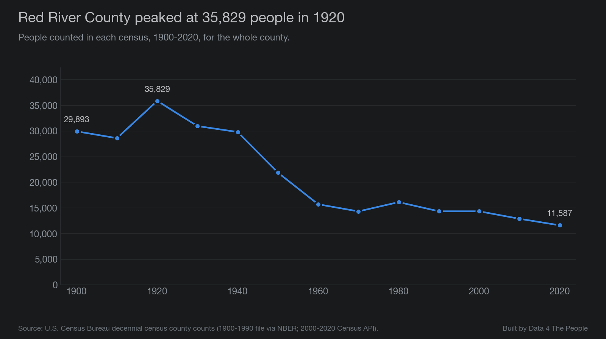
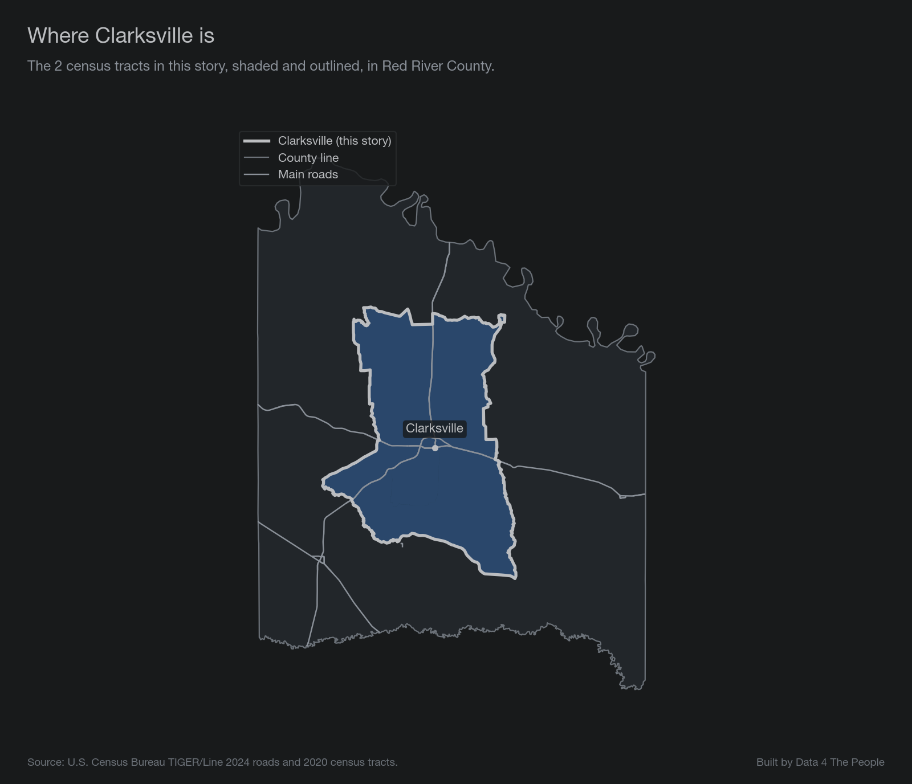
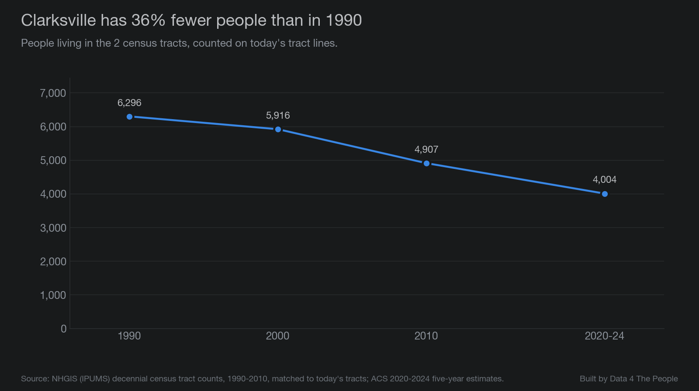
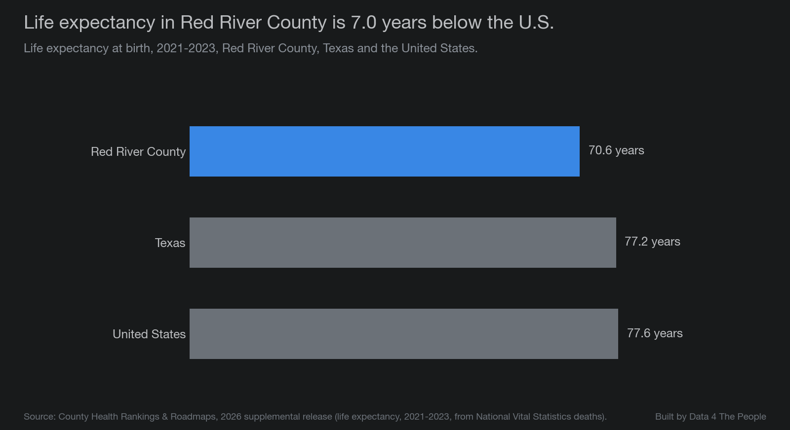

::: blurb Stories of a Forgotten American Community
The connection between a community's economy and its health seems logical, and our [recent work](https://www.data4thepeople.com/p/income-health-viz) shows the two are closely linked. Yet, in the policy world, we tend to treat a community's economy and its physical and mental health as separate goals.

Maybe we do this because we rarely learn how communities end up in this position. This series tries to fill that gap. We selected 10 communities, out of thousands across the country with low incomes and poor health, five in cities and five in rural areas. And we have gone back over the past century to tell the story of how they got here.

What we have found challenges the way you may think about America. If you tend to believe that people's circumstances are mostly the result of their own choices, this series may challenge that view. What you will see is that decisions made decades ago, some of them openly racist, set these communities on a path that has been very hard to leave. Just like a good investment can compound wealth over many years, a decision, like redlining a neighborhood or tying a county's jobs to a single industry, can compound the other way.

When you read this series, try to put yourself in the shoes of people in these communities. If you don't live here, or in an area like this, you may not live in the shadow of past decisions. But people in these communities do.

Ask yourself one question: What would your life be like if you had grown up here?

Then ask a second: Is it fair to ignore what this community faces now? Or should we do something about decisions made decades ago that held this community back?
:::

::: spacer 20px

Here is how Clarksville compares with the country today.

*Census Bureau, CDC PLACES and USALEEP. Health figures are model estimates for adults.*

::: spacer 20px

::: dropcap
Clarksville is the county seat of Red River County, in the far northeast corner of Texas. The two census tracts in this story hold the town and the farm and timber land around it, with about 4,000 people. About 37% of them are Black. Life expectancy is 71.3 years, 7.4 years shorter than for the country as a whole, and the shortest of any tract in the county in 2010-2015 ([CDC, USALEEP](https://ftp.cdc.gov/pub/Health_Statistics/NCHS/Datasets/NVSS/USALEEP/CSV/TX_A.CSV)). Nearly 3 in 10 households get SNAP food aid, and nearly half of adults have high blood pressure.

The latest survey shows 15% of people here in poverty, close to the U.S. rate. That estimate comes from a small sample of about 4,000 people, and it is uncertain. Other numbers from the same survey point the other way: 29% of households get SNAP, compared with 12% nationally. This post focuses on the record that does not depend on that one estimate. It walks through Clarksville's history in order, with a link to the source for each step.

## Cotton

::: spacer 5px

The Texas and Pacific Railway reached Clarksville in the 1870s ([Handbook of Texas, Clarksville](https://www.tshaonline.org/handbook/entries/clarksville-tx-red-river-county); [Handbook of Texas, Red River County](https://www.tshaonline.org/handbook/entries/red-river-county)). Red River County's population peaked at 35,829 in 1920. That year its farms grew 46,263 bales of cotton, the most in any census year. By 1930, fewer than 30% of the county's farmers owned all or part of the farms they worked ([Handbook of Texas, Red River County](https://www.tshaonline.org/handbook/entries/red-river-county)).

In the Depression, the number of rated businesses in Clarksville fell from 165 in 1931 to 104 in 1936. The cotton wholesale and processing trade was hit especially hard ([Handbook of Texas, Clarksville](https://www.tshaonline.org/handbook/entries/clarksville-tx-red-river-county)). A second railroad through the county's southwest corner, built in 1913, was abandoned in 1956 ([Handbook of Texas, Red River County](https://www.tshaonline.org/handbook/entries/red-river-county)).

By 1970 the county had 14,298 people, 60% fewer than in 1920. The chart below shows the county's census counts since 1900.

*Counts are for the whole county.*

In 1979, 20.5% of the county's families lived below the poverty line. In 1981, the county ranked 233rd of 254 Texas counties in income per person ([Handbook of Texas, Red River County](https://www.tshaonline.org/handbook/entries/red-river-county)).

The map below shows where the two tracts sit.

*Tracts are 2020 census tracts. Roads are from the Census Bureau.*

## The housing case

::: spacer 5px

On March 14, 1980, Black public housing applicants and tenants filed *Young v. Pierce* in federal court in East Texas. Two of the named plaintiffs, Lucille Young and Virginia Wyatt, had applied for housing run by the Clarksville and Pittsburg housing authorities ([Civil Rights Litigation Clearinghouse](https://clearinghouse.net/case/11152/); [Tarlton Law Library, University of Texas](https://tarlton.law.utexas.edu/william-wayne-justice/young-case)).

In a separate Clarksville case, on Oct. 11, 1983, Judge William Wayne Justice found that the Clarksville Housing Authority assigned tenants by race on purpose. A transfer plan moved 25 families from a white complex into two Black complexes, and 24 families the other way. The court approved the plan on Nov. 25, 1983 ([Tarlton Law Library](https://tarlton.law.utexas.edu/william-wayne-justice/young-case)).

On July 31, 1985, Judge Justice ruled in *Young v. Pierce* that the U.S. Department of Housing and Urban Development "has intentionally and knowingly continued to promote purposefully segregated housing" in 36 East Texas counties ([Young v. Pierce, 628 F. Supp. 1037](https://tarltonapps.law.utexas.edu/exhibits/ww_justice/documents_4/Young_opinion_2_1985.pdf)). By 1988, Clarksville's three public housing complexes were 33%, 48% and 89% Black ([Tarlton Law Library](https://tarlton.law.utexas.edu/william-wayne-justice/young-case)). The case settled in 2003, with HUD agreeing to create 1,500 more desegregated housing opportunities for class members, and ended in 2004 ([Tarlton Law Library](https://tarlton.law.utexas.edu/william-wayne-justice/young-case); [Civil Rights Litigation Clearinghouse](https://clearinghouse.net/case/11152/)).

## The banks

::: spacer 5px

Three Clarksville banks failed in six years: First National Bank in Clarksville on Jan. 24, 1985, Red River National Bank in Clarksville on March 19, 1987, and Citizens Bank on Sept. 13, 1990 ([FDIC bank failures](https://banks.data.fdic.gov/bankfind-suite/failures)). The Handbook of Texas says one of the town's banks failed under bad farm and energy loans ([Handbook of Texas, Clarksville](https://www.tshaonline.org/handbook/entries/clarksville-tx-red-river-county)). The sources do not say what caused the other two.

## People leave

::: spacer 5px

The town of Clarksville peaked at 4,917 people in 1980. It had 2,857 in 2020, 42% fewer ([Handbook of Texas, Clarksville](https://www.tshaonline.org/handbook/entries/clarksville-tx-red-river-county); [Census API](https://api.census.gov/data/2020/dec/pl?get=NAME,P1_001N&for=place:15160&in=state:48)). The bank failures and the population loss came in the same years, but no source we found ties one to the other. The chart below counts the people living inside today's two tract lines since 1990.

*Earlier counts are fitted to today's tract lines. 2020-2024 is a five-year survey estimate.*

Enrollment in the Clarksville school district fell from 1,466 in 1990 to 522 in 2022, a drop of 64% ([National Center for Education Statistics, via the Urban Institute](https://educationdata.urban.org/api/v1/school-districts/ccd/directory/2022/?leaid=4814190)).

The poverty rate alone can miss what is happening here. The chart below shows the share of people with low incomes, meaning below 200% of the poverty line, and the share of homes vacant. About 55% of people in these tracts have low incomes, compared with 28% nationwide, and that share has not moved since 2008-2012. The vacancy rate rose.

*Low income here means below 200% of the federal poverty line. Income for 2010 is from the 2008-2012 survey.*

## The hospital

::: spacer 5px

In August 2014, East Texas Medical Center said it would not renew its lease on the Clarksville hospital. It said the emergency room averaged less than one patient an hour, and it cited cuts in Medicare and Medicaid payments ([KETR, 2014](https://www.ketr.org/news/2014-08-07/clarksville-could-lose-hospital)). The 30-bed hospital closed in 2014, with no services left ([Sheps Center, University of North Carolina](https://www.shepscenter.unc.edu/programs-projects/rural-health/rural-hospital-closures/)). A state record shows a new 12-bed hospital registered in Clarksville with a planned completion in October 2023 ([Texas Department of Licensing and Regulation](https://www.tdlr.texas.gov/TABS/Search/Print/TABS2022023485)). [Eric: we could not confirm whether the new hospital opened. A Texas health agency licensing record would settle it.]

The chart below compares life expectancy in Red River County with Texas and the country.

*Life expectancy from [County Health Rankings & Roadmaps](https://www.countyhealthrankings.org/health-data/methodology-and-sources/data-documentation), based on death records, for the whole county, not Clarksville alone.*

## What has changed

::: spacer 5px

The housing case ended with a settlement in 2003, after a federal judge found that HUD had kept public housing segregated across 36 East Texas counties. Clarksville has fewer people, a smaller school district and, since 2014, no confirmed hospital. Its adults have higher rates of diabetes and high blood pressure than adults nationwide.

::: divider

## How we built this

::: spacer 5px

- **The area.** Clarksville here is two 2020 census tracts in Red River County, Texas: 48387950501 and 48387950502. Together they match the 2010 tract that held the town, so the area can be followed over time. The second tract includes countryside around the town that is better off than the town itself.
- **Then and now.** Census tract counts from 1990 to 2010 come from [NHGIS (IPUMS)](https://www.nhgis.org/) and are fitted to today's tract lines. 2020-2024 numbers are from the Census Bureau's [American Community Survey](https://www.census.gov/programs-surveys/acs) five-year estimates. County counts from 1900 to 1990 are from the [Census Bureau's county file, as copied by NBER](https://data.nber.org/census/population/cencounts/cencounts.csv), and 2000 to 2020 from the Census API.
- **Survey uncertainty.** With about 4,000 people, survey estimates here carry wide margins of error. The survey counts 1,692 people in tract 48387950502, while the 2020 census counted 2,178. Poverty fell from 23.1% in the 2008-2012 survey to 14.8% in 2020-2024 while SNAP use stayed near 29%. Read the poverty rate with care.
- **The table at the top.** Rates are computed from counts summed across the two tracts. Median household income is estimated from income ranges, the Census Bureau's method for combined areas. Health measures are [CDC PLACES](https://www.cdc.gov/places/) model estimates for adults, weighted by each tract's adult population. Life expectancy is from the [U.S. Small-Area Life Expectancy Estimates Project](https://www.cdc.gov/nchs/nvss/usaleep/usaleep.html), 2010-2015, for the 2010 tract that the two tracts came from.
- **County life expectancy.** [County Health Rankings & Roadmaps](https://www.countyhealthrankings.org/health-data/methodology-and-sources/data-documentation), 2026 supplemental release, 2021-2023.
