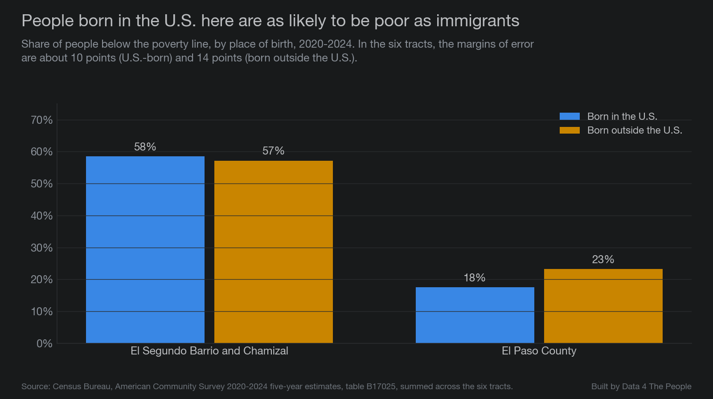
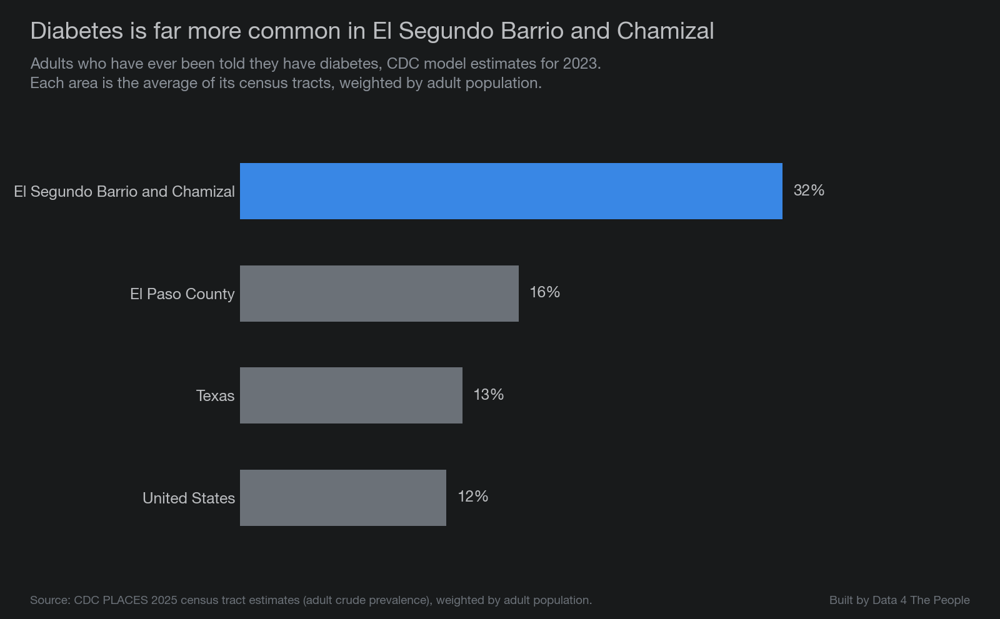
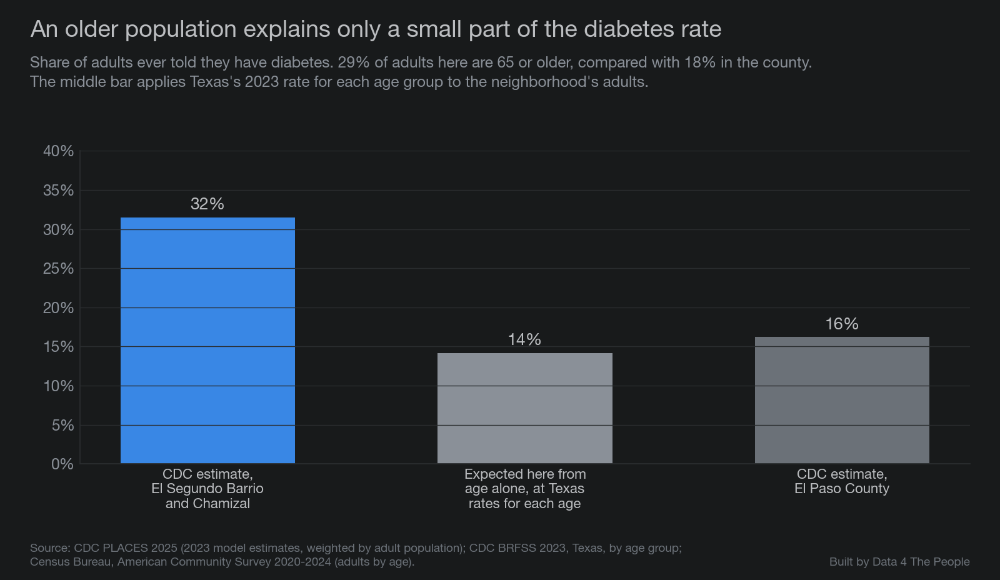
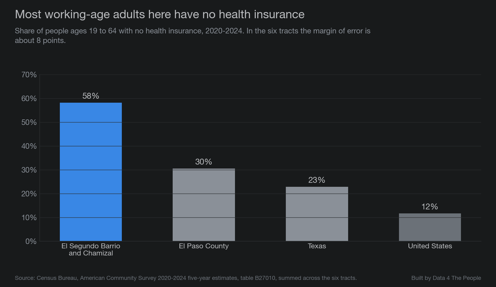

::: blurb Stories of a Forgotten American Community
The connection between a community's economy and its health seems logical, and our [recent work](https://www.data4thepeople.com/p/income-health-viz) shows the two are closely linked. Yet, in the policy world, we tend to treat a community's economy and its physical and mental health as separate goals.

Maybe we do this because we rarely learn how communities end up in this position. This series tries to fill that gap. We selected 10 communities, out of thousands across the country with low incomes and poor health, five in cities and five in rural areas. And we have gone back over the past century to tell the story of how they got here.

What we have found challenges the way you may think about America. If you tend to believe that people's circumstances are mostly the result of their own choices, this series may challenge that view. What you will see is that decisions made decades ago, some of them openly racist, set these communities on a path that has been very hard to leave. Just like a good investment can compound wealth over many years, a decision, like redlining a neighborhood or tying a county's jobs to a single industry, can compound the other way.

When you read this series, try to put yourself in the shoes of people in these communities. If you don't live here, or in an area like this, you may not live in the shadow of past decisions. But people in these communities do.

Ask yourself one question: What would your life be like if you had grown up here?

Then ask a second: Is it fair to ignore what this community faces now? Or should we do something about decisions made decades ago that held this community back?
:::

::: spacer 20px

Here is how El Segundo Barrio and Chamizal compare with the country today.

*Census Bureau, CDC PLACES and USALEEP. Health figures are model estimates for adults.*

::: spacer 5px

::: dropcap
El Segundo Barrio, the old Second Ward, sits along the Rio Grande just south of downtown El Paso, Texas. The Chamizal neighborhood lies to its east. Together, the six census tracts in this story had 15,195 people in the 2020 census. Median household income is about $18,300, 23% of the U.S. figure. Almost three in five people live below the poverty line. More than half of adults say their health is fair or poor, and almost a third have diabetes.

Life expectancy here, 76.7 years, is about two years below the U.S. figure. That is much closer to the national number than in the other neighborhoods in this series. The health gap here shows up in chronic illness more than in early death.

For more than a century, this neighborhood was a first home for families arriving from Mexico. The National Register of Historic Places calls it "a landing place for immigrants" ([National Register nomination, 2021](https://atlas.thc.texas.gov/NR/pdfs/100006994/100006994.pdf)). Over that time it lost land and housing again and again. This post walks through those losses in order, with a link to the source for each one.

The map below shows where the neighborhood sits, just south of downtown El Paso. No part of the six tracts is more than about 1.4 miles from the Rio Grande, the border with Ciudad Juárez, Mexico.

*Census Bureau tract, state and road files. The border follows the river's current channel.*

## 1916 and 1917

::: spacer 5px

In January 1916, after Pancho Villa's troops killed American mining engineers in Chihuahua, a mob of El Pasoans raided Chihuahuita and Segundo Barrio. Gen. John J. Pershing declared martial law and set "Dead Lines" that kept Mexican residents inside their neighborhoods. Pershing said conditions there put his soldiers' health at risk. The city then tore down more than 100 small homes, some of which housed as many as 12 families. Tenement residents who shared a building with a sick person faced forced baths in kerosene and vinegar ([National Register nomination, p. 124](https://atlas.thc.texas.gov/NR/pdfs/100006994/100006994.pdf); [Handbook of Texas](https://www.tshaonline.org/handbook/entries/el-paso-race-riot-of-1916)). The sources give different counts for the mob and the engineers killed.

On Jan. 28, 1917, up to 500 women protested at the Santa Fe Street bridge against forced "delousing" baths for people crossing from Ciudad Juárez. The protest, known as the Bath House Riots, was started by 17-year-old Carmelita Torres ([National Register nomination, p. 124](https://atlas.thc.texas.gov/NR/pdfs/100006994/100006994.pdf); [Handbook of Texas](https://www.tshaonline.org/handbook/entries/el-paso-bath-house-riots-1917)).

## The 1930s map

::: spacer 5px

In about 1936, the federal Home Owners' Loan Corporation mapped El Paso for mortgage risk. South El Paso, along the river, was graded D, labeled "hazardous," or left as business and industrial land. Every graded area inside our six tracts was graded D ([Mapping Inequality map scan](https://s3.amazonaws.com/holc/tiles/TX/ElPaso/1936/holc-scan.jpg); [Mapping Inequality](https://dsl.richmond.edu/panorama/redlining)).

The map below shows those grades with the six tracts in this story outlined.

*The grades come from Mapping Inequality. Freeways are today's, from the Census Bureau.*

## Public housing and a wider road

::: spacer 5px

El Paso's first public housing went up near the barrio. The Alamito project opened in 1940 with 349 units, just outside the historic district. The Tays project, in Chamizal, opened in 1941 with 359 units and is the city's oldest public housing still in use ([National Register nomination, p. 136](https://atlas.thc.texas.gov/NR/pdfs/100006994/100006994.pdf); [City of El Paso, Chamizal plan, 2008, p. 21](https://www.elpasotexas.gov/assets/Documents/CoEP/Community-Development/Neighborhood-Associations/Neighborhood-Revitalization/CHAMIZAL-NRS.pdf)).

In 1946 and 1947, the city widened Paisano Drive, part of U.S. 80. The widening destroyed nearby properties and moved out as many as 6,000 residents. The National Register nomination says this led to more shacks being built elsewhere in the barrio. By the 1950s, Paisano was a fast road that was dangerous to cross on foot ([National Register nomination, p. 122](https://atlas.thc.texas.gov/NR/pdfs/100006994/100006994.pdf); [City of El Paso, Chamizal plan, 2008, p. 6](https://www.elpasotexas.gov/assets/Documents/CoEP/Community-Development/Neighborhood-Associations/Neighborhood-Revitalization/CHAMIZAL-NRS.pdf)).

## The river moves

::: spacer 5px

On Aug. 29, 1963, the United States and Mexico signed the Chamizal Convention to settle a long border dispute. The Rio Grande was moved into a new concrete channel 4.34 miles long. About 630 acres went to Mexico and 193 acres to the United States ([Chamizal Convention, 1963](https://www.nps.gov/cham/learn/historyculture/chamizalconvention.htm); [National Park Service](https://www.nps.gov/cham/learn/historyculture/implementation.htm)). The federal boundary commission counts the net change as 437 acres to Mexico ([International Boundary and Water Commission](https://www.ibwc.gov/treaties/)).

Between 1964 and 1967, one third of the Second Ward's land was cleared, including 1,155 homes rated substandard. Owners were paid and scattered across the city. Renters mostly stayed within half a mile, so the rest of South El Paso gained 1,804 people and only two new housing units ([National Register nomination, p. 143](https://atlas.thc.texas.gov/NR/pdfs/100006994/100006994.pdf)).

The land formally passed to Mexico at 12:01 a.m. on Oct. 28, 1967 ([Chamizal Declaration, 1967](https://presidency.ucsb.edu/documents/text-the-chamizal-declaration-recognizing-the-transfer-lands-between-the-united-states-and)). About 5,600 people were moved out. Neighborhoods including Rio Linda, Cordova Gardens, Cotton Mill and El Jardín were removed, along with the two southernmost blocks of Segundo Barrio ([National Park Service](https://www.nps.gov/cham/learn/historyculture/implementation.htm); [Handbook of Texas](https://www.tshaonline.org/handbook/entries/chamizal-dispute)).

The map below is a 1955 federal map of the area, made before the river was moved. Today's six tracts are outlined in pink, and today's border is the dashed blue line. U.S. land between the 1955 river and the blue line went to Mexico.

*U.S. Geological Survey, El Paso and Ysleta NW map sheets, 1955. The border line is simplified from Census Bureau files.*

## Tenements

::: spacer 5px

In 1967, the city planning department surveyed 3,494 units in 238 tenement buildings. Only 24 had hot and cold running water, and there were 4.2 units for each toilet, mostly outdoors. That year, a tenement fire at 503 S. Mesa St. killed three children, and about 300 people marched to City Hall. A housing code passed in 1968. That year, 76% of the Second Ward's housing was rated "deteriorating or dilapidated" ([National Register nomination, pp. 143 to 144](https://atlas.thc.texas.gov/NR/pdfs/100006994/100006994.pdf)).

In 1973 and 1974, a city code enforcement drive called the Tenement Eradication Program removed more housing. Residents formed La Campaña Pro Preservación del Barrio in 1974 ([National Register nomination, p. 146](https://atlas.thc.texas.gov/NR/pdfs/100006994/100006994.pdf)). Counting the Chamizal transfer, a park, the code drive and private land deals, the nomination says that from 1960 to the early 1970s the neighborhood lost about a third of its land and "over half of the housing stock disappeared" ([National Register nomination, p. 143](https://atlas.thc.texas.gov/NR/pdfs/100006994/100006994.pdf)).

Crowding has fallen a long way since then. In 1960, 54% of occupied homes here had more than one person per room, compared with 25% across El Paso County. In 2020-2024, it was 9% here and 5% in the county. The chart below shows the change.

*Earlier counts are fitted to today's tract lines. 2010 is from the 2008-2012 survey.*

Some homes still lack basic plumbing. In 2020-2024, about 6.5% of homes here lacked complete plumbing, compared with 1.6% in the county. The margin of error is wide, from about 4% to 9% ([Census Bureau, American Community Survey 2020-2024](https://data.census.gov/table/ACSDT5Y2024.B25047)).

The chart below counts the people and homes inside today's six tract lines in each census, and how many people lived in each occupied home.

*Earlier counts are fitted to today's tract lines. 2010 and 2020 are census counts.*

In 1960, about 50,500 people lived here, in about 13,300 homes. By 1970, there were about 34,800 people. By 2020, there were about 6,500 homes, 51% fewer than in 1960. From 1960 to 1980, most of the drop in people came from fewer occupied homes, not from smaller households. Since 2000, it has been the other way around. Households shrank from 3.2 people per home in 2000 to 2.6 in 2020, and the number of homes rose a little after 2010.

The National Register nomination says over half of the Second Ward's housing was gone by the early 1970s. Our six tracts cover a larger area. In them, about 28% of homes were gone by 1970 and 40% by 1980.

## Garment jobs

::: spacer 5px

In May 1972, about 4,000 workers at Farah Manufacturing, 85% of them women, went on strike for union representation. Farah was then El Paso's second-largest employer. The strike ended when the workers won their union in March 1974 ([Handbook of Texas, Farah strike](https://www.tshaonline.org/handbook/entries/farah-strike)). Farah laid off about 5,000 workers from 1974 to 1977, and by 1994 it had 3,000 workers in El Paso ([Handbook of Texas, Farah Inc.](https://www.tshaonline.org/handbook/entries/farah-incorporated)).

Clothing jobs in El Paso County fell from 16,150 in 1990 to 1,310 in 2019, a drop of 92% ([Bureau of Labor Statistics, 1990](https://data.bls.gov/cew/data/files/1990/csv/1990_annual_by_area.zip); [2019](https://data.bls.gov/cew/data/api/2019/a/area/48141.csv)). The North American Free Trade Agreement took effect in 1994. The Federal Reserve Bank of Dallas wrote that NAFTA "likely accelerated" the move of clothing work to lower-cost countries. By early 2002, VF Jeanswear had laid off about 1,180 workers, and Levi Strauss had announced it would close its last El Paso sewing plant, with 780 workers. A decade earlier, Levi had six plants and about 6,000 workers in El Paso ([Federal Reserve Bank of Dallas, 2002](https://fraser.stlouisfed.org/files/docs/publications/frbdal_bus/frbdal_bus_2002_iss1.pdf); [U.S. Department of Labor, 1999](https://www.govinfo.gov/content/pkg/FR-1999-12-21/html/99-32992.htm)).

These are county jobs, and the National Register nomination says many garment workers crossed daily from Juárez. But census counts show how many people living here worked in manufacturing, which includes clothing. In 1970 and 1980, about 30% of working residents in the six tracts had manufacturing jobs, compared with 17% to 19% across El Paso County. By 2020-2024, it was 9%. Over the same years, the number of working residents fell from about 8,300 in 1970 to about 4,300 ([NHGIS](https://www.nhgis.org/); [Census Bureau, American Community Survey 2020-2024](https://data.census.gov/table/ACSDT5Y2024.C24050)).

The chart below shows the share of people with low incomes, meaning below 200% of the poverty line, and the share of homes standing empty in the six tracts. About 83% of people here have low incomes, compared with 28% nationwide.

*Low income here means below 200% of the federal poverty line. Income for 2010 is from the 2008-2012 survey.*

Poverty was already above 50% in 1970, the first year in our data. It peaked in 1990, before NAFTA, and was lower in 2000, while clothing jobs were falling fastest. The city's 2008 plan for Chamizal, using 2000 census figures, put 58.1% of Chamizal residents below the poverty line, compared with 22.2% for El Paso as a whole ([City of El Paso, Chamizal plan, 2008, p. 14](https://www.elpasotexas.gov/assets/Documents/CoEP/Community-Development/Neighborhood-Associations/Neighborhood-Revitalization/CHAMIZAL-NRS.pdf)).

## A redevelopment plan

::: spacer 5px

In 2006 and 2007, a downtown plan drawn up over two years by a private business group, the Paso del Norte Group, targeted about 325 acres between I-10 and the border, including Segundo Barrio. The Texas Observer reported that nearly 168 acres would probably be bulldozed and 157 acres would become a historic zone, and that the city would not rule out eminent domain ([Texas Observer, 2007](http://web.archive.org/web/20260614071230/https://www.texasobserver.org/2483-eminent-disaster-a-cabal-of-politicians-and-profiteers-targets-an-el-paso-barrio/)). Eminent domain was never used for the project. By the end of the decade, the plan, "at least as initially conceived," had "lost steam," the Texas Tribune later reported. In 2009, Texas voters approved a state constitutional amendment tightening eminent domain rules ([Texas Tribune, 2018](https://www.texastribune.org/2018/09/04/cruz-orourke-el-paso-eminent-domain/)). Historian David Dorado Romo helped form Paso del Sur, a group that opposed the plan. In his view, "We were able to stop the complete destruction of the Segundo Barrio because of the huge recession in 2008" ([Longreads, 2018](https://longreads.com/2018/11/16/the-city-i-love-is-destroying-itself-2/)).

## Recognition

::: spacer 5px

In February 2016, Preservation Texas named Segundo Barrio one of the 14 Most Endangered Places in Texas ([El Paso Inc., 2016](http://web.archive.org/web/20250829103104/https://www.elpasoinc.com/news/local_news/article_31e7c5ca-d990-11e5-be6f-f7d4a2605132.html)). On Nov. 3, 2021, the Segundo Barrio Historic District was listed on the National Register of Historic Places, with 688 contributing buildings and other resources ([National Park Service, 2021](https://www.nps.gov/subjects/nationalregister/weekly-list-2021-11-05.htm); [National Register nomination, p. 12](https://atlas.thc.texas.gov/NR/pdfs/100006994/100006994.pdf)).

## Stuck, not passing through

::: spacer 5px

One explanation for poverty here could be that the neighborhood is a first stop. Jaime F. Torres, a writer from Segundo Barrio, described it as "a launching platform from which many Chicano families would choose, or be forced, to move to other locales in farther flung directions" ([National Register nomination, p. 117](https://atlas.thc.texas.gov/NR/pdfs/100006994/100006994.pdf)). If newcomers arrive poor and leave once they get ahead, a neighborhood can stay poor even as the families in it move up.

The census numbers do not fit that explanation well today. In every census from 1960 to 2000, the share of people here living in the same home as five years earlier was as high as or higher than in El Paso County ([NHGIS](https://www.nhgis.org/)). In 2020-2024, 90% of people here lived in the same home a year earlier, compared with 88% in the county. Among immigrants living here, 22% arrived in 2010 or later, about the same as in the county, 23% ([Census Bureau, American Community Survey 2020-2024](https://data.census.gov/table/ACSDT5Y2024.B05005)).

Poverty here is also not limited to newcomers. The chart below compares the poverty rate of people born in the United States with that of people born in another country.

*In the six tracts, margins of error are about 10 points for people born in the U.S. and 14 points for people born elsewhere.*

About 58% of people born in the U.S. who live here are below the poverty line, compared with 18% in the county ([Census Bureau, American Community Survey 2020-2024](https://data.census.gov/table/ACSDT5Y2024.B17025)). These numbers cannot follow families over time. But they show that poverty here is shared by people born here as much as by people who came from Mexico.

## Health

::: spacer 5px

The health numbers in the table at the top are today's, and we have no tract health data from earlier decades. The chronic illness rates are CDC model estimates, not counts. Diabetes stands out. About 32% of adults here have been told they have diabetes, compared with 16% in El Paso County. The chart below compares the neighborhood with the county, Texas and the country.

*CDC PLACES model estimates for 2023, weighted by adult population.*

Part of the reason could be age. Adults here are older than in the county: 29% are 65 or older, compared with 18%. To check, we applied Texas's 2023 diabetes rate for each age group to the adults living here. The chart below shows the result.

*Texas rates by age are from CDC's 2023 Behavioral Risk Factor Surveillance System. The rate for ages 18 to 24 is not published, so that group gets the rate for ages 25 to 34.*

Age alone would put the rate at about 14%, less than half of CDC's estimate of 32% ([CDC BRFSS](https://www.cdc.gov/brfss/)). CDC's estimate is itself a model that uses age, sex, race and ethnicity, so it is not a direct count. Still, age explains only a small part of the gap.

## Sick and uninsured

::: spacer 5px

Almost a third of adults here have diabetes, and more than half say their health is fair or poor. Many of them have no health insurance. In 2020-2024, 58% of people ages 19 to 64 in the six tracts had no coverage of any kind, compared with 12% nationwide. The chart below compares the neighborhood with El Paso County, Texas and the country.

*The margin of error in the six tracts is about 8 points.*

Children here are in a different position. About 78% of children are covered by Medicaid or the Children's Health Insurance Program, and 16% are uninsured. Among adults ages 19 to 64, only 15% have Medicaid, and 11% have coverage only through an employer, compared with 57% nationwide ([Census Bureau, American Community Survey 2020-2024](https://data.census.gov/table/ACSDT5Y2024.B27010); [table C27007](https://data.census.gov/table/ACSDT5Y2024.C27007)).

Part of the reason is how Texas's Medicaid rules work. Texas did not expand Medicaid under the Affordable Care Act. KFF reports that "Texas has the nation's lowest eligibility threshold for parents at 15% FPL," which bars parents in a family of three earning more than $4,098 a year. In states that did not expand, adults under 65 without dependent children generally cannot get Medicaid at any income, apart from Wisconsin and Georgia ([KFF, 2026](https://www.kff.org/medicaid/issue-brief/the-coverage-gap-uninsured-poor-adults-in-states-that-do-not-expand-medicaid/)). Federal subsidies for marketplace plans begin at the poverty line, so many adults below it fall into a gap between the two programs. In these six tracts, 58% of people live below the poverty line. Those original subsidies remain. But the larger subsidies Congress added in 2021 expired at the end of 2025, so people above the poverty line now pay more for marketplace plans, and enrollment has fallen ([KFF, 2026](https://www.kff.org/affordable-care-act/9-things-to-watch-for-the-2027-aca-open-enrollment-period/)).

Federal rules are changing in 2026 and 2027. The Medicaid work requirements in the 2025 federal budget law, which start in January 2027, apply to adults covered through the Medicaid expansion ([KFF](https://www.kff.org/medicaid/issue-brief/health-provisions-in-the-2025-federal-budget-reconciliation-law/); [Centers for Medicare & Medicaid Services, 2025](https://www.medicaid.gov/federal-policy-guidance/downloads/cib12082025.pdf)). Because Texas has no expansion group, the adults who would face them in other states are mostly uninsured here already. Changes for immigrants do apply in Texas. Since Oct. 1, 2026, federal Medicaid and CHIP funding for lawfully present immigrants has been limited mostly to green card holders. Before then, other groups could qualify, including refugees and people granted asylum who did not yet have a green card ([KFF](https://www.kff.org/immigrant-health/implementation-of-medicaid-immigrant-eligibility-restrictions-under-the-2025-reconciliation-law-issues-to-consider/)). On Jan. 1, 2027, marketplace subsidies narrow to the same groups ([Georgetown University Center for Children and Families, 2025](https://ccf.georgetown.edu/2025/10/01/new-immigrant-eligibility-restrictions-coming-to-federally-funded-health-coverage/)). About 36% of people here were born outside the U.S., and 48% of residents who are not citizens are already uninsured. Census data do not show immigration status in enough detail to count how many people here these changes reach.

::: divider

## How we built this

::: spacer 5px

- **The neighborhood.** El Segundo Barrio and Chamizal here are six 2020 census tracts in El Paso County, Texas: 48141001800, 48141001900, 48141002000, 48141002800, 48141002900 and 48141003000. All six are in the bottom 20% of U.S. tracts on both median household income and our health index. Tract 48141003000 lies just east of the city's Chamizal boundary.
- **Then and now.** Census counts from 1970 to 2010 come from [NHGIS (IPUMS)](https://www.nhgis.org/) and are fitted to today's tract lines. 2020-2024 numbers are from the Census Bureau's [American Community Survey](https://www.census.gov/programs-surveys/acs) five-year estimates.
- **The table at the top.** Rates are computed from counts summed across the six tracts. Median household income is estimated from income ranges, the Census Bureau's method for combined areas. Health measures are [CDC PLACES](https://www.cdc.gov/places/) model estimates for adults, weighted by each tract's adult population. Life expectancy is from the [U.S. Small-Area Life Expectancy Estimates Project](https://www.cdc.gov/nchs/nvss/usaleep/usaleep.html), 2010-2015.
- **The map.** Grades are from [Mapping Inequality](https://dsl.richmond.edu/panorama/redlining/). The map itself is undated; Mapping Inequality files it under 1936.
- **Clothing jobs.** Bureau of Labor Statistics [Quarterly Census of Employment and Wages](https://www.bls.gov/cew/), El Paso County, private apparel manufacturing (NAICS 315), annual averages.
- **Homes, crowding and birthplace.** Census counts from 1960 to 2000 come from [NHGIS (IPUMS)](https://www.nhgis.org/), fitted to today's tract lines; 2010 and 2020 are census counts; 2008-2012 and 2020-2024 are [American Community Survey](https://www.census.gov/programs-surveys/acs) estimates. Census plumbing questions changed over time, so we compare only today's plumbing numbers.
- **Health insurance.** [American Community Survey](https://www.census.gov/programs-surveys/acs) 2020-2024 tables B27010 (coverage by type and age), C27007 (Medicaid by age) and B27020 (coverage by place of birth and citizenship), summed across the six tracts. Medicaid here includes other means-tested public coverage, such as CHIP.
- **Diabetes and age.** We applied Texas's 2023 diabetes rates by age group, from CDC's [Behavioral Risk Factor Surveillance System](https://www.cdc.gov/brfss/), to the neighborhood's adults by age from the American Community Survey 2020-2024.
- **River map.** U.S. Geological Survey historical topographic maps, El Paso and Ysleta NW sheets, 1:24,000, 1955 (public domain), from [topoView](https://ngmdb.usgs.gov/topoview/). Today's border is from the Census Bureau's 2020 state boundary file.
- **Diabetes.** [CDC PLACES](https://www.cdc.gov/places/) 2025 tract estimates. The county, state and U.S. values are averages of their tracts, weighted by adult population.
