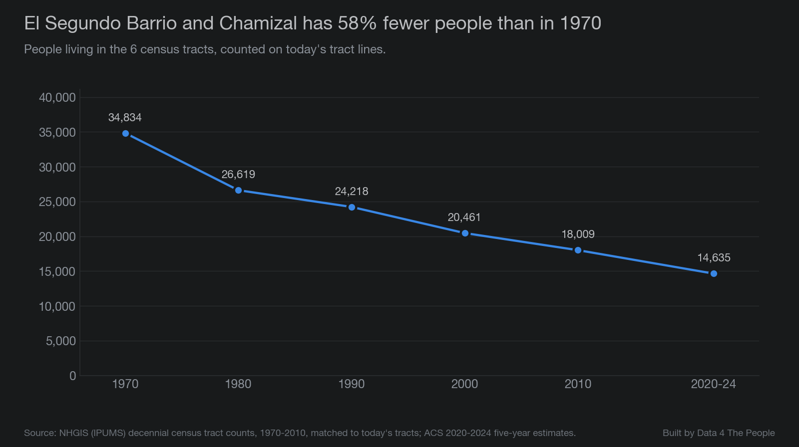

Here is how El Segundo Barrio and Chamizal compare with the country today.

*Census Bureau, CDC PLACES and USALEEP. Health figures are model estimates for adults.*

::: dropcap
El Segundo Barrio, the old Second Ward, sits along the Rio Grande just south of downtown El Paso, Texas. The Chamizal neighborhood lies to its east. Together, the six census tracts in this story hold about 14,600 people. Median household income is about $18,300, 23% of the U.S. figure. Almost three in five people live below the poverty line. More than half of adults say their health is fair or poor, and almost a third have diabetes.

Life expectancy here, 76.7 years, is about two years below the U.S. figure. That is much closer to the national number than in the other neighborhoods in this series. The health gap here shows up in chronic illness more than in early death.

For more than a century, this neighborhood was a first home for families arriving from Mexico. The National Register of Historic Places calls it "a landing place for immigrants" ([National Register nomination, 2021](https://atlas.thc.texas.gov/NR/pdfs/100006994/100006994.pdf)). Over that time it lost land and housing again and again. This post walks through those losses in order, with a link to the source for each one.

## 1916 and 1917

::: spacer 5px

In January 1916, after Pancho Villa's troops killed American mining engineers in Chihuahua, a mob of El Pasoans raided Chihuahuita and Segundo Barrio. Gen. John J. Pershing declared martial law and set "Dead Lines" that kept Mexican residents inside their neighborhoods. Pershing said conditions there put his soldiers' health at risk. The city then tore down more than 100 small homes, some of which housed as many as 12 families. Tenement residents who shared a building with a sick person faced forced baths in kerosene and vinegar ([National Register nomination, p. 124](https://atlas.thc.texas.gov/NR/pdfs/100006994/100006994.pdf); [Handbook of Texas](https://www.tshaonline.org/handbook/entries/el-paso-race-riot-of-1916)). The sources give different counts for the mob and the engineers killed.

On Jan. 28, 1917, up to 500 women protested at the Santa Fe Street bridge against forced "delousing" baths for people crossing from Ciudad Juárez. The protest, known as the Bath House Riots, was started by 17-year-old Carmelita Torres ([National Register nomination, p. 124](https://atlas.thc.texas.gov/NR/pdfs/100006994/100006994.pdf); [Handbook of Texas](https://www.tshaonline.org/handbook/entries/el-paso-bath-house-riots-1917)).

## The 1930s map

::: spacer 5px

In about 1936, the federal Home Owners' Loan Corporation mapped El Paso for mortgage risk. South El Paso, along the river, was graded D, labeled "hazardous," or left as business and industrial land. Every graded area inside our six tracts was graded D ([Mapping Inequality map scan](https://s3.amazonaws.com/holc/tiles/TX/ElPaso/1936/holc-scan.jpg); [Mapping Inequality](https://dsl.richmond.edu/panorama/redlining)).

The map below shows those grades with the six tracts in this story outlined.

*The grades come from Mapping Inequality. Freeways are today's, from the Census Bureau.*

## Public housing and a wider road

::: spacer 5px

El Paso's first public housing went up near the barrio. The Alamito project opened in 1940 with 349 units, just outside the historic district. The Tays project, in Chamizal, opened in 1941 with 359 units and is the city's oldest public housing still in use ([National Register nomination, p. 136](https://atlas.thc.texas.gov/NR/pdfs/100006994/100006994.pdf); [City of El Paso, Chamizal plan, 2008, p. 21](https://www.elpasotexas.gov/assets/Documents/CoEP/Community-Development/Neighborhood-Associations/Neighborhood-Revitalization/CHAMIZAL-NRS.pdf)).

In 1946 and 1947, the city widened Paisano Drive, part of U.S. 80. The widening destroyed nearby properties and moved out as many as 6,000 residents. The National Register nomination says this led to more shacks being built elsewhere in the barrio. By the 1950s, Paisano was a fast road that was dangerous to cross on foot ([National Register nomination, p. 122](https://atlas.thc.texas.gov/NR/pdfs/100006994/100006994.pdf); [City of El Paso, Chamizal plan, 2008, p. 6](https://www.elpasotexas.gov/assets/Documents/CoEP/Community-Development/Neighborhood-Associations/Neighborhood-Revitalization/CHAMIZAL-NRS.pdf)).

## The river moves

::: spacer 5px

On Aug. 29, 1963, the United States and Mexico signed the Chamizal Convention to settle a long border dispute. The Rio Grande was moved into a new concrete channel 4.34 miles long. About 630 acres went to Mexico and 193 acres to the United States ([Chamizal Convention, 1963](https://www.nps.gov/cham/learn/historyculture/chamizalconvention.htm); [National Park Service](https://www.nps.gov/cham/learn/historyculture/implementation.htm)). The federal boundary commission counts the net change as 437 acres to Mexico ([International Boundary and Water Commission](https://www.ibwc.gov/treaties/)).

Between 1964 and 1967, one third of the Second Ward's land was cleared, including 1,155 homes rated substandard. Owners were paid and scattered across the city. Renters mostly stayed within half a mile, so the rest of South El Paso gained 1,804 people and only two new housing units ([National Register nomination, p. 143](https://atlas.thc.texas.gov/NR/pdfs/100006994/100006994.pdf)).

The land formally passed to Mexico at 12:01 a.m. on Oct. 28, 1967 ([Chamizal Declaration, 1967](https://presidency.ucsb.edu/documents/text-the-chamizal-declaration-recognizing-the-transfer-lands-between-the-united-states-and)). About 5,600 people were moved out. Neighborhoods including Rio Linda, Cordova Gardens, Cotton Mill and El Jardín were removed, along with the two southernmost blocks of Segundo Barrio ([National Park Service](https://www.nps.gov/cham/learn/historyculture/implementation.htm); [Handbook of Texas](https://www.tshaonline.org/handbook/entries/chamizal-dispute)).

## Tenements

::: spacer 5px

In 1967, the city planning department surveyed 3,494 units in 238 tenement buildings. Only 24 had hot and cold running water, and there were 4.2 units for each toilet, mostly outdoors. That year, a tenement fire at 503 S. Mesa St. killed three children, and about 300 people marched to City Hall. A housing code passed in 1968. That year, 76% of the Second Ward's housing was rated "deteriorating or dilapidated" ([National Register nomination, pp. 143 to 144](https://atlas.thc.texas.gov/NR/pdfs/100006994/100006994.pdf)).

In 1973 and 1974, a city code enforcement drive called the Tenement Eradication Program removed more housing. Residents formed La Campaña Pro Preservación del Barrio in 1974 ([National Register nomination, p. 146](https://atlas.thc.texas.gov/NR/pdfs/100006994/100006994.pdf)). Counting the Chamizal transfer, a park, the code drive and private land deals, the nomination says that from 1960 to the early 1970s the neighborhood lost about a third of its land and "over half of the housing stock disappeared" ([National Register nomination, p. 143](https://atlas.thc.texas.gov/NR/pdfs/100006994/100006994.pdf)).

The chart below counts the people living inside today's six tract lines in each census.

*Earlier counts are fitted to today's tract lines. 2020-2024 is a five-year survey estimate.*

Part of this drop may come from smaller households and from the city's own housing removal, not only from people leaving.

## Garment jobs

::: spacer 5px

In May 1972, about 4,000 workers at Farah Manufacturing, 85% of them women, went on strike for union representation. Farah was then El Paso's second-largest employer. The strike ended when the workers won their union in March 1974 ([Handbook of Texas, Farah strike](https://www.tshaonline.org/handbook/entries/farah-strike)). Farah laid off about 5,000 workers from 1974 to 1977, and by 1994 it had 3,000 workers in El Paso ([Handbook of Texas, Farah Inc.](https://www.tshaonline.org/handbook/entries/farah-incorporated)).

Clothing jobs in El Paso County fell from 16,150 in 1990 to 1,310 in 2019, a drop of 92% ([Bureau of Labor Statistics, 1990](https://data.bls.gov/cew/data/files/1990/csv/1990_annual_by_area.zip); [2019](https://data.bls.gov/cew/data/api/2019/a/area/48141.csv)). The North American Free Trade Agreement took effect in 1994. The Federal Reserve Bank of Dallas wrote that NAFTA "likely accelerated" the move of clothing work to lower-cost countries. By early 2002, VF Jeanswear had laid off about 1,180 workers, and Levi Strauss had announced it would close its last El Paso sewing plant, with 780 workers. A decade earlier, Levi had six plants and about 6,000 workers in El Paso ([Federal Reserve Bank of Dallas, 2002](https://fraser.stlouisfed.org/files/docs/publications/frbdal_bus/frbdal_bus_2002_iss1.pdf); [U.S. Department of Labor, 1999](https://www.govinfo.gov/content/pkg/FR-1999-12-21/html/99-32992.htm)).

These are county jobs. We do not know how many were held by people who lived in these tracts. The National Register nomination says many garment workers crossed daily from Juárez.

The chart below shows the share of people with low incomes, meaning below 200% of the poverty line, and the share of homes standing empty in the six tracts. About 83% of people here have low incomes, compared with 28% nationwide.

*Low income here means below 200% of the federal poverty line. Income for 2010 is from the 2008-2012 survey.*

Poverty was already above 50% in 1970, the first year in our data. It peaked in 1990, before NAFTA, and was lower in 2000, while clothing jobs were falling fastest. The city's 2008 plan for Chamizal, using 2000 census figures, put 58.1% of Chamizal residents below the poverty line, compared with 22.2% for El Paso as a whole ([City of El Paso, Chamizal plan, 2008, p. 14](https://www.elpasotexas.gov/assets/Documents/CoEP/Community-Development/Neighborhood-Associations/Neighborhood-Revitalization/CHAMIZAL-NRS.pdf)).

## A redevelopment plan

::: spacer 5px

In 2006 and 2007, a downtown plan drawn up over two years by a private business group, the Paso del Norte Group, targeted about 325 acres between I-10 and the border, including Segundo Barrio. The Texas Observer reported that nearly 168 acres would probably be bulldozed and 157 acres would become a historic zone, and that the city would not rule out eminent domain ([Texas Observer, 2007](http://web.archive.org/web/20260614071230/https://www.texasobserver.org/2483-eminent-disaster-a-cabal-of-politicians-and-profiteers-targets-an-el-paso-barrio/)). [Eric: we did not find a source for what happened to the plan. I left the outcome out.]

## Health

::: spacer 5px

The health numbers in the table at the top are today's, and we have no tract health data from earlier decades. The chronic illness rates are CDC model estimates, not counts. Diabetes stands out. About 32% of adults here have been told they have diabetes, compared with 16% in El Paso County. The chart below compares the neighborhood with the county, Texas and the country.

*CDC PLACES model estimates for 2023, weighted by adult population.*

## Recognition

::: spacer 5px

In February 2016, Preservation Texas named Segundo Barrio one of the 14 Most Endangered Places in Texas ([El Paso Inc., 2016](http://web.archive.org/web/20250829103104/https://www.elpasoinc.com/news/local_news/article_31e7c5ca-d990-11e5-be6f-f7d4a2605132.html)). On Nov. 3, 2021, the Segundo Barrio Historic District was listed on the National Register of Historic Places, with 688 contributing buildings and other resources ([National Park Service, 2021](https://www.nps.gov/subjects/nationalregister/weekly-list-2021-11-05.htm); [National Register nomination, p. 12](https://atlas.thc.texas.gov/NR/pdfs/100006994/100006994.pdf)).

::: divider

## How we built this

::: spacer 5px

- **The neighborhood.** El Segundo Barrio and Chamizal here are six 2020 census tracts in El Paso County, Texas: 48141001800, 48141001900, 48141002000, 48141002800, 48141002900 and 48141003000. All six are in the bottom 20% of U.S. tracts on both median household income and our health index. Tract 48141003000 lies just east of the city's Chamizal boundary.
- **Then and now.** Census counts from 1970 to 2010 come from [NHGIS (IPUMS)](https://www.nhgis.org/) and are fitted to today's tract lines. 2020-2024 numbers are from the Census Bureau's [American Community Survey](https://www.census.gov/programs-surveys/acs) five-year estimates.
- **The table at the top.** Rates are computed from counts summed across the six tracts. Median household income is estimated from income ranges, the Census Bureau's method for combined areas. Health measures are [CDC PLACES](https://www.cdc.gov/places/) model estimates for adults, weighted by each tract's adult population. Life expectancy is from the [U.S. Small-Area Life Expectancy Estimates Project](https://www.cdc.gov/nchs/nvss/usaleep/usaleep.html), 2010-2015.
- **The map.** Grades are from [Mapping Inequality](https://dsl.richmond.edu/panorama/redlining/). The map itself is undated; Mapping Inequality files it under 1936.
- **Clothing jobs.** Bureau of Labor Statistics [Quarterly Census of Employment and Wages](https://www.bls.gov/cew/), El Paso County, private apparel manufacturing (NAICS 315), annual averages.
- **Diabetes.** [CDC PLACES](https://www.cdc.gov/places/) 2025 tract estimates. The county, state and U.S. values are averages of their tracts, weighted by adult population.
