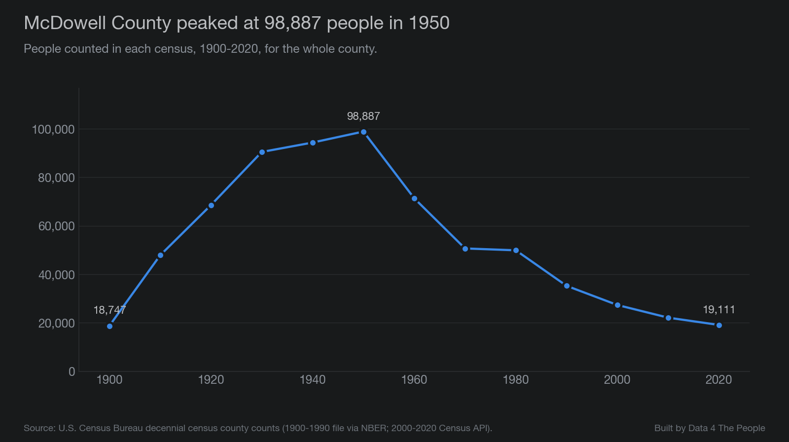
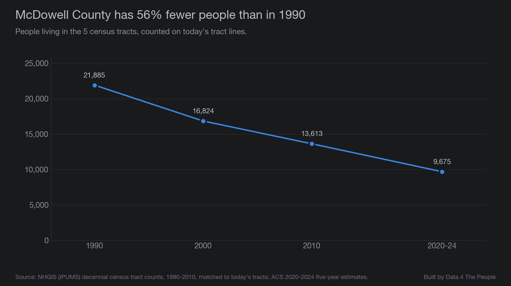
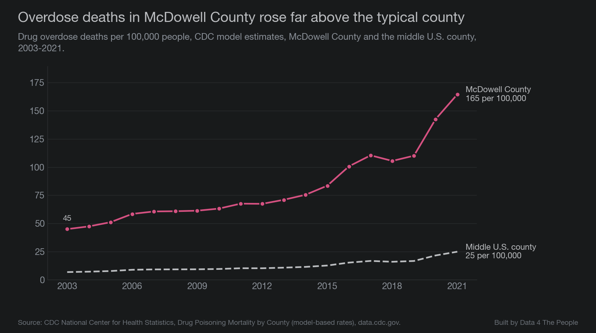

Here is how McDowell County's coal camps compare with the country today.

*Census Bureau, CDC PLACES and USALEEP. Health figures are model estimates for adults.*

::: spacer 20px

::: blurb Stories of a Forgotten American Community
The connection between a community's economy and its health seems logical, and our [recent work](https://www.data4thepeople.com/p/income-health-viz) shows the two are closely linked. Yet, in the policy world, we tend to treat a community's economy and its physical and mental health as separate goals.

Maybe we do this because we rarely learn how communities end up in this position. This series tries to fill that gap. We selected 10 communities, out of thousands across the country with low incomes and poor health, five in cities and five in rural areas. And we have gone back over the past century to tell the story of how they got here.

What we have found challenges the way you may think about America. If you tend to believe that people's circumstances are mostly the result of their own choices, this series may challenge that view. What you will see is that decisions made decades ago, some of them openly racist, set these communities on a path that has been very hard to leave. Just like a good investment can compound wealth over many years, a decision, like redlining a neighborhood or tying a county's jobs to a single industry, can compound the other way.

When you read this series, try to put yourself in the shoes of people in these communities. If you don't live here, or in an area like this, you may not live in the shadow of past decisions. But people in these communities do.

Ask yourself one question: What would your life be like if you had grown up here?

Then ask a second: Is it fair to ignore what this community faces now? Or should we do something about decisions made decades ago that held this community back?
:::

::: spacer 5px

::: dropcap
McDowell County sits at the southern tip of West Virginia. This story covers five of its census tracts, the coal camps along Elkhorn Creek, the Tug Fork and Dry Fork: Northfork, Davy, War, Gary, Iaeger, Bradshaw and the towns around them. About 9,700 people live there. Median household income is about $33,300, 41% of the U.S. figure. A third of all homes stand empty.

McDowell took a long series of hits over more than a century. This post walks through them in order, with a link to the source for each one. Our census numbers for these tracts start in 1990, so the early chapters come from county records and historical sources.

The map below shows the five tracts inside McDowell County.

*Tract and road lines from the Census Bureau. The tract with the federal prison near Welch is left out.*

## Built for coal

::: spacer 5px

In 1901, U.S. Steel began building a huge coal works at Gary on more than 50,000 acres. Fully built, Gary Hollow had 12 company towns, and nearly 15,000 people lived there by the 1940s ([e-WV, "Gary"](https://www.wvencyclopedia.org/entries/2025); [e-WV, "U.S. Coal & Coke Company"](https://www.wvencyclopedia.org/entries/808)). For decades, Gary was West Virginia's most productive coal operation, and it fed U.S. Steel's mills ([e-WV, "U.S. Coal & Coke Company"](https://www.wvencyclopedia.org/entries/808)).

McDowell was the leading coal-producing county in the nation until neighboring Logan County passed it in 1955 ([e-WV, "McDowell County"](https://www.wvencyclopedia.org/entries/1577)). The county's population peaked at 98,887 in the 1950 census. About a fourth of residents were Black ([U.S. Census Bureau county counts, via NBER](https://data.nber.org/census/population/cencounts/cencounts.csv); [e-WV, "McDowell County"](https://www.wvencyclopedia.org/entries/1577)).

## Machines replace miners

::: spacer 5px

After 1950, the state encyclopedia says, machines in the mines led to widespread job losses ([e-WV, "McDowell County"](https://www.wvencyclopedia.org/entries/1577)). State mine records show McDowell's coal output fell 28% in one year, from 20.24 million tons in 1957 to 14.57 million tons in 1958 ([West Virginia Office of Miners' Health, Safety and Training](https://minesafety.wv.gov/PDFs/Spreadsheets/Coal%20Production%20in%20WV%201883-2021.xlsx)). [Eric: a magazine puts the county's miners at 15,812 in 1950 and 7,118 in 1960 but names no source. The state mine reports for those years would confirm it. I left the counts out.]

The county lost people in every census after 1950. From 1950 to 1970, its population fell by about half, to 50,666 ([U.S. Census Bureau county counts, via NBER](https://data.nber.org/census/population/cencounts/cencounts.csv)). The chart below shows the county's population in every census since 1900.

*Whole county, not just the five tracts in this story.*

## U.S. Steel leaves Gary

::: spacer 5px

In March 1982, U.S. Steel laid off about 550 miners at Gary. By the end of that year, it had closed all of its mines in McDowell County. Gary's unemployment rate neared 90% in March 1983. County mining jobs fell from 5,814 in 1980 to 3,755 in 1982 ([Charleston Gazette review of Ronald Garay's history of Gary, 2013](https://web.archive.org/web/20130529041545/http://www.wvgazette.com/Entertainment/Books/201302080136)). The company ended all its operations in Gary in 1984 ([e-WV, "U.S. Coal & Coke Company"](https://www.wvencyclopedia.org/entries/808)). The Gary No. 2 mine reopened in 1987 under a new owner ([Charleston Gazette, 2013](https://web.archive.org/web/20130529041545/http://www.wvgazette.com/Entertainment/Books/201302080136)).

From 1980 to 1990, the county lost 29% of its people, its largest percentage drop of any decade ([U.S. Census Bureau county counts, via NBER](https://data.nber.org/census/population/cencounts/cencounts.csv)).

## Floods

::: spacer 5px

On July 8, 2001, the Tug Fork reached 19.77 feet. On May 2, 2002, it crested at a record 22.10 feet. The 2002 floods and related weather killed four people ([e-WV, "McDowell County"](https://www.wvencyclopedia.org/entries/1577)). McDowell was named in federal disaster declarations both years ([FEMA, DR-1378](https://www.fema.gov/api/open/v2/DisasterDeclarationsSummaries?$filter=disasterNumber%20eq%201378%20and%20fipsCountyCode%20eq%20'047'%20and%20fipsStateCode%20eq%20'54'); [FEMA, DR-1410](https://www.fema.gov/api/open/v2/DisasterDeclarationsSummaries?$filter=disasterNumber%20eq%201410%20and%20fipsCountyCode%20eq%20'047'%20and%20fipsStateCode%20eq%20'54')). The e-WV encyclopedia names the loss of mining jobs and the floods among the problems of Welch, the county seat ([e-WV, "Welch"](https://www.wvencyclopedia.org/entries/938)).

From 2000 to 2010, the county's population fell 19% and its housing units fell 17% ([Census API](https://api.census.gov/data/2010/dec/sf1)). No source we read ties that drop to the floods.

The chart below counts the people living inside today's five tract lines in each census since 1990.

*Earlier counts are fitted to today's tract lines. 2020-2024 is a five-year survey estimate.*

Over the same years, the share of homes standing empty rose from 16% to 33%. The share of people with low incomes, meaning below 200% of the poverty line, stayed near two in three. The chart below shows both shares.

*Low income here means below 200% of the federal poverty line. Income for 2010 is from the 2008-2012 survey.*

## Pills, a prison and a store

::: spacer 5px

From 2006 to 2012, drug distributors shipped about 15.2 million opioid pills to McDowell County, about 96 pills per resident each year. By our count of federal shipping data, that was the 66th highest rate of 3,034 counties ([DEA ARCOS data, as released by The Washington Post](https://github.com/wpinvestigative/arcos-api/tree/master/data)).

In September 2010, a $232 million federal prison near Welch took its first inmates ([Bluefield Daily Telegraph, 2010](http://web.archive.org/web/20100920230905/http://bdtonline.com:80/local/x842118014/First-inmates-arrive-at-McDowell-s-new-federal-prison)). The tract that holds it is left out of this story, so prisoners do not change our numbers.

In January 2016, Walmart closed its store in Kimball as part of 269 closings across the company. About 140 people lost their jobs, and many residents lost their main grocery store. The local food pantry had relied on donations from that Walmart to help feed 11,000 people the year before ([WV Public Broadcasting, 2016](https://www.wvpublic.org/post/what-happens-when-walmart-closes-one-coal-community)). That same year, the county averaged 799 coal miners, its lowest since at least 2000. By 2024, it was back to 1,059 ([Mine Safety and Health Administration](https://arlweb.msha.gov/OpenGovernmentData/OGIMSHA.asp)).

## Health

::: spacer 5px

The health numbers in the table at the top are today's. We do not have tract health data from earlier decades, so we cannot show how health here changed over time.

Life expectancy is where the sources disagree. For the five tracts, federal estimates for 2010 to 2015 put it at 76.7 years, two years below the U.S. Those tract estimates are noisy: one tract's figure carries a margin of several years. A different study, for the whole county in 2014, put life expectancy at 67.0 years for men and 73.8 for women. Those were among the lowest of 3,142 U.S. counties ([Institute for Health Metrics and Evaluation, 2015](https://www.healthdata.org/sites/default/files/files/county_profiles/US/2015/County_Report_McDowell_County_West_Virginia.pdf)). For 2021 to 2023, County Health Rankings put it at 65.5 years for the county, against 77.6 for the U.S. ([County Health Rankings & Roadmaps](https://www.countyhealthrankings.org/health-data/methodology-and-sources/data-documentation)). The table at the top uses that county figure.

The chart below compares McDowell County's drug overdose death rate with the middle U.S. county.

*These are CDC model estimates for the whole county.*

The heavy pill shipments and the county's short life spans came after decades of job loss. The timing lines up, but no source we read connects them directly.

## Still here

::: spacer 5px

The 2020 census counted 19,111 people in McDowell County, its lowest count since 1900 and 81% below its 1950 peak. On Feb. 15, 2025, the Tug Fork again crested at 22.10 feet, and three people in McDowell County died ([e-WV, "McDowell County"](https://www.wvencyclopedia.org/entries/1577); [FEMA, DR-4861](https://www.fema.gov/api/open/v2/DisasterDeclarationsSummaries?$filter=disasterNumber%20eq%204861%20and%20fipsCountyCode%20eq%20'047'%20and%20fipsStateCode%20eq%20'54')).

::: divider

## How we built this

::: spacer 5px

- **The neighborhood.** The story covers five 2020 census tracts in McDowell County, West Virginia: 54047953600, 54047953800, 54047954200, 54047954501 and 54047954504. All five are in the bottom 20% of U.S. tracts on both median household income and our health index. We left out tract 54047954503, which holds the federal prison. That tract also holds downtown Welch and Kimball, so those towns are told with county data.
- **Then and now.** Tract counts from 1990 to 2010 come from [NHGIS (IPUMS)](https://www.nhgis.org/) and are fitted to today's tract lines. Earlier tracts do not line up well enough to compare, so the long view uses county counts from the census, 1900-1990 ([NBER copy of the Census Bureau file](https://data.nber.org/census/population/cencounts/cencounts.csv)) and 2000-2020 ([Census API](https://api.census.gov/data/2020/dec/pl)). 2020-2024 numbers are from the Census Bureau's [American Community Survey](https://www.census.gov/programs-surveys/acs) five-year estimates.
- **The table at the top.** Rates are computed from counts summed across the five tracts. Median household income is estimated from income ranges, the Census Bureau's method for combined areas. Health measures are [CDC PLACES](https://www.cdc.gov/places/) model estimates for adults, weighted by each tract's adult population. Life expectancy is the county figure from [County Health Rankings & Roadmaps](https://www.countyhealthrankings.org/health-data/methodology-and-sources/data-documentation), 2021-2023, because the tract estimates from the [U.S. Small-Area Life Expectancy Estimates Project](https://www.cdc.gov/nchs/nvss/usaleep/usaleep.html) (76.7 years, 2010-2015) are far above every county figure we found.
- **Coal.** Output is our sum of mine-level records from the [West Virginia Office of Miners' Health, Safety and Training](https://minesafety.wv.gov/PDFs/Spreadsheets/Coal%20Production%20in%20WV%201883-2021.xlsx). Recent miner counts are our sum of [MSHA](https://arlweb.msha.gov/OpenGovernmentData/OGIMSHA.asp) county data.
- **Pills.** Dosage units per resident per year, 2006-2012, from the DEA ARCOS files [published by The Washington Post](https://github.com/wpinvestigative/arcos-api/tree/master/data). The rank is our own calculation.
- **Overdose deaths.** CDC National Center for Health Statistics, [Drug Poisoning Mortality by County](https://data.cdc.gov/resource/rpvx-m2md.json?fips=54047). The middle U.S. county is the median of all county rates each year.
