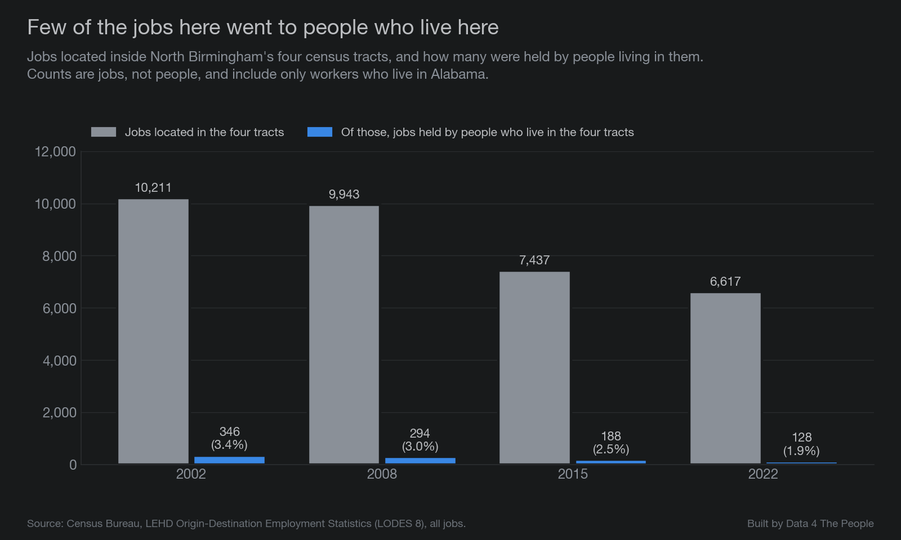
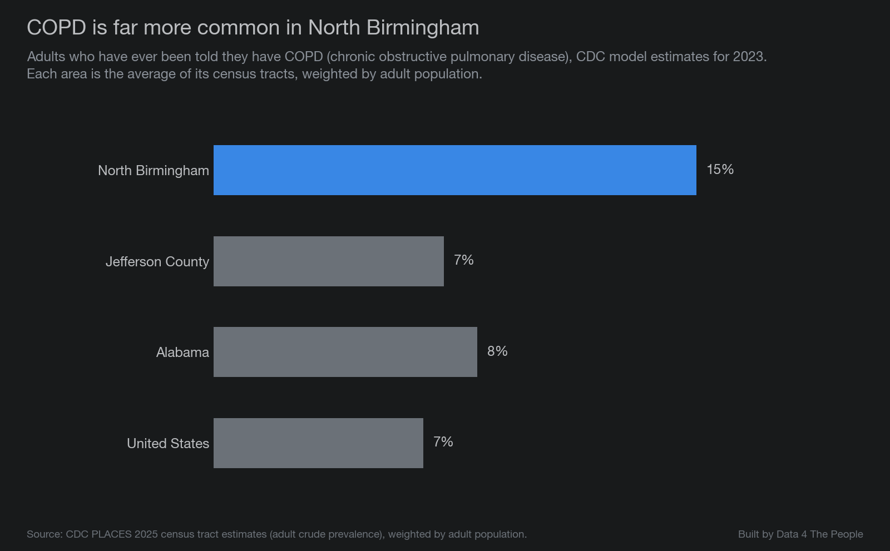
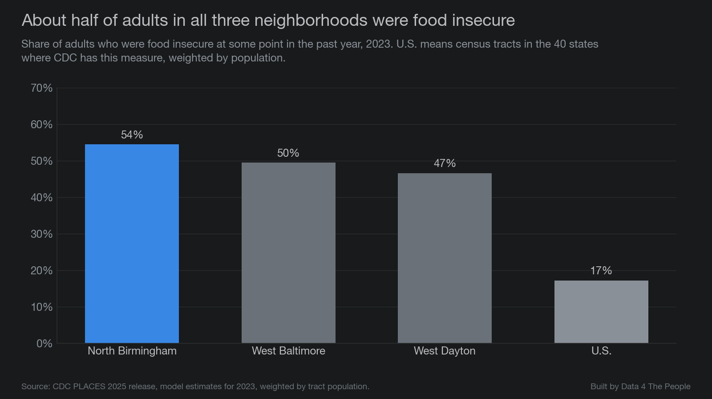

::: blurb Stories of a Forgotten American Community
The connection between a community's economy and its health seems logical, and our [recent work](https://www.data4thepeople.com/p/income-health-viz) shows the two are closely linked. Yet, in the policy world, we tend to treat a community's economy and its physical and mental health as separate goals.

Maybe we do this because we rarely learn how communities end up in this position. This series tries to fill that gap. We selected 10 communities, out of thousands across the country with low incomes and poor health, five in cities and five in rural areas. And we have gone back over the past century to tell the story of how they got here.

What we have found challenges the way you may think about America. If you tend to believe that people's circumstances are mostly the result of their own choices, this series may challenge that view. What you will see is that decisions made decades ago, some of them openly racist, set these communities on a path that has been very hard to leave. Just like a good investment can compound wealth over many years, a decision, like redlining a neighborhood or tying a county's jobs to a single industry, can compound the other way.

When you read this series, try to put yourself in the shoes of people in these communities. If you don't live here, or in an area like this, you may not live in the shadow of past decisions. But people in these communities do.

Ask yourself one question: What would your life be like if you had grown up here?

Then ask a second: Is it fair to ignore what this community faces now? Or should we do something about decisions made decades ago that held this community back?
:::

::: spacer 20px

Here is how North Birmingham compares with the country today.

*Census Bureau, CDC PLACES and USALEEP. Health figures are model estimates for adults.*

::: spacer 5px

::: dropcap
North Birmingham is four census tracts just north of downtown Birmingham, Ala., with about 9,800 people. They take in Collegeville, Harriman Park and Fairmont, the three neighborhoods that make up the EPA's 35th Avenue Superfund site ([EPA, 2014](https://19january2021snapshot.epa.gov/sites/static/files/2014-09/documents/ns-35th-avenue-9-2-2014.pdf)). Median household income is about $23,900, 30% of the U.S. figure. About half the people here live below the poverty line. Life expectancy is 67.5 years, 11.2 years shorter than for the country as a whole.

The homes here sit next to coke ovens and pipe plants. Over more than a century, North Birmingham took a long series of hits. This post walks through them in order, with a link to the source for each one.

## Iron, coke and convict labor

::: spacer 5px

North Birmingham was incorporated as its own city in 1902 and was annexed into Birmingham in 1910 ([Allen et al., 2019](https://pmc.ncbi.nlm.nih.gov/articles/PMC6617205/)). Industry was there from the start. In 1900, the Sloss-Sheffield Steel & Iron Co. housed nearly 500 Black men and a few white men at its convict prison in North Birmingham. The men were leased from Alabama counties for $9 to $10 a month, and convicts made up nearly half of the Sloss workforce that year ([Facing South, 1984](https://www.facingsouth.org/1984/11/steel-workers-boom-town)). Under Alabama's convict-lease system, which ran from 1875 to 1928, companies paid the state and counties for the labor of prisoners. Sloss worked county prisoners at its mines until 1928, when Alabama became the last state in the nation to end the practice ([Encyclopedia of Alabama](https://encyclopediaofalabama.org/article/convict-lease-system/)).

Two coke plants run through this story. Construction of the first, ABC Coke, began in 1918. It sits in Tarrant, just outside the four tracts, and is now owned by Drummond Co. The second, at 3500 35th Ave. N. inside the tracts, ran on its site from 1920 ([Allen et al., 2019](https://pmc.ncbi.nlm.nih.gov/articles/PMC6617205/); [EPA TRI facility record](https://data.epa.gov/efservice/tri_facility/tri_facility_id/35207SLSSN35003/JSON)). Over the years it ran under the names Sloss, Walter Coke, ERP and Bluestone. This post calls it the 35th Avenue plant.

## Zoned by race, graded D

::: spacer 5px

Birmingham's 1926 zoning law set racial zones. The 1944 city code made it unlawful for Black residents to live in areas zoned white, and the reverse. A 1949 ordinance made it a crime to move into an area long known as Black or as white. A federal court struck the ordinances down on Dec. 16, 1949, and an appeals court agreed in 1950 ([Monk v. City of Birmingham, 1949](https://case-law.vlex.com/vid/monk-v-city-of-890398921); [City of Birmingham v. Monk, 1950](https://case-law.vlex.com/vid/city-of-birmingham-v-885951209)). But the ordinances did long term damage. Researchers write that this kind of policy "kept the location racially segregated through zoning ordinances for decades," and that land use and zoning decisions left "isolated neighborhoods with limited amenities" ([Allen et al., 2019](https://pmc.ncbi.nlm.nih.gov/articles/PMC6617205/)).

In the late 1930s, the federal Home Owners' Loan Corporation graded Birmingham's neighborhoods for mortgage risk. Areas graded D, shaded red, were labeled "hazardous." No part of the four tracts got an A or B grade, and 41% to 64% of each tract was graded D ([Mapping Inequality, University of Richmond](https://dsl.richmond.edu/panorama/redlining/)).

The map below shows those grades with the four tracts in this story outlined.

*The grades come from Mapping Inequality. Freeways are today's, from the Census Bureau.*

## Smoke and a court order

::: spacer 5px

In 1971, the federal government went to court over Birmingham's air. During an air pollution emergency in mid-November 1971, federal Judge Sam Pointer signed a 10-day emergency order, at the EPA's request, requiring 23 Birmingham industries to sharply cut their emissions. Two days later, the weather improved and the order was lifted ([Bham Now, 2017](https://bhamnow.com/2017/08/17/smoke-city-birmingham/)). An EPA guidance memo from the early 1980s says it was the only time the agency had asked a court for an emergency order under that section of the Clean Air Act ([EPA](https://www.epa.gov/sites/default/files/documents/guide-sec303-rpt.pdf)).

Jim Walter Corp. bought the Sloss furnace site in 1969, and the furnaces stopped making iron in 1970 or 1971 ([Encyclopedia of Alabama](https://encyclopediaofalabama.org/article/sloss-furnaces-national-historic-landmark/); [Facing South, 1984](https://www.facingsouth.org/1984/11/steel-workers-boom-town)). Those furnaces are near downtown, outside the four tracts. Sloss-Sheffield, by then part of U.S. Pipe, had built a large new blast furnace in North Birmingham in 1958. During the 1970s, rising environmental rules and energy shortages pushed costs up until the company closed its Alabama factories in 1980 ([Encyclopedia of Alabama](https://encyclopediaofalabama.org/article/sloss-furnaces/)).

But both coke plants, ABC Coke and the 35th Avenue plant, kept running. Both sold coke to other companies rather than only feeding a furnace next door. ABC Coke's owner calls it the largest U.S. maker of foundry coke for sale, with customers in the auto, construction and other industries ([Drummond Co.](https://drummondco.com/?p=2138)). The 35th Avenue plant made coke for foundries and furnaces ([EPA](https://19january2025snapshot.epa.gov/enforcement/case-summary-environmental-concerns-addressed-walter-coke-facility-alabama)). Each plant's worst year came in the late 1980s. The 35th Avenue plant reported releasing 1,401,515 pounds of toxic chemicals into the air in 1989, its highest year on record. ABC Coke reported 881,136 pounds in 1988, its highest year, about 850,000 of it benzene. By 2019, the two plants reported 25,180 and 49,104 pounds ([EPA Toxics Release Inventory, 35th Avenue plant](https://data.epa.gov/efservice/tri_reporting_form/tri_facility_id/35207SLSSN35003/tri_release_qty/JSON); [ABC Coke](https://data.epa.gov/efservice/tri_reporting_form/tri_facility_id/35217BCCKDRAILR/tri_release_qty/JSON)). Plants report these numbers themselves, and the rules for what they had to report changed over time, so part of the drop may come from how releases were counted.

## People leave

::: spacer 5px

The chart below shows how many people lived inside today's four tract lines in each census since 1980, and the share of them with low incomes, meaning below 200% of the poverty line. Earlier counts do not line up well enough with today's tracts to use.

*Earlier counts are fitted to today's tract lines. 2020-2024 is a five-year survey estimate. Income for 2010 is from the 2008-2012 survey.*

The number of people fell 67%, but the share with low incomes stayed near three in four. Nationwide, it is 28%.

In March, we wrote that when a place's labor force shrinks far enough, "police stations, fire departments, schools, and local infrastructure will struggle to make ends meet" ([Data 4 The People, "Mapping The Viral Spread of Labor Force Decline"](https://www.data4thepeople.com/p/viral-labor-force-decline)). In North Birmingham, the schools show it most clearly. The library, a fire station and a community health center are still inside the four tracts ([Birmingham Public Library](https://bplolinenews.blogspot.com/2026/04/100-years-strong-north-birmingham_16.html); [Birmingham Fire and Rescue, 2022](http://web.archive.org/web/20221208163447/http://fire.birminghamal.gov/fire-stations/); [Alabama Regional Medical Services](https://alabamaarms.org/northern-health-center/)). The chart below shows each public school inside the tracts since the 1986-87 school year.

*Years are school years. A school's bar ends with the last year it reported students. Carver High moved to a new building in 2001.*

Schools closed as the population fell. In the 1986-87 school year, 10 public schools inside the four tracts taught about 4,400 students. In 2023-24, there were three, with about 1,500 students: Carver High, Hudson K-8 and i3 Academy, a charter school that moved here in 2022 ([NCES Common Core of Data](https://nces.ed.gov/ccd/)). The school board closed schools across the city to cut costs. When it closed North Birmingham Elementary in 2012, the superintendent said combining it with Lewis Elementary would save $300,000 ([WBRC](https://www.wbrc.com/story/18899939/birmingham-suprintendent-addresses-consolidation-concerns/)). Lewis closed in 2016. The North Birmingham Elementary building still sat empty in 2025. "We have a vacant building that's been vacant nearly ten years, and no one's been told anything," Sandra Brown, the neighborhood president, told [ABC 33/40](https://abc3340.com/news/abc-3340-news-iteam/north-birmingham-school-elementary-3-million-dollars-federal-funding-2022-congresswoman-terri-sewell-mayor-randall-woodfin-community-development-affordable-housing-update).

*North Birmingham Elementary in 2008, four years before it closed. The building still sat empty in 2025. Photo: Dystopos, CC BY-NC 2.0.*

## The jobs next door

::: spacer 5px

Our last two posts ([West Dayton](https://www.data4thepeople.com/p/spotlight-west-dayton) and [West Baltimore](https://www.data4thepeople.com/p/spotlight-west-baltimore)) cataloged the decline in jobs as manufacturing left the areas. But North Birmingham seems different. It still had these coke plants spewing toxic chemicals into the air for the residents to breathe. So, at the very least, they must have been providing jobs to these residents? 

They were not.

The chart below uses Census Bureau records that match each job's workplace with the worker's home. The gray bars are the jobs located in North Birmingham's four tracts. The blue bars are how many of those jobs were held by people who live in the four tracts, with the share in parentheses.

*Counts are jobs, not people, and include only workers who live in Alabama. These records begin in 2002.*

In 2002, the four tracts held about 10,200 jobs. About half were in manufacturing, compared with 9% of jobs across Jefferson County. People living in the four tracts held 346 of those 10,200 jobs, or 3.4%. By 2022, they held 128 of about 6,600, or 1.9%. The records do not say why so few residents held these jobs ([Census Bureau, LODES](https://lehd.ces.census.gov/data/)), but this fact is nonetheless striking.

## Fewer than half of adults have a job

::: spacer 5px

We are not trying to list every reason the jobs in North Birmingham disappeared. But the damage shows up in who is working. In 1980, 43% of adults here had a job, compared with 55% across Jefferson County. In 2020-2024, it was still 43% here and 59% in the county. Among people ages 25 to 54, 64% here had a job, compared with 78% in the county. The chart below shows two measures of work: the share of adults in the labor force, meaning working or looking for work, and the share of adults with a job.

*Adults are people 16 and over. Census counts before 1980 do not line up closely enough with today's tracts to use.*

The unemployment rate tells a different story. Unemployment here was 29% in 2008-2012 and fell to 6.5% in 2020-2024. Over the same years, the share of adults working or looking for work fell from 54% to 46% ([Census Bureau, American Community Survey 2020-2024](https://data.census.gov/table/ACSDT5Y2024.B23025)). The unemployment rate counts only people who are working or looking for work, so it leaves out people who have stopped looking. In March, we showed why "our over reliance on the unemployment rate could be misleading," comparing Perry County, Ala., with Las Vegas ([Data 4 The People](https://www.data4thepeople.com/p/viral-labor-force-decline)). North Birmingham is another example.

## Flat home values

::: spacer 5px

Homes here have also lost ground. After adjusting for inflation, the typical owner's home was worth about $78,000 in 1980 and about $73,000 in 2020-2024, in today's dollars. Across Jefferson County, the typical home rose from about $149,000 to $240,000. A home here was worth about half the county's typical home in 1980 and less than a third in 2020-2024 ([NHGIS](https://www.nhgis.org/); [Census Bureau, American Community Survey 2020-2024](https://data.census.gov/table/ACSDT5Y2024.B25075)).

The chart below shows the typical owner's home value here and across Jefferson County since 1980, in today's dollars.

*Values are owners' own estimates, adjusted for inflation with the CPI-U. The 2010 point is from the 2008-2012 survey.*

Studies elsewhere suggest pollution is part of this. A national study of 1,600 toxic plants found that home values within half a mile fell 11% when a plant opened and did not recover when it closed. The authors wrote that "toxic plants continue to negatively affect housing prices after they cease operations" ([Currie, Davis, Greenstone and Walker, 2015](https://doi.org/10.1257/aer.20121656)). The City of Birmingham has written that North Birmingham's abandoned properties, vacant lots, polluting plants and history of soil and air pollution "bring down property values" ([City of Birmingham, 2025, p. 2](https://www.njit.edu/tab/sites/njit.edu.tab/files/FY25%20Assessment%20CW%20-%20City%20of%20Birmingham%2C%20AL.pdf)). ProPublica reported in 2022 that some homes in Collegeville had sold for as little as $1,000 ([ProPublica, 2022](https://www.propublica.org/article/bluestone-jim-justice-north-birmingham)). No study we found measures how much of the gap here comes from pollution and how much from the job losses and other hits in this story.

## Poisoned yards and a bribery case

::: spacer 5px

In 2011, the EPA used emergency Superfund powers after it found contaminants leaving one of the local coke plants. In October 2012, it notified 2,049 residential properties that their soil needed testing ([Allen et al., 2019](https://pmc.ncbi.nlm.nih.gov/articles/PMC6617205/)). In September 2014, the EPA proposed the 35th Avenue site for its National Priorities List, the EPA's list of top-priority hazardous waste sites. The EPA found benzo(a)pyrene, arsenic and lead in yards in Collegeville, Fairmont and Harriman Park. It named the plant's 122 coke ovens, ABC Coke, U.S. Pipe and others as possible sources. The site covered more than 2,000 properties and more than 1,000 acres ([EPA, 2014](https://19january2021snapshot.epa.gov/sites/static/files/2014-09/documents/ns-35th-avenue-9-2-2014.pdf)).

But the site was never added to that list ([Southern Science, 2022](https://southern-science.com/2022/09/19/birminghams-pollution-master-class/)). The listing became the center of a federal bribery case. In 2018, a jury convicted a Drummond Co. vice president and a partner at the company's outside law firm of bribing a state legislator. The scheme paid about $360,000 to the legislator's foundation to oppose the EPA's plans for the site. Drummond's subsidiary, ABC Coke, had been named as one of the parties that could be held responsible for the cleanup. ProPublica reported that the legislator hired a friend to get residents to sign a petition saying a listing would lower their property values ([ProPublica, 2022](https://www.propublica.org/article/bluestone-jim-justice-north-birmingham)). The legislator pleaded guilty and got 33 months in prison. The lawyer got five years and the executive got 2½ years. An appeals court upheld the convictions in 2021 ([United States v. Roberson, 2021](https://case-law.vlex.com/vid/united-states-v-roberson-889988842); [ABA Journal, 2018](https://www.abajournal.com/news/article/former_partner_is_sentenced_to_five_years_in_prison_for_scheme_to_bribe_law)).

Cleanup went on under the EPA's emergency powers. As of January 2021, the EPA had sampled 1,910 of 2,034 properties. It found 645 that needed cleanup and had cleaned 533 ([EPA, 2021](https://semspub.epa.gov/work/04/11159163.pdf)). The EPA now says more than 650 properties have been cleaned ([EPA site profile](https://cumulis.epa.gov/supercpad/cursites/csitinfo.cfm?id=0410750)).

## One coke plant closes, the other keeps running

::: spacer 5px

The 35th Avenue coke plant changed hands twice more. ERP Compliant Coke bought it in February 2016. Bluestone Resources announced on Aug. 1, 2019, that it had bought the plant, which had about 210 workers ([Allen et al., 2019](https://pmc.ncbi.nlm.nih.gov/articles/PMC6617205/); [World Coal, 2019](https://www.worldcoal.com/coal/02082019/bluestone-resources-supports-hundreds-of-jobs-through-birmingham-coke-plant-purchase/)). On Aug. 11, 2021, the Jefferson County Board of Health went to court over violations at the plant. In October 2021, Bluestone took the heat off its coke ovens and stopped all production ([Consent decree, 2022, p. 2](https://www.southernenvironment.org/wp-content/uploads/2023/07/Doc.-112-2022.12.14-Consent-Decree-and-Final-Order.pdf)). The Southern Environmental Law Center, which represented the clean air group GASP in that case, said the plant "had been violating its air pollution permit for over a decade" ([SELC, 2021](https://www.selc.org/news/bluestone-coke-shuts-down-providing-relief-for-surrounding-communities/)). In December 2022, the plant was still shut down, and how much of it would need to be rebuilt to restart had not been determined (Consent decree, 2022, p. 3). We found no report that it has reopened.

ABC Coke, the Drummond plant in Tarrant, is still open. It reported its toxic releases to the EPA for 2024, the latest year available ([EPA Toxics Release Inventory](https://data.epa.gov/efservice/tri_reporting_form/tri_facility_id/35217BCCKDRAILR/reporting_year/2024/JSON)). Drummond describes it as having 132 ovens ([Drummond Co.](https://drummondco.com/?p=2138)).

## Health

::: spacer 5px

The health numbers in the table at the top are today's. Studies of the plants and health in North Birmingham point in different directions, and none we found shows the plants caused the poor health here. In 2015, the federal Agency for Toxic Substances and Disease Registry (ATSDR) found that particle pollution from 1999 to 2012 "could have resulted in harmful effects in sensitive individuals but not the general public," and that current levels were "unlikely to result in harmful effects" ([ATSDR, 2015](https://www.atsdr.cdc.gov/HAC/pha/NorthBirminghamAirSite/35th%20Avenue%20Site_PHA_Final_04-21-2015_508.pdf)). In 2017, the agency found that arsenic and lead in some yards "could harm people's health," and that long-term contact with chemicals called PAHs in some yards "increases the risk of cancer" ([ATSDR, 2017](https://www.atsdr.cdc.gov/HAC/pha/35thAvenueSite/35th_Ave_Site_Soil_HC_Final_01-18-2017_508.pdf)). The county health department found no significant difference in 2000-2009 death rates from cancer, asthma and COPD between the North Birmingham ZIP codes and the rest of the county, according to a 2019 review ([Allen et al., 2019](https://pmc.ncbi.nlm.nih.gov/articles/PMC6617205/)).

We do not have tract health data from earlier decades. Today, CDC estimates show that COPD, a long-term lung disease, is far more common in North Birmingham than in the county, the state or the country. The estimates do not show what causes it. The chart below compares the four areas.

*CDC PLACES model estimates for 2023, weighted by adult population.*

## A common thread: food

::: spacer 5px

CDC estimates that 54% of adults in North Birmingham were food insecure at some point in the past year, compared with 17% in the 40 states where CDC has this measure ([CDC PLACES](https://www.cdc.gov/places/)). The chart below compares North Birmingham with the other two neighborhoods in this series so far.

*CDC PLACES model estimates for 2023, weighted by tract population. U.S. means tracts in the 40 states with this measure.*

In all three neighborhoods, about half of adults were food insecure. It is a common thread across every community we have studied so far.

::: divider

## How we built this

::: spacer 5px

- **The neighborhood.** North Birmingham here is four 2020 census tracts in Jefferson County, Ala.: 01073000500, 01073000700, 01073000800 and 01073005500. All four are in the bottom 20% of U.S. tracts on both median household income and our health index. We left out nearby tracts that hold a state prison facility and the county jail, and two tracts that are separate neighborhoods.
- **Then and now.** Census counts from 1980 to 2010 come from [NHGIS (IPUMS)](https://www.nhgis.org/) and are fitted to today's tract lines. The 1970 counts did not fit today's lines well enough to use. 2020-2024 numbers are from the Census Bureau's [American Community Survey](https://www.census.gov/programs-surveys/acs) five-year estimates.
- **The table at the top.** Rates are computed from counts summed across the four tracts. Median household income is estimated from income ranges, the Census Bureau's method for combined areas. Health measures are [CDC PLACES](https://www.cdc.gov/places/) model estimates for adults, weighted by each tract's adult population. Life expectancy is from the [U.S. Small-Area Life Expectancy Estimates Project](https://www.cdc.gov/nchs/nvss/usaleep/usaleep.html), 2010-2015.
- **The map.** Grades are from [Mapping Inequality](https://dsl.richmond.edu/panorama/redlining/). The tract shares graded D are our own overlay of that map on 2020 tract lines. The Sloss furnaces, at 20 32nd St. N., fall outside the four tracts by the Census Bureau's geocoder.
- **Jobs.** Labor force, job and unemployment shares are sums of census tract counts: 1980 by map overlay, 1990 and 2000 by NHGIS crosswalks, and ACS tables B23025 and B23001 for 2008-2012 and 2020-2024. Manufacturing shares use census industry tables (ACS C24050). Jobs located in the tracts and who held them are from the Census Bureau's [LEHD Origin-Destination Employment Statistics](https://lehd.ces.census.gov/data/) (LODES 8) origin-destination files, all jobs, for workers who live in Alabama. Jefferson County figures sum every tract in the county.
- **Home values.** Medians are estimated from the summed value distributions (1980 STF1, 1990 STF1, 2000 SF3, ACS B25075), the Census Bureau's method for combined areas. Our county figures match the Bureau's published medians. Dollars are adjusted with the CPI-U. Values are owners' own estimates.
- **Food insecurity.** [CDC PLACES](https://www.cdc.gov/places/) 2025 release estimates for 2023, weighted by tract population, for the four tracts here and the tracts used in the West Dayton and West Baltimore posts. The U.S. figure covers tracts in the 40 states with this measure.
- **Photo.** "Day becomes night when industrial smog is heavy in North Birmingham. Adjacent to U.S. Pipe plant," July 1972, by LeRoy Woodson for the EPA's DOCUMERICA project, [National Archives](https://catalog.archives.gov/id/545397) via [Wikimedia Commons](https://commons.wikimedia.org/wiki/File:DAY_BECOMES_NIGHT_WHEN_INDUSTRIAL_SMOG_IS_HEAVY_IN_NORTH_BIRMINGHAM._ADJACENT_TO_U.S._PIPE_PLANT._THIS_IS_THE_MOST..._-_NARA_-_545397.jpg). Public domain. Cropped. The U.S. Pipe plant, at 3000 30th Ave. N., is inside one of the four tracts.
- **School photo.** "North Birmingham School," Feb. 24, 2008, by Dystopos on [Flickr](https://www.flickr.com/photos/96586445@N00/2289432421), [CC BY-NC 2.0](https://creativecommons.org/licenses/by-nc/2.0/). Not altered.
- **Toxic releases.** EPA [Toxics Release Inventory](https://www.epa.gov/toxics-release-inventory-tri-program), air releases as reported by each plant.
- **COPD.** [CDC PLACES](https://www.cdc.gov/places/) 2025 release tract estimates, for 2023. The county, state and U.S. values are averages of their tracts, weighted by adult population.

## Common questions

::: spacer 5px

### What is the 35th Avenue Superfund site?

It covers Collegeville, Fairmont and Harriman Park in North Birmingham. The EPA found arsenic, lead and benzo(a)pyrene in yards there and proposed the site for its National Priorities List in 2014, but it was never added. The EPA says it has cleaned more than 650 properties.

### Was North Birmingham redlined?

Yes. On the federal Home Owners' Loan Corporation map from the late 1930s, 41% to 64% of each of the four tracts in this post was graded D, the lowest grade. No part got an A or B.

### Is the North Birmingham coke plant still open?

The 35th Avenue plant, last run by Bluestone, stopped production in October 2021, and we found no report it has reopened. ABC Coke, owned by Drummond Co. in nearby Tarrant, is still open and reported to the EPA for 2024.

### What was the Drummond bribery case?

In 2018, a jury convicted a Drummond Co. vice president and a lawyer at the company's outside law firm of bribing a state legislator to oppose the EPA's plans for the site. An appeals court upheld the convictions in 2021.

### Did people in North Birmingham work at the plants?

Few did in recent decades. People living in the four tracts held 3.4% of the jobs located there in 2002 and 1.9% in 2022.

### How many people live in North Birmingham?

The four tracts held 29,946 people in 1980 and about 9,820 in 2020-2024, 67% fewer.
