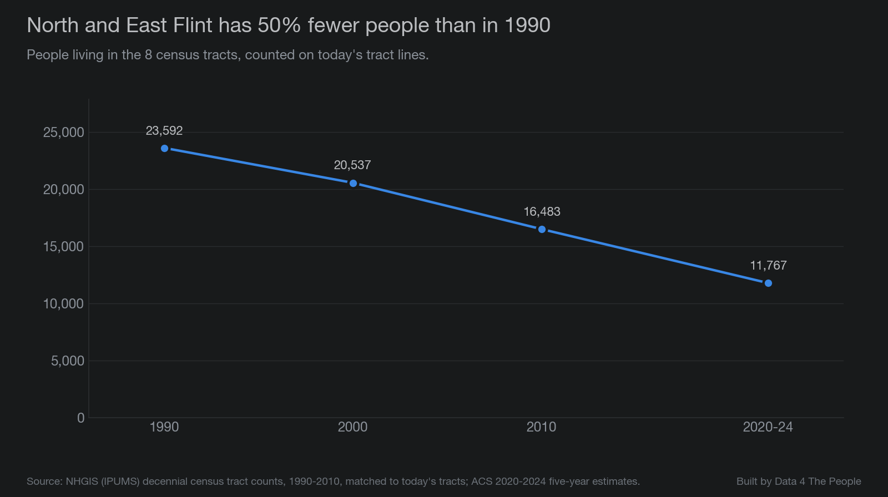

::: blurb Stories of a Forgotten American Community
The connection between a community's economy and its health seems logical, and our [recent work](https://www.data4thepeople.com/p/income-health-viz) shows the two are closely linked. Yet, in the policy world, we tend to treat a community's economy and its physical and mental health as separate goals.

Maybe we do this because we rarely learn how communities end up in this position. This series tries to fill that gap. We selected 10 communities, out of thousands across the country with low incomes and poor health, five in cities and five in rural areas. And we have gone back over the past century to tell the story of how they got here.

What we have found challenges the way you may think about America. If you tend to believe that people's circumstances are mostly the result of their own choices, this series may challenge that view. What you will see is that decisions made decades ago, some of them openly racist, set these communities on a path that has been very hard to leave. Just like a good investment can compound wealth over many years, a decision, like redlining a neighborhood or tying a county's jobs to a single industry, can compound the other way.

When you read this series, try to put yourself in the shoes of people in these communities. If you don't live here, or in an area like this, you may not live in the shadow of past decisions. But people in these communities do.

Ask yourself one question: What would your life be like if you had grown up here?

Then ask a second: Is it fair to ignore what this community faces now? Or should we do something about decisions made decades ago that held this community back?
:::

::: spacer 20px

Here is how North and East Flint compares with the country today.

*Census Bureau, CDC PLACES and USALEEP. Health figures are model estimates for adults.*

::: spacer 20px

::: dropcap
North and East Flint is eight census tracts on Flint, Michigan's north and east sides, with about 11,800 people. They wrap around the land where General Motors' Buick City plant once stood and run east along the I-475 freeway toward Davison Road. About 46% of the people who live here are Black, up from 32% in 1990. Median household income is about $25,300, 31% of the U.S. figure. Life expectancy is 69.9 years, 8.8 years shorter than for the country as a whole.

North and East Flint took a long series of hits over almost a century. This post walks through them in order, with a link to the source for each one. Our census numbers for these tracts start in 1990, so the early chapters come from historical records, not from our data.

## The map that came first

::: spacer 5px

From 1919 to 1933, GM's housing company built nearly 3,000 homes for its workers in Flint. All of those sales carried racial covenants, deed rules that kept Black families from buying. Into the 1940s, almost all new homes built in Flint carried them too ([Michigan Civil Rights Commission, 2017, pp. 26 to 27](https://www.michigan.gov/-/media/Project/Websites/mdcr/mcrc/reports/2017/flint-crisis-report-edited.pdf)).

That left Black families in two inner-city neighborhoods, St. John and Floral Park, which held almost all of Flint's 6,000 Black residents in the 1930s ([Highsmith, 2009, p. 54](http://web.archive.org/web/20241101133630/https://deepblue.lib.umich.edu/bitstream/handle/2027.42/62230/ahighsmi_1.pdf)). During the Depression, more than 85% of Black residents there were on public aid ([Michigan Civil Rights Commission, 2017, pp. 30 to 32](https://www.michigan.gov/-/media/Project/Websites/mdcr/mcrc/reports/2017/flint-crisis-report-edited.pdf)). St. John sat on the near north side, next to the Buick factories. A 1934 federal housing survey called it "a deteriorated residence section, more than a third negro, adjoining and partly enclosing a part of the Buick factories" ([Highsmith, 2009, pp. 53 to 54](http://web.archive.org/web/20241101133630/https://deepblue.lib.umich.edu/bitstream/handle/2027.42/62230/ahighsmi_1.pdf)).

In 1937, the federal Home Owners' Loan Corporation graded Flint's neighborhoods for mortgage risk. Black residents were limited to 3 of greater Flint's 50 districts, and all 3 were graded D, "hazardous" ([Michigan Civil Rights Commission, 2017, p. 36](https://www.michigan.gov/-/media/Project/Websites/mdcr/mcrc/reports/2017/flint-crisis-report-edited.pdf)). Inside today's tracts, our overlay finds tract 20 is 82% graded D and tract 136 is 59% D ([Mapping Inequality, University of Richmond](https://dsl.richmond.edu/panorama/redlining/map/MI/Flint)).

The map below shows the 1937 grades with the eight tracts in this story outlined.

*The 1937 grades come from Mapping Inequality. Freeways are today's, from the Census Bureau.*

## A freeway through St. John

::: spacer 5px

Flint reached its peak of 196,940 people in the 1960 census ([U.S. Census Bureau, 1998](https://www2.census.gov/library/working-papers/1998/demographics/pop-twps0027/tab19.txt)). In 1958, the city announced it would buy and redevelop the St. John area ([Michigan Civil Rights Commission, 2017, p. 70](https://www.michigan.gov/-/media/Project/Websites/mdcr/mcrc/reports/2017/flint-crisis-report-edited.pdf)).

On Jan. 17, 1963, the Michigan State Highway Department released "Freeways for Flint." It proposed I-475 and an interchange over the St. John neighborhood ([Highsmith, 2009, pp. 412 to 413](http://web.archive.org/web/20241101133630/https://deepblue.lib.umich.edu/bitstream/handle/2027.42/62230/ahighsmi_1.pdf)). The Michigan Civil Rights Commission says the state chose the route partly because of "lower property values" and a "higher level of impoverishment" there, and the city cleared the area around it for renewal ([Michigan Civil Rights Commission, 2017, p. 69](https://www.michigan.gov/-/media/Project/Websites/mdcr/mcrc/reports/2017/flint-crisis-report-edited.pdf)).

Land buying for St. John began in 1965. That year the City Council banned all but ordinary maintenance on homes in the area, which kept purchase costs low. Displaced Black families had few places to go ([Michigan Civil Rights Commission, 2017, p. 70](https://www.michigan.gov/-/media/Project/Websites/mdcr/mcrc/reports/2017/flint-crisis-report-edited.pdf)). Historian Andrew Highsmith counts nearly 1,500 low-income families displaced by the I-475 and St. John projects. Among displaced St. John residents, homeownership fell from 32% to 15% ([Highsmith, 2009, pp. 468 and 472](http://web.archive.org/web/20241101133630/https://deepblue.lib.umich.edu/bitstream/handle/2027.42/62230/ahighsmi_1.pdf)). [Eric: Highsmith's 2015 book is quoted elsewhere as "50 percent to 15 percent." I used the dissertation's 32% until the book is checked.] The last St. John property was bought in 1977, and I-475 was finished in 1981 ([Highsmith, 2009, p. 476](http://web.archive.org/web/20241101133630/https://deepblue.lib.umich.edu/bitstream/handle/2027.42/62230/ahighsmi_1.pdf)). Highsmith writes that the two projects "ultimately intensified black poverty and residential segregation" ([Highsmith, 2009, p. 473](http://web.archive.org/web/20241101133630/https://deepblue.lib.umich.edu/bitstream/handle/2027.42/62230/ahighsmi_1.pdf)).

Most of the cleared St. John land is now highway, industrial land or a neighboring tract, outside the eight tracts in this story. The tracts are the neighborhoods around it.

## The jobs go

::: spacer 5px

In 1954, GM had nearly 80,000 workers in the Flint area. From 1955 to 1987, it cut 34,000 jobs there ([Highsmith, 2009, pp. 3 and 8](http://web.archive.org/web/20241101133630/https://deepblue.lib.umich.edu/bitstream/handle/2027.42/62230/ahighsmi_1.pdf)). In 1985, GM spent $300 million to turn its North End Buick plants into Buick City, one large complex. Those plants had once employed more than 20,000 local workers ([Highsmith, 2009, pp. 477 and 479](http://web.archive.org/web/20241101133630/https://deepblue.lib.umich.edu/bitstream/handle/2027.42/62230/ahighsmi_1.pdf)).

In November 1997, GM announced that Buick City would close, and it closed in the summer of 1999 ([Highsmith, 2009, p. 479](http://web.archive.org/web/20241101133630/https://deepblue.lib.umich.edu/bitstream/handle/2027.42/62230/ahighsmi_1.pdf)). The 413-acre site was torn down in stages from 2000 to 2012 ([RACER Trust](https://www.racertrust.org/properties/buick-city-site)). GM's workforce in Genesee County fell to 33,000 in 1997 and to 15,000 by 2002 ([Highsmith, 2009, p. 9](http://web.archive.org/web/20241101133630/https://deepblue.lib.umich.edu/bitstream/handle/2027.42/62230/ahighsmi_1.pdf)).

The chart below counts the people living inside today's eight tract lines in each census since 1990.

*Earlier counts are fitted to today's tract lines. 2020-2024 is a five-year survey estimate.*

Over the same years, more people here had low incomes and more homes stood empty. The chart below shows the share of people below 200% of the poverty line, which rose from 60% in 1990 to 73% in 2020-2024, and the share of homes vacant.

*Low income here means below 200% of the federal poverty line. Income for 2010 is from the 2008-2012 survey.*

Vacancy fell after 2010. We think that is mostly because empty houses were torn down, but we have not checked demolition counts by tract. Census and survey vacancy are also measured in different ways.

## State control and the water

::: spacer 5px

Flint was run by state-appointed managers twice. An emergency financial manager ran the city from 2002 to 2004. A second state takeover began in December 2011. Four emergency managers served through April 2015, one of them twice ([Flint Water Advisory Task Force, 2016, p. 43](https://www.michigan.gov/-/media/Project/Websites/formergovernors/Folder6/FWATF_FINAL_REPORT_21March2016.pdf)). A state board then oversaw the city until April 10, 2018 ([Associated Press via WKAR, 2018](https://www.wkar.org/community/2018-04-10/city-of-flint-officially-released-from-state-oversight)).

In April 2014, under emergency management, the city began treating and serving Flint River water. State regulators wrongly decided that treatment to control pipe corrosion was not needed right away. The city switched back to Detroit water on Oct. 16, 2015. The governor's task force found that "emergency managers, not locally elected officials, made the decision" ([Flint Water Advisory Task Force, 2016, pp. 20, 25 and 44](https://www.michigan.gov/-/media/Project/Websites/formergovernors/Folder6/FWATF_FINAL_REPORT_21March2016.pdf)).

A 2016 study compared tested children under 5 in 2013 and 2015. The share with elevated blood lead rose from 2.4% to 4.9% citywide, and from 4.0% to 10.6% in the wards with the highest water lead ([Hanna-Attisha et al., American Journal of Public Health, 2016](https://pmc.ncbi.nlm.nih.gov/articles/PMC4985856/)). The water crisis hit the whole city. We have not matched those wards to the tracts in this story.

## Health

::: spacer 5px

The health numbers in the table at the top are today's. We do not have tract health data from earlier decades, so we cannot show how health here changed over time. What we can show is the county. The chart below compares Genesee County's drug overdose death rate with the middle U.S. county.

*These are CDC model estimates for the whole county, not North and East Flint alone.*

## What is there now

::: spacer 5px

The Buick City site is now held by RACER Trust, which lists it for sale and reuse ([RACER Trust](https://www.racertrust.org/properties/buick-city-site)). The Genesee County Land Bank holds and demolishes vacant property across the county ([Genesee County Land Bank](https://www.thelandbank.org)). [Eric: this closing section is thin. Our sources do not cover recent rebuilding in these tracts. Cut it, or I can look for more.]

::: divider

## How we built this

::: spacer 5px

- **The neighborhood.** North and East Flint here is eight 2020 census tracts in Genesee County, Michigan: 26049000800, 26049001800, 26049001900, 26049002000, 26049002200, 26049002300, 26049002400 and 26049013600. All eight are in the bottom 20% of U.S. tracts on both median household income and our health index. The old St. John core is mostly outside these tracts, in highway, industrial land and a neighboring tract.
- **Then and now.** Census counts from 1990 to 2010 come from [NHGIS (IPUMS)](https://www.nhgis.org/) and are fitted to today's tract lines. Earlier censuses do not line up well enough with today's tracts to compare, so we left them out. 2020-2024 numbers are from the Census Bureau's [American Community Survey](https://www.census.gov/programs-surveys/acs) five-year estimates.
- **The table at the top.** Rates are computed from counts summed across the eight tracts. Median household income is estimated from income ranges, the Census Bureau's method for combined areas. Health measures are [CDC PLACES](https://www.cdc.gov/places/) model estimates for adults, weighted by each tract's adult population. Life expectancy is from the [U.S. Small-Area Life Expectancy Estimates Project](https://www.cdc.gov/nchs/nvss/usaleep/usaleep.html), 2010-2015.
- **The map.** 1937 grades are from [Mapping Inequality](https://dsl.richmond.edu/panorama/redlining/map/MI/Flint). The tract shares graded D are our own overlay of that map on 2020 tract lines.
- **Overdose deaths.** CDC National Center for Health Statistics, [Drug Poisoning Mortality by County](https://data.cdc.gov/resource/rpvx-m2md.json?fips=26049). The middle U.S. county is the median of all county rates each year.
- **Highsmith, 2009** is Andrew Highsmith's University of Michigan dissertation, the basis for his 2015 book *Demolition Means Progress*.
