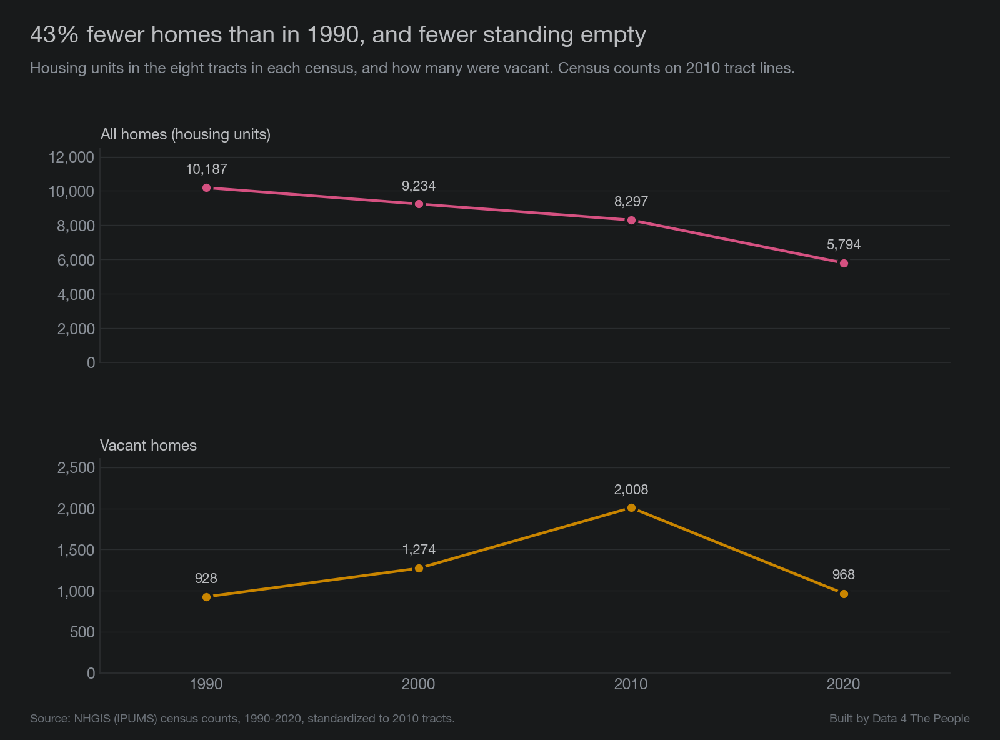
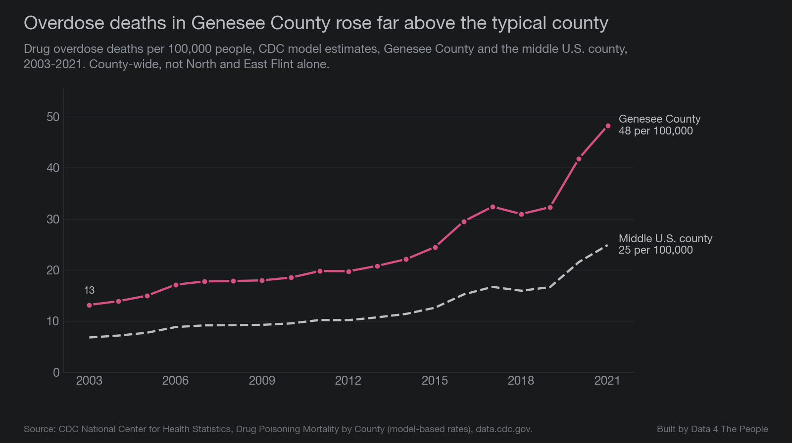
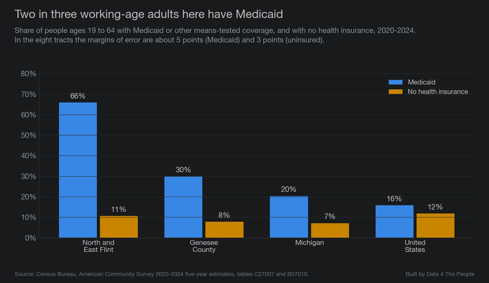

::: blurb Stories of a Forgotten American Community
The connection between a community's economy and its health seems logical, and our [recent work](https://www.data4thepeople.com/p/income-health-viz) shows the two are closely linked. Yet, in the policy world, we tend to treat a community's economy and its physical and mental health as separate goals.

Maybe we do this because we rarely learn how communities end up in this position. This series tries to fill that gap. We selected 10 communities, out of thousands across the country with low incomes and poor health, five in cities and five in rural areas. And we have gone back over the past century to tell the story of how they got here.

What we have found challenges the way you may think about America. If you tend to believe that people's circumstances are mostly the result of their own choices, this series may challenge that view. What you will see is that decisions made decades ago, some of them openly racist, set these communities on a path that has been very hard to leave. Just like a good investment can compound wealth over many years, a decision, like redlining a neighborhood or tying a county's jobs to a single industry, can compound the other way.

When you read this series, try to put yourself in the shoes of people in these communities. If you don't live here, or in an area like this, you may not live in the shadow of past decisions. But people in these communities do.

Ask yourself one question: What would your life be like if you had grown up here?

Then ask a second: Is it fair to ignore what this community faces now? Or should we do something about decisions made decades ago that held this community back?
:::

::: spacer 20px

Here is how North and East Flint compares with the country today.

*Census Bureau, CDC PLACES and USALEEP. Health figures are model estimates for adults.*

::: spacer 20px

::: dropcap
North and East Flint is eight census tracts on Flint, Michigan's north and east sides. Together they had 11,704 people in the 2020 census. They wrap around the land where General Motors' Buick City plant once stood and run east along the I-475 freeway toward Davison Road. In the 2020 census, 47% of the people here were Black, up from 32% in 1990. Median household income is about $25,300, 31% of the U.S. figure. Life expectancy is 69.9 years, 8.8 years shorter than for the country as a whole.

North and East Flint took a long series of hits over almost a century. This post walks through them in order, with a link to the source for each one. Our census numbers for these tracts start in 1990, so the early chapters come from historical records, not from our data.

The map below shows where the eight tracts are.

*Tracts, city boundary, freeways and water from the Census Bureau.*

## The map that came first

::: spacer 5px

From 1919 to 1933, GM's housing company built nearly 3,000 homes for its workers in Flint. All of those sales carried racial covenants, deed rules that kept Black families from buying. Into the 1940s, almost all new homes built in Flint carried them too ([Michigan Civil Rights Commission, 2017, pp. 26 to 27](https://www.michigan.gov/-/media/Project/Websites/mdcr/mcrc/reports/2017/flint-crisis-report-edited.pdf)).

That left Black families in two inner-city neighborhoods, St. John and Floral Park, which held almost all of Flint's 6,000 Black residents in the 1930s ([Highsmith, 2009, p. 54](http://web.archive.org/web/20241101133630/https://deepblue.lib.umich.edu/bitstream/handle/2027.42/62230/ahighsmi_1.pdf)). During the Depression, more than 85% of Black residents there were on public aid ([Michigan Civil Rights Commission, 2017, pp. 30 to 32](https://www.michigan.gov/-/media/Project/Websites/mdcr/mcrc/reports/2017/flint-crisis-report-edited.pdf)). St. John sat on the near north side, next to the Buick factories. A 1934 federal housing survey called it "a deteriorated residence section, more than a third negro, adjoining and partly enclosing a part of the Buick factories" ([Highsmith, 2009, pp. 53 to 54](http://web.archive.org/web/20241101133630/https://deepblue.lib.umich.edu/bitstream/handle/2027.42/62230/ahighsmi_1.pdf)).

In 1937, the federal Home Owners' Loan Corporation graded Flint's neighborhoods for mortgage risk. Black residents were limited to 3 of greater Flint's 50 districts, and all 3 were graded D, the lowest grade ([Michigan Civil Rights Commission, 2017, p. 36](https://www.michigan.gov/-/media/Project/Websites/mdcr/mcrc/reports/2017/flint-crisis-report-edited.pdf)). Inside today's tracts, our overlay finds tract 20 is 82% graded D and tract 136 is 59% D ([Mapping Inequality, University of Richmond](https://dsl.richmond.edu/panorama/redlining/map/MI/Flint)).

The map below shows the 1937 grades with the eight tracts in this story outlined.

*The 1937 grades come from Mapping Inequality. Freeways are today's, from the Census Bureau.*

## A freeway through St. John

::: spacer 5px

Flint had 196,940 people in the 1960 census ([U.S. Census Bureau, 1998](https://www2.census.gov/library/working-papers/1998/demographics/pop-twps0027/tab19.txt)). In 1958, the city announced it would buy and redevelop the St. John area ([Michigan Civil Rights Commission, 2017, p. 70](https://www.michigan.gov/-/media/Project/Websites/mdcr/mcrc/reports/2017/flint-crisis-report-edited.pdf)).

On Jan. 17, 1963, the Michigan State Highway Department released "Freeways for Flint." It proposed I-475, a north-south freeway through St. John, and a large interchange with an east-west freeway, now I-69, in the Floral Park neighborhood southeast of downtown. Highsmith writes that the state picked Floral Park for the interchange partly because of its "relatively low property values, and its preponderance of impoverished black families" ([Highsmith, 2009, pp. 412 to 413 and 440](http://web.archive.org/web/20241101133630/https://deepblue.lib.umich.edu/bitstream/handle/2027.42/62230/ahighsmi_1.pdf)).

Land buying for St. John began in 1965. That year the City Council banned all but ordinary maintenance on homes in the area, which kept purchase costs low. Displaced Black families had few places to go ([Michigan Civil Rights Commission, 2017, p. 70](https://www.michigan.gov/-/media/Project/Websites/mdcr/mcrc/reports/2017/flint-crisis-report-edited.pdf)). Historian Andrew Highsmith counts nearly 1,500 low-income families displaced by the I-475 and St. John projects ([Highsmith, 2009, pp. 468 and 472](http://web.archive.org/web/20241101133630/https://deepblue.lib.umich.edu/bitstream/handle/2027.42/62230/ahighsmi_1.pdf)). Among displaced St. John residents, homeownership fell from 32% to 15% ([Highsmith, Journal of Urban History, 2009, note 26](https://doi.org/10.1177/0096144208330403)). The last St. John property was bought in 1977, and I-475 was finished in 1981 ([Highsmith, 2009, pp. 464 and 476](http://web.archive.org/web/20241101133630/https://deepblue.lib.umich.edu/bitstream/handle/2027.42/62230/ahighsmi_1.pdf)). Highsmith writes that the two projects "ultimately intensified black poverty and residential segregation" ([Highsmith, 2009, p. 473](http://web.archive.org/web/20241101133630/https://deepblue.lib.umich.edu/bitstream/handle/2027.42/62230/ahighsmi_1.pdf)).

Most of the cleared St. John land is now highway, industrial land or a neighboring tract, outside the eight tracts in this story. The tracts are the neighborhoods around it.

## The jobs go

::: spacer 5px

*The Buick Motor Works in Flint, about 1907. Postcard, public domain.*

In 1954, GM had nearly 80,000 workers in the Flint area. From 1955 to 1987, it cut 34,000 jobs there ([Highsmith, 2009, pp. 3 and 8](http://web.archive.org/web/20241101133630/https://deepblue.lib.umich.edu/bitstream/handle/2027.42/62230/ahighsmi_1.pdf)). GM invested $300 million to turn its North End Buick plants into Buick City, one large complex, which opened in 1985. Those plants had once employed more than 20,000 local workers ([Highsmith, 2009, pp. 477 and 479](http://web.archive.org/web/20241101133630/https://deepblue.lib.umich.edu/bitstream/handle/2027.42/62230/ahighsmi_1.pdf)).

In November 1997, GM announced that Buick City would close, and it closed in the summer of 1999 ([Highsmith, 2009, p. 479](http://web.archive.org/web/20241101133630/https://deepblue.lib.umich.edu/bitstream/handle/2027.42/62230/ahighsmi_1.pdf)). The 413-acre site was torn down in stages from 2000 to 2012 ([RACER Trust](https://www.racertrust.org/properties/buick-city-site)). GM's workforce in Genesee County fell to 33,000 in 1997 and to 15,000 by 2002 ([Highsmith, 2009, p. 9](http://web.archive.org/web/20241101133630/https://deepblue.lib.umich.edu/bitstream/handle/2027.42/62230/ahighsmi_1.pdf)). In 2023, RACER Trust sold most of the site, in two phases, to a developer, Ashley Capital ([Flint Beat, 2023](https://www.flintbeat.com/economy/racer-trust-ashley-capital-complete-sale-of-former-buick-city-site-in-flint-790b63c0)). By April 2025, its first new building there, 330,000 square feet, was fully leased ([City of Flint, 2025](https://www.cityofflint.com/flint-commerce-center-building-fully-leased-marking-major-milestone-at-former-buick-city-site/)).

*Central Flint, June 28, 2022. Copernicus Sentinel-2 image, ESA. CC BY-SA 3.0 IGO.*

Fewer people who live here have jobs. In 1990, about 7,000 people living in the eight tracts were working. In 2020-2024, about 3,800 were ([NHGIS](https://www.nhgis.org/); [Census Bureau, American Community Survey 2020-2024](https://data.census.gov/table/ACSDT5Y2024.B23025)). Among people ages 25 to 54, 56% had a job, compared with 76% across Genesee County ([Census Bureau, American Community Survey 2020-2024](https://data.census.gov/table/ACSDT5Y2024.B23001)). In 1990, 29% of working residents here worked in manufacturing, about the same as the county's 30%.

## People leave

::: spacer 5px

The chart below shows how much the number of people changed in each decade since 1990, here, in the rest of Flint and in Genesee County.

*Census counts on 2010 tract lines. The rest of Flint is the other tracts inside the city.*

The eight tracts lost 13% of their people in the 1990s, 20% in the 2000s and 29% in the 2010s. The census counted 23,592 people here in 1990 and 11,704 in 2020. The rest of Flint lost 19% in the 2010s. That decade included the second state takeover and the water crisis, described below. These counts show when people left, not why.

The numbers of children and adults fell at about the same pace. From 2010 to 2020, the number of children here fell 31% and the number of adults fell 28%. Children were 32% of residents in 2000 and 28% in 2020.

The number of white residents fell first. From 1990 to 2010, the number of white residents fell from 15,027 to 7,913, while the number of Black residents stayed near 7,500. In the 2010s, the number of Black residents fell 25%, to 5,476. The chart below shows both groups.

*Census counts on 2010 tract lines. White and Black alone; other groups are not shown.*

Homes went with the people. The eight tracts had 10,187 homes in 1990 and 5,794 in 2020, 43% fewer. About 2,500 of the homes lost were lost in the 2010s. Over that decade, the number of vacant homes fell from 2,008 to 968. The census counts homes that are standing, so these homes were removed. City records show part of it. Permit records posted on ArcGIS show 534 house demolition permits in the eight tracts from 2015 to 2019 ([Building Permits 2015-2019, ArcGIS](https://www.arcgis.com/home/item.html?id=f61da1745517400c93af76217795f35d)). Earlier in the decade, the Genesee County Land Bank used a federal grant to tear down more than 1,600 vacant houses across Flint by mid-2015 ([City of Flint, 2015](https://www.cityofflint.com/genesee-county-land-bank-wrapping-up-largest-blight-elimination-program-in-flint-history/)). We could not find address-level records for those years. The chart below shows all homes and vacant homes.

*Census counts on 2010 tract lines.*

The people who stayed had less to live on. The chart below shows the share of people below 200% of the poverty line, which rose from 60% in 1990 to 73% in 2020-2024, and the share of homes vacant.

*Low income here means below 200% of the federal poverty line. Income for 2010 is from the 2008-2012 survey.*

## State control and the water

::: spacer 5px

Flint was run by state-appointed managers twice. An emergency financial manager ran the city from 2002 to 2004. A second state takeover began in December 2011. Four emergency managers served through April 2015, one of them twice ([Flint Water Advisory Task Force, 2016, p. 39](https://www.michigan.gov/-/media/Project/Websites/formergovernors/Folder6/FWATF_FINAL_REPORT_21March2016.pdf)). A state board then oversaw the city until April 10, 2018 ([Associated Press via WKAR, 2018](https://www.wkar.org/community/2018-04-10/city-of-flint-officially-released-from-state-oversight)).

*EPA staff test water quality at a sink in Flint, April 2016. Photo: U.S. Environmental Protection Agency, public domain.*

In April 2014, under emergency management, the city began treating and serving Flint River water. State regulators wrongly decided that treatment to control pipe corrosion was not needed right away. The city switched back to Detroit water on Oct. 16, 2015. The governor's task force found that "emergency managers, not locally elected officials, made the decision" ([Flint Water Advisory Task Force, 2016, pp. 7, 16 and 21](https://www.michigan.gov/-/media/Project/Websites/formergovernors/Folder6/FWATF_FINAL_REPORT_21March2016.pdf)).

A 2016 study compared tested children under 5 in 2013 and 2015. The share with elevated blood lead rose from 2.4% to 4.9% citywide, and from 4.0% to 10.6% in the wards with the highest water lead ([Hanna-Attisha et al., American Journal of Public Health, 2016](https://pmc.ncbi.nlm.nih.gov/articles/PMC4985856/)). The water crisis hit the whole city, but not every ward the same way. In the same study, Wards 5, 6 and 7 had the most water samples over 15 parts per billion of lead. About 85% of the land in the eight tracts in this story is in Wards 3 and 4, and 11% is in Ward 5. In Ward 3, the share of tested young children with elevated blood lead rose from 1.0% to 4.5%. In Ward 4, it fell from 3.1% to 1.7%. The study adds that the area where Wards 3, 4 and 5 meet, on the east side, also showed high predicted blood lead. That spot is inside tract 22, one of the eight ([Hanna-Attisha et al., 2016](https://pmc.ncbi.nlm.nih.gov/articles/PMC4985856/); 2012 ward lines from [ArcGIS](https://www.arcgis.com/home/item.html?id=47808bf632e043d995516693c1697064)).

## Health

::: spacer 5px

The health numbers in the table at the top are today's. Life expectancy differs from tract to tract. Across the seven tracts with an estimate, it ranged from 65.8 to 72.1 years in 2010-2015 ([USALEEP](https://www.cdc.gov/nchs/nvss/usaleep/usaleep.html)). We do not have tract health data from earlier decades, so we cannot show how health here changed over time. What we can show is the county. The chart below compares Genesee County's drug overdose death rate with the middle U.S. county.

*These are CDC model estimates for the whole county, not North and East Flint alone.*

## Medicaid, and a new rule

::: spacer 5px

Most people here get health coverage through Medicaid. In 2020-2024, 66% of people ages 19 to 64 in the eight tracts had Medicaid or other public coverage based on income. That compares with 30% in Genesee County, 20% in Michigan and 16% in the U.S. Among children under 19 here, 87% had it ([Census Bureau, American Community Survey 2020-2024](https://data.census.gov/table/ACSDT5Y2024.C27007)). Only 19% of working-age adults here had coverage through an employer alone, compared with 57% nationwide. About 11% had no health insurance, close to the U.S. rate of 12% ([Census Bureau, American Community Survey 2020-2024](https://data.census.gov/table/ACSDT5Y2024.B27010)).

The chart below compares the shares on Medicaid and with no insurance.

*Medicaid here includes other public coverage based on income. The margins of error for the eight tracts are about 5 points (Medicaid) and 3 points (uninsured).*

Michigan's Medicaid expansion, the Healthy Michigan Plan, covers adults ages 19 to 64 with incomes at or below 133% of the poverty line ([Michigan Department of Health and Human Services](https://www.michigan.gov/healthymiplan)). About 625,000 people in Michigan are enrolled in it, according to an October 2026 state release ([MDHHS, 2026](https://www.michigan.gov/mdhhs/inside-mdhhs/newsroom/2026/10/22/hmp-tool)). The census survey does not say which Medicaid program each person is in, so we cannot count how many adults here are in the plan.

A federal law passed in 2025 requires states to tie Medicaid expansion coverage to work starting Jan. 1, 2027 ([KFF, 2025](https://www.kff.org/medicaid/a-closer-look-at-the-work-requirement-provisions-in-the-2025-federal-budget-reconciliation-law/)). In Michigan, the rule applies to people already on the Healthy Michigan Plan at renewals on or after March 1, 2027. To keep coverage, a person shows at least 80 hours of work or other approved activities, such as school or volunteering, in one month, or earnings of at least $580 in a month, or qualifies for an exemption. Exemptions include parents of a child 13 or under and people who are pregnant ([MDHHS](https://www.michigan.gov/healthymiplan/new-medicaid-work-requirements)). The Urban Institute projected that 171,000 to 355,000 people in Michigan would lose Medicaid coverage under the work rules and more frequent eligibility checks ([Michigan Public, 2026](https://www.michiganpublic.org/health/2026-03-30/fewer-michiganders-will-be-covered-by-medicaid-in-2028-report-says)).

Here, 56% of people ages 25 to 54 had a job in 2020-2024. We do not know how many adults here without a job would qualify for an exemption.

One group in Flint is covered separately. Since 2016, a federal waiver has given Medicaid to children up to age 21 and to pregnant women who were served by Flint water during the crisis, at incomes up to 400% of the poverty line. It now runs through Sept. 30, 2031, and federal officials say the new work rules do not apply to the people it covers ([Centers for Medicare & Medicaid Services, 2026](https://www.medicaid.gov/medicaid/section-1115-demonstrations/downloads/MI-flint-mi-1115demo-ca-04022026.pdf)).

::: divider

## How we built this

::: spacer 5px

- **The neighborhood.** North and East Flint here is eight 2020 census tracts in Genesee County, Michigan: 26049000800, 26049001800, 26049001900, 26049002000, 26049002200, 26049002300, 26049002400 and 26049013600. All eight are in the bottom 20% of U.S. tracts on both median household income and our health index. The old St. John core is mostly outside these tracts, in highway, industrial land and a neighboring tract.
- **Then and now.** Census counts from 1990 to 2020 come from [NHGIS (IPUMS)](https://www.nhgis.org/) on 2010 tract lines, which match the eight tracts. The rest of Flint is the other tracts with at least half their land inside the city. Earlier censuses do not line up well enough with today's tracts to compare, so we left them out. 2020-2024 numbers are from the Census Bureau's [American Community Survey](https://www.census.gov/programs-surveys/acs) five-year estimates.
- **The table at the top.** Rates are computed from counts summed across the eight tracts. Median household income is estimated from income ranges, the Census Bureau's method for combined areas. Health measures are [CDC PLACES](https://www.cdc.gov/places/) model estimates for adults, weighted by each tract's adult population. Life expectancy is from the [U.S. Small-Area Life Expectancy Estimates Project](https://www.cdc.gov/nchs/nvss/usaleep/usaleep.html), 2010-2015.
- **The map.** 1937 grades are from [Mapping Inequality](https://dsl.richmond.edu/panorama/redlining/map/MI/Flint). The tract shares graded D are our own overlay of that map on 2020 tract lines.
- **Overdose deaths.** CDC National Center for Health Statistics, [Drug Poisoning Mortality by County](https://data.cdc.gov/resource/rpvx-m2md.json?fips=26049). The middle U.S. county is the median of all county rates each year.
- **Health insurance.** American Community Survey 2020-2024, tables C27007 and B27010, summed across the eight tracts.
- **Photos.** Hero: Flint water plant tower, U.S. Environmental Protection Agency, April 2016, public domain (Wikimedia Commons). Buick Motor Works postcard, about 1907, public domain. EPA water testing, April 2016, public domain. Satellite image: Copernicus Sentinel-2, ESA, CC BY-SA 3.0 IGO.
- **Wards and demolitions.** We overlaid Flint's 2012 ward lines, in use in 2015, on the eight tracts by land area. Demolition permits come from a 2015-2019 building permit layer posted on ArcGIS for Genesee County, placed by their map coordinates. The point where Wards 3, 4 and 5 meet, and the land shares, are our own overlay.
- **Highsmith, 2009** is Andrew Highsmith's University of Michigan dissertation, the basis for his 2015 book *Demolition Means Progress*.
