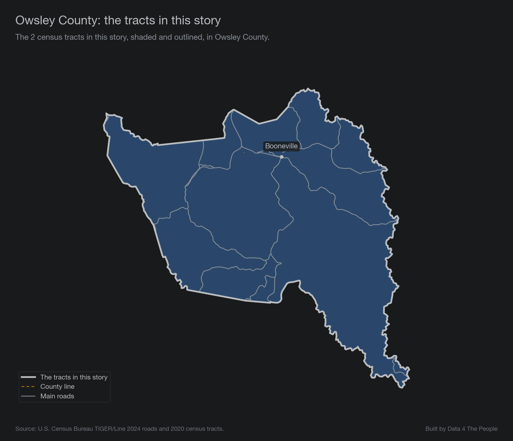
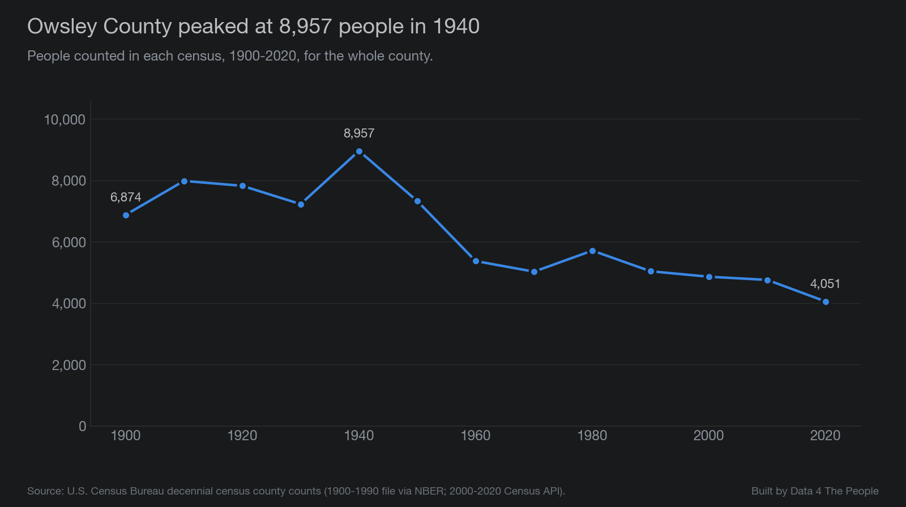
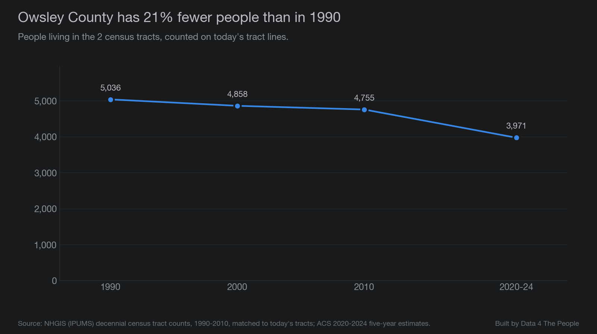
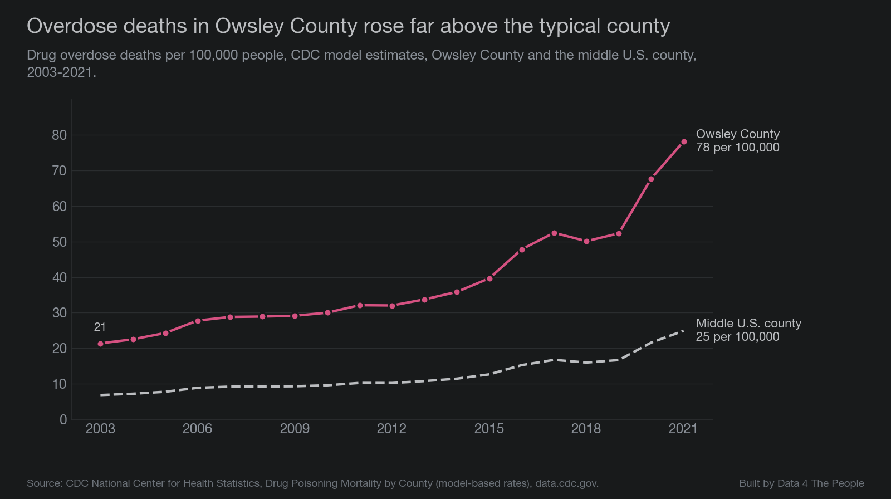

::: blurb Stories of a Forgotten American Community
The connection between a community's economy and its health seems logical, and our [recent work](https://www.data4thepeople.com/p/income-health-viz) shows the two are closely linked. Yet, in the policy world, we tend to treat a community's economy and its physical and mental health as separate goals.

Maybe we do this because we rarely learn how communities end up in this position. This series tries to fill that gap. We selected 10 communities, out of thousands across the country with low incomes and poor health, five in cities and five in rural areas. And we have gone back over the past century to tell the story of how they got here.

What we have found challenges the way you may think about America. If you tend to believe that people's circumstances are mostly the result of their own choices, this series may challenge that view. What you will see is that decisions made decades ago, some of them openly racist, set these communities on a path that has been very hard to leave. Just like a good investment can compound wealth over many years, a decision, like redlining a neighborhood or tying a county's jobs to a single industry, can compound the other way.

When you read this series, try to put yourself in the shoes of people in these communities. If you don't live here, or in an area like this, you may not live in the shadow of past decisions. But people in these communities do.

Ask yourself one question: What would your life be like if you had grown up here?

Then ask a second: Is it fair to ignore what this community faces now? Or should we do something about decisions made decades ago that held this community back?
:::

::: spacer 20px

Here is how Owsley County compares with the country today.

*Census Bureau, CDC PLACES 2024 and USALEEP. Health figures are model estimates for adults.*

::: spacer 20px

::: dropcap
Owsley County is in the hills of eastern Kentucky, along the South Fork of the Kentucky River. It has two census tracts and about 4,000 people, most of them in and around Booneville, the county seat. Median household income is about $23,900, 30% of the U.S. figure. Life expectancy is 72.4 years, 6.3 years shorter than for the country as a whole. In 2000, Owsley's median household income was the third lowest of 3,141 U.S. counties ([Census 2000, via the Census API](https://api.census.gov/data/2000/dec/sf3?get=NAME,P053001&for=county:*)).

Owsley has no large manufacturing plants, and many people who live here drive 25 minutes or more to work, the county's agriculture council says ([Owsley County Agriculture Development Council, 2025, p. 1](https://www.kyagr.com/agpolicy/documents/ADF_Councils_Plans_OWSLEY.pdf)). Its story is a long series of smaller losses. This post walks through them in order, with a link to the source for each one.

## The tobacco quota

::: spacer 5px

In 1938, the Agricultural Adjustment Act set up federal tobacco marketing quotas and price supports. Each quota was set for a farm, so the right to grow and sell tobacco went with the farm ([Federal Register, April 4, 2005](https://www.govinfo.gov/content/pkg/FR-2005-04-04/html/05-6455.htm); [Pub. L. 108-357](https://www.govinfo.gov/content/pkg/PLAW-108publ357/html/PLAW-108publ357.htm)). The county's agriculture council says tobacco "has been the mainstay of agriculture in the county" ([Owsley County Agriculture Development Council, 2025](https://www.kyagr.com/agpolicy/documents/ADF_Councils_Plans_OWSLEY.pdf)).

The map below shows where the county's two tracts sit.

*Tracts are 2020 census tracts. Roads are from the Census Bureau.*

## People leave

::: spacer 5px

Owsley's population peaked at 8,957 in the 1940 census. By 1970 it was 5,023, a drop of 44% ([Census Bureau county counts, 1900-1990](https://web.archive.org/web/2019/https://www.census.gov/population/cencounts/ky190090.txt)). Al Jazeera reported that the drop came as people left Appalachia in search of work after World War II ([Al Jazeera, 2016](https://www.aljazeera.com/features/2016/11/8/inside-owsley-americas-poorest-white-county)). The chart below shows the county's census counts since 1900.

*Counts are for the whole county.*

Starting in the 1960s and 1970s, many Owsley men found work in coal mines in neighboring counties. Owsley's own mines were smaller ([Al Jazeera, 2016](https://www.aljazeera.com/features/2016/11/8/inside-owsley-americas-poorest-white-county)). The population grew back for one decade, to 5,709 in 1980, then fell again to 5,036 in 1990 ([Census Bureau county counts](https://web.archive.org/web/2019/https://www.census.gov/population/cencounts/ky190090.txt)).

## Farms stop making money

::: spacer 5px

In the 1980s, Owsley's farms took in less cash from crops: $3.24 million in 1982 and $1.60 million in 1987. From 1987 to 1989, the county's farms together lost money for the first time in the federal series that starts in 1969 ([Bureau of Economic Analysis, farm income by county](https://apps.bea.gov/regional/zip/CAINC45.zip)). Those years line up with the national farm debt crisis, but we did not find a source that ties the two together in Owsley. In 1989, the Census Bureau estimates 55.4% of the county's people lived in poverty ([Census Bureau, small area poverty estimates](https://api.census.gov/data/timeseries/poverty/saipe?get=NAME,SAEPOVRTALL_PT&for=county:189&in=state:21&time=1989)).

A Booneville resident, Lowell Morris, told Al Jazeera that local businesses "could not survive when Walmart came to neighbouring counties in the 80s and 90s" ([Al Jazeera, 2016](https://www.aljazeera.com/features/2016/11/8/inside-owsley-americas-poorest-white-county)). That is one resident's view.

## The quota ends

::: spacer 5px

On Oct. 22, 2004, a federal law ended tobacco quotas and price supports starting with the 2005 crop. Quota holders were paid $7 a pound and growers $3 a pound, spread over 10 years. Payments nationwide came to about $9.6 billion ([Pub. L. 108-357, Title VI](https://www.govinfo.gov/content/pkg/PLAW-108publ357/html/PLAW-108publ357.htm); [Federal Register, April 4, 2005](https://www.govinfo.gov/content/pkg/FR-2005-04-04/html/05-6455.htm)).

The county's agriculture council says the loss of tobacco income accounts for most of the county's lost farm income. It says Owsley "was one of the most tobacco dependent counties but now has no Tobacco on record being produced" ([Owsley County Agriculture Development Council, 2025](https://www.kyagr.com/agpolicy/documents/ADF_Councils_Plans_OWSLEY.pdf)). The county's farms together have lost money every year since 2003 ([Bureau of Economic Analysis](https://apps.bea.gov/regional/zip/CAINC45.zip)). The county had 153 farms in 2017 and 84 in 2022, a drop of 45% ([USDA Census of Agriculture, 2017](https://www.nass.usda.gov/sites/default/files/publications/agcensus/2017/Online_Resources/County_Profiles/Kentucky/cp21189.pdf); [2022](https://www.nass.usda.gov/sites/default/files/publications/agcensus/2022/Online_Resources/County_Profiles/Kentucky/cp21189.pdf)). [Eric: we could not get Owsley's tobacco farm counts or acres before 2017, so there is no tobacco chart. The 1997 and 2002 Census of Agriculture county tables would let us add one.]

Payments from government to people, such as Social Security, Medicare, Medicaid and food aid, grew as a share of income in Owsley. All such payments were 34.9% of personal income in 1970 and 55.1% in 2009 ([Bureau of Economic Analysis, economic profile by county](https://apps.bea.gov/regional/zip/CAINC30.zip)).

The county's two tracts make up the whole county, so the next two charts show the same area from 1990 on. The first counts the people living there.

*2020-2024 is a five-year survey estimate.*

The chart below shows the share of people with low incomes, meaning below 200% of the poverty line, and the share of homes vacant. Poverty alone has fallen since 1990, but about 70% of people still have low incomes, and more homes stand empty.

*Low income here means below 200% of the federal poverty line. Income for 2010 is from the 2008-2012 survey.*

## Health

::: spacer 5px

From 2006 to 2012, pharmacies and practitioners in Owsley received about 3.95 million opioid pills, about 119 per resident per year. That was the 24th highest of about 3,030 counties by our count. Yearly shipments rose from 308,200 in 2006 to 746,600 in 2012 ([DEA shipment records, released by the Washington Post](https://github.com/wpinvestigative/arcos-api/tree/master/data)). Pills are counted where the pharmacy is, so some went to people from nearby counties. The chart below compares the county's overdose death rate with the middle U.S. county.

*These are CDC model estimates. With about 4,000 people, county rates swing from year to year.*

From 1980 to 2014, Owsley's death rate from lung cancer rose 99.7%, the largest increase of any U.S. county. In 2014, Owsley had the highest lung cancer death rate for women of any county ([Mokdad et al., JAMA, 2017](https://jamanetwork.com/journals/jama/fullarticle/2598772)). The National Cancer Institute notes that rates in small counties are unstable ([NCI Cancer Currents, 2017](https://www.cancer.gov/news-events/cancer-currents-blog/2017/cancer-death-disparities)).

Life expectancy differs a lot between the county's two tracts: 77.3 years in the Booneville tract and 66.5 years in the other, for 2010-2015. The 72.4 years in the table at the top combines the two, weighted by population.

Pill shipments rose from 2006 to 2012, lung cancer deaths rose from 1980 to 2014, and government payments grew as a share of income from 1970 on. The timing lines up with the loss of farm income, but no source we read ties any of them to the end of the tobacco program.

## What the county says now

::: spacer 5px

The county's agriculture council lays out plans for farming without tobacco in its 2025 plan, and notes that Owsley has no large manufacturing plants ([Owsley County Agriculture Development Council, 2025](https://www.kyagr.com/agpolicy/documents/ADF_Councils_Plans_OWSLEY.pdf)). The 2020 census counted 4,051 people, 55% fewer than in 1940.

::: divider

## How we built this

::: spacer 5px

- **The area.** Owsley County, Kentucky: its two 2020 census tracts, 21189930100 and 21189930200, which make up the whole county.
- **Then and now.** Census tract counts from 1990 to 2010 come from [NHGIS (IPUMS)](https://www.nhgis.org/). 2020-2024 numbers are from the Census Bureau's [American Community Survey](https://www.census.gov/programs-surveys/acs) five-year estimates. County counts from 1900 to 1990 are from the [Census Bureau's county file, as copied by NBER](https://data.nber.org/census/population/cencounts/cencounts.csv), and 2000 to 2020 from the Census API. With about 4,000 people, survey estimates carry wide margins of error.
- **The table at the top.** Rates are computed from counts summed across the two tracts. Median household income is estimated from income ranges, the Census Bureau's method for combined areas. Health measures are [CDC PLACES](https://www.cdc.gov/places/) 2024 model estimates for adults, weighted by population; the 2025 release left Kentucky out, so these are not directly comparable with other posts in the series. Life expectancy is from the [U.S. Small-Area Life Expectancy Estimates Project](https://www.cdc.gov/nchs/nvss/usaleep/usaleep.html), 2010-2015.
- **Overdose deaths.** CDC National Center for Health Statistics, [Drug Poisoning Mortality by County](https://data.cdc.gov/resource/rpvx-m2md.json?fips=21189). The middle U.S. county is the median of all county rates each year.
- **Dollars.** Bureau of Economic Analysis figures are in dollars of each year, not adjusted for inflation.
