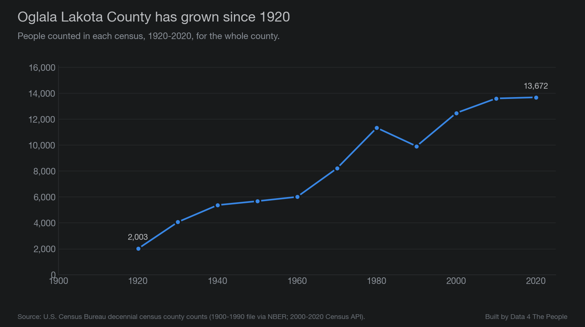
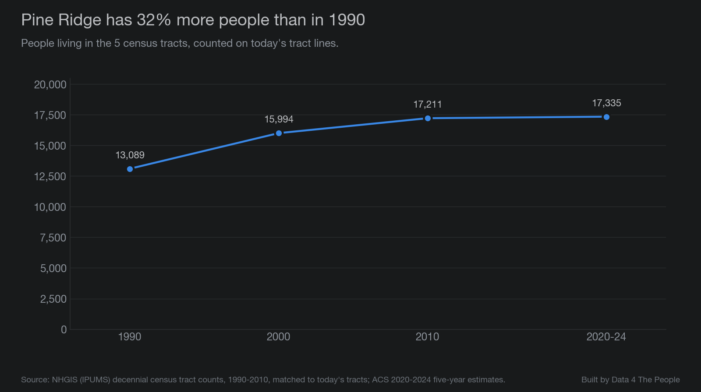
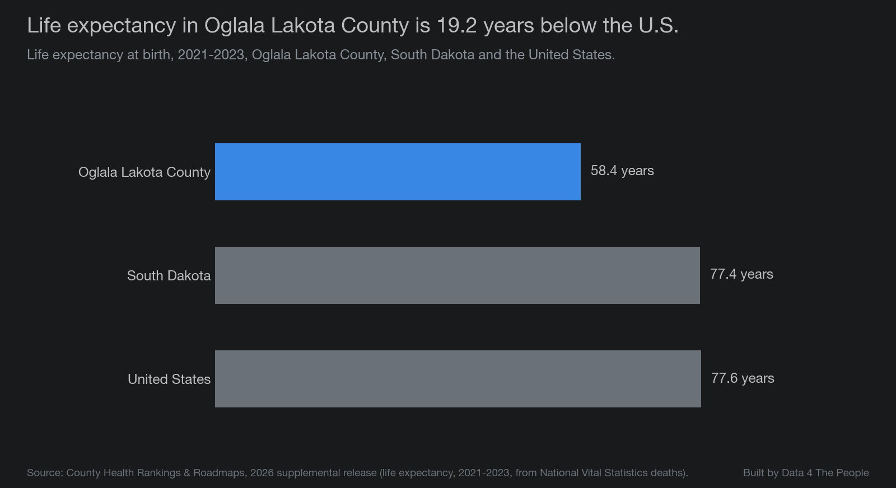

Here is how Pine Ridge compares with the country today.

*Census Bureau, CDC PLACES and County Health Rankings. Life expectancy is for all of Oglala Lakota County, 2021-2023.*

::: spacer 20px

::: blurb About this series
The connection between a community's economy and its health seems logical, and our [recent work](https://www.data4thepeople.com/p/income-health-viz) shows the two are closely linked. Yet, in the policy world, we tend to treat a community's economy and its physical and mental health as separate goals.

Maybe we do this because we rarely learn how communities end up in this position. This series tries to fill that gap. We selected 10 communities, out of thousands across the country with low incomes and poor health, five in cities and five in rural areas. And we have gone back over the past century to tell the story of how they got here.

What we have found challenges the way you may think about America. If you tend to believe that people's circumstances are mostly the result of their own choices, this series may challenge that view. What you will see is that decisions made decades ago, some of them openly racist, set these communities on a path that has been very hard to leave. Just like a good investment can compound wealth over many years, a decision, like redlining a neighborhood or tying a county's jobs to a single industry, can compound the other way.

When you read this series, try to put yourself in the shoes of people in these communities. If you don't live here, or in an area like this, you may not live in the shadow of past decisions. But people in these communities do.

Ask yourself one question: What would your life be like if you had grown up here?

Then ask a second: Is it fair to ignore what this community faces now? Or should we do something about decisions made decades ago that held this community back?
:::

::: spacer 5px

::: dropcap
Pine Ridge here is five census tracts on the Pine Ridge Reservation in southwestern South Dakota, with about 17,300 people. They cover all of Oglala Lakota County, including the village of Pine Ridge, the tribal seat, along with Wanblee in Jackson County and Allen in Bennett County. The Oglala Lakota Oyate, also called the Oglala Sioux Tribe, governs the reservation. More than half of the people in these tracts live below the poverty line. Life expectancy in Oglala Lakota County is 58.4 years, 19.2 years shorter than the U.S. figure from the same source. We use the county number because tract-level estimates cover only about a fifth of the people here.

This is not a story of a place that fell from a high point. The records show Pine Ridge poor at every point where we have data. What they show over time is the land base shrinking, one federal act at a time, and a health gap that has stayed wide. This post walks through that record in order, with a link to the source for each step.

## The treaties

::: spacer 5px

On Sept. 17, 1851, at Fort Laramie, the United States signed a treaty with the Sioux and other nations. The nations recognized each other's territories, and the U.S. got the right to build roads and military posts in them. The treaty promised $50,000 a year for 50 years. The U.S. Senate changed that to 10 years ([Kappler, Indian Affairs: Laws and Treaties, vol. 2](https://treaties.okstate.edu/treaties/treaty-of-fort-laramie-with-sioux-etc-1851-0594)).

On April 29, 1868, a second Fort Laramie Treaty set apart the Great Sioux Reservation, about 25 million acres, "for the absolute and undisturbed use and occupation" of the Lakota and allied nations. Article XII said no part of it could be given up unless at least three-fourths of the adult men signed ([National Archives](https://www.archives.gov/milestone-documents/fort-laramie-treaty); [Rosebud Sioux Tribe v. Kneip, 1977](https://www.law.cornell.edu/supremecourt/text/430/584)).

## The land shrinks

::: spacer 5px

On Feb. 28, 1877, Congress took the Black Hills, about 7.5 million acres. The agreement behind the act was signed by only about 10% of adult Sioux men, not the three-fourths the treaty required ([United States v. Sioux Nation of Indians, 1980](https://www.law.cornell.edu/supremecourt/text/448/371)).

On March 2, 1889, another act of Congress returned about half of the remaining reservation to the public domain and carved six separate reservations out of the rest. Pine Ridge was one of them ([Rosebud Sioux Tribe v. Kneip, 1977](https://www.law.cornell.edu/supremecourt/text/430/584); [Putnam v. United States, 1957](https://law.resource.org/pub/us/case/reporter/F2/248/248.F2d.292.15750.html)).

On Dec. 29, 1890, soldiers of the Seventh Cavalry killed Lakota people camped at Wounded Knee Creek, inside one of today's tracts in this story. More than 250 Lakota were killed, and possibly up to 300. Twenty-five soldiers died ([Encyclopedia of the Great Plains, University of Nebraska-Lincoln](http://plainshumanities.unl.edu/encyclopedia/doc/egp.war.056)).

On May 27, 1910, Congress opened unallotted Pine Ridge land in Bennett County to non-Indian settlers. Bennett County grew from 96 people in 1910 to 4,590 in 1930. The courts have not treated Bennett County the same way over time. In 1957 a federal appeals court treated it as inside the reservation. In 1975 the same court held that the 1910 act removed it, and a 2004 Interior Department board decision says the parties agreed it "was removed from the reservation" ([Cook v. Parkinson, 1975](https://law.resource.org/pub/us/case/reporter/F2/525/525.F2d.120.75-1306.html); [Putnam v. United States, 1957](https://law.resource.org/pub/us/case/reporter/F2/248/248.F2d.292.15750.html); [Interior Board of Indian Appeals, 2004](https://www.oha.doi.gov/ibia/IbiaDecisions/39ibia/39ibia301.pdf)).

Starting in 1942, the military took 341,726 acres of the reservation for an aerial gunnery range, and 125 families were moved off their farms and ranches ([National Park Service](https://www.nps.gov/articles/000/aerial-gunnery-range.htm)). In 1968 Congress returned 202,357 acres to the Oglala Lakota Nation and placed 136,882 acres in Badlands National Monument ([Meadows, American Indian magazine, Smithsonian, 2023](https://www.americanindianmagazine.org/story/Badlands-bombing-range); [16 U.S.C. 441m](https://www.law.cornell.edu/uscode/text/16/441m)). Those two figures add up to less than the land taken, and the sources we read do not explain the gap.

The map below shows where the five tracts sit.

*Tracts are 2020 census tracts. Roads are from the Census Bureau.*

## Relocation and Wounded Knee, 1973

::: spacer 5px

From 1952 to 1973, under the federal relocation program, an estimated 100,000 Native Americans moved from reservations to cities such as Chicago, Los Angeles, Denver and Seattle. By the late 1990s, Rapid City had 10,000 to 12,000 Native residents, mainly Lakota ([Fixico, Encyclopedia of the Great Plains](https://plainshumanities.unl.edu/encyclopedia/doc/egp.na.122.html)).

In 1973, Wounded Knee was occupied for 71 days. The occupation ended on May 8, 1973 ([United States v. Means, 1975](https://law.resource.org/pub/us/case/reporter/F2/513/513.F2d.1329.74-1787.74-1784.html)). [Eric: the number of occupiers (about 200) and the deaths of Frank Clearwater and Lawrence "Buddy" Lamont rest only on Wikipedia until the New York Times story of May 9, 1973, is pulled. I left them out.]

In 1980, the U.S. Supreme Court held that the 1877 act was a taking of tribal property that required payment. It upheld an award of $17.1 million plus 5% yearly interest from 1877 ([United States v. Sioux Nation of Indians, 1980](https://www.law.cornell.edu/supremecourt/text/448/371)).

## People stay

::: spacer 5px

Unlike most places in this series, the population here has grown. The chart below shows the county's census counts since 1920. Census counts on reservations carry extra risk: the Census Bureau estimates it missed 5.64% of American Indian people living on reservations in 2020 ([Census Bureau](https://www.census.gov/newsroom/press-releases/2022/2020-census-estimates-of-undercount-and-overcount.html)). The dip in 1990 may be a counting problem rather than a real loss.

*The county was named Shannon County until 2015. Counts are for the whole county.*

The five tracts in this story follow the same pattern. The chart below counts the people inside today's tract lines in each census since 1990.

*Earlier counts are fitted to today's tract lines. 2020-2024 is a five-year survey estimate.*

## Poverty

::: spacer 5px

In 2000, 52.3% of the people in what was then Shannon County lived below the poverty line, and median household income was $20,916 ([Census 2000, via the Census API](https://api.census.gov/data/2000/dec/sf3?get=NAME,P053001,P087001,P087002&for=county:113&in=state:46)). The chart below shows the share of people with low incomes, meaning below 200% of the poverty line, and the share of homes vacant in the five tracts. About four in five people here have low incomes, compared with 28% nationwide.

*Low income here means below 200% of the federal poverty line. Income for 2010 is from the 2008-2012 survey.*

Just south of the reservation, in Whiteclay, Nebraska, four stores sold about 4.9 million 12-ounce cans of beer in 2010, by the tribe's lawyer's count. That is about 13,400 a day. Whiteclay had 10 residents in the 2010 census. Alcohol is banned on the reservation. In February 2012, the tribe sued the stores, distributors and brewers for $500 million ([Associated Press, via Salon, 2012](https://www.salon.com/2012/02/09/tribe_suing_beer_companies_for_alcohol_problems_3/); [Census API](https://api.census.gov/data/2020/dec/pl?get=NAME,P1_001N&for=place:52855&in=state:31)). In April 2017, the Nebraska Liquor Control Commission voted not to renew the four licenses, citing inadequate law enforcement, and sales stopped at the end of the month ([KETV, 2017](https://www.ketv.com/article/license-renewal-denied-for-whiteclay-liquor-stores/9527984); [Indianz.com, 2017](https://indianz.com/News/2017/05/01/whiteclay-goes-quiet-as-liquor-stores-ne.asp)). On Sept. 29, 2017, the Nebraska Supreme Court ended the stores' appeal ([Kozal v. Nebraska Liquor Control Commission](https://nebraskasupremecourtopinions.justia.com/2017/09/29/kozal-v-nebraska-liquor-control-commission)).

## Health

::: spacer 5px

Life expectancy in this county has been far below the U.S. figure for as long as the county records we found go back. Researchers estimate it was 61.3 years in 1980 and 66.8 years in 2014, the lowest of any U.S. county in 2014. Over the same years, the U.S. figure rose from 73.8 to 79.1. The gap was about 12 years at both ends ([Indian Country Today, 2017](https://ictnews.org/archive/life-expectancy-falling-us-tribal-communities-not-much/); [Dwyer-Lindgren et al., JAMA Internal Medicine, 2017](https://pmc.ncbi.nlm.nih.gov/articles/PMC5543324/)). The latest county figure, 58.4 years for 2021-2023, comes from a different source and covers the pandemic years, so it should not be read as a straight continuation of that series.

The U.S. Commission on Civil Rights says Native American health care "has been chronically underfunded." In 2016, the Indian Health Service spent $2,834 per person on health care, compared with $9,990 per person for federal health spending nationwide, about 72% less. In 2017 the figures were $3,332 and $9,207 ([U.S. Commission on Civil Rights, Broken Promises, 2018, pp. 66-67](https://www.usccr.gov/files/pubs/2018/12-20-Broken-Promises.pdf)). The timing lines up with the gap in life expectancy, but neither source shows that one caused the other.

The chart below compares life expectancy in Oglala Lakota County with South Dakota and the country.

*Life expectancy from [County Health Rankings & Roadmaps](https://www.countyhealthrankings.org/health-data/methodology-and-sources/data-documentation), based on death records, for the whole county.*

## What has changed

::: spacer 5px

Some of the record has been contested and partly answered. The Supreme Court found in 1980 that the Black Hills taking required payment. Congress returned most of the gunnery range land in 1968. The tribe kept its alcohol ban, sued the Whiteclay stores and brewers in 2012, and the stores lost their licenses in 2017. The gap in life expectancy has not closed.

::: divider

## How we built this

::: spacer 5px

- **The area.** Pine Ridge here is five 2020 census tracts: 46102941000, 46102941100 and 46102941200 (all of Oglala Lakota County), 46071941200 (Jackson County, Wanblee) and 46007941200 (Bennett County, Allen). All five are on the Pine Ridge Reservation. Tracts on the nearby Rosebud Reservation, home of a separate nation, are left out. Bennett County's legal status has been decided both ways by the courts, as described above.
- **Then and now.** Census tract counts from 1990 to 2010 come from [NHGIS (IPUMS)](https://www.nhgis.org/) and are fitted to today's tract lines. 2020-2024 numbers are from the Census Bureau's [American Community Survey](https://www.census.gov/programs-surveys/acs) five-year estimates. County counts from 1920 to 1990 are from the [Census Bureau's county file, as copied by NBER](https://data.nber.org/census/population/cencounts/cencounts.csv), and 2000 to 2020 from the Census API. Survey estimates for small areas here carry wide margins of error.
- **The table at the top.** Rates are computed from counts summed across the five tracts. Median household income is estimated from income ranges, the Census Bureau's method for combined areas. Health measures are [CDC PLACES](https://www.cdc.gov/places/) model estimates for adults, weighted by each tract's adult population. Life expectancy is for all of Oglala Lakota County, 2021-2023, from [County Health Rankings](https://www.countyhealthrankings.org/health-data/methodology-and-sources/data-documentation), with the U.S. figure from the same source. Tract estimates from the [U.S. Small-Area Life Expectancy Estimates Project](https://www.cdc.gov/nchs/nvss/usaleep/usaleep.html) cover only about 21% of the people here, so we do not use them.
