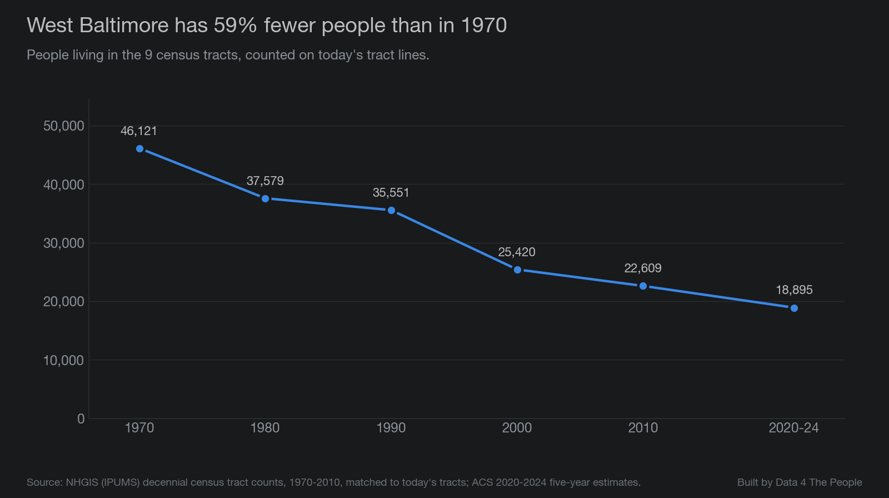
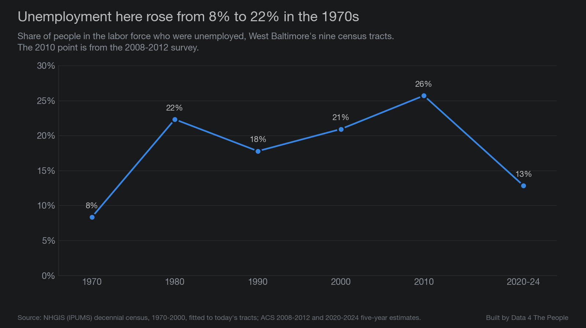

::: blurb Stories of a Forgotten American Community
The connection between a community's economy and its health seems logical, and our [recent work](https://www.data4thepeople.com/p/income-health-viz) shows the two are closely linked. Yet, in the policy world, we tend to treat a community's economy and its physical and mental health as separate goals.

Maybe we do this because we rarely learn how communities end up in this position. This series tries to fill that gap. We selected 10 communities, out of thousands across the country with low incomes and poor health, five in cities and five in rural areas. And we have gone back over the past century to tell the story of how they got here.

What we have found challenges the way you may think about America. If you tend to believe that people's circumstances are mostly the result of their own choices, this series may challenge that view. What you will see is that decisions made decades ago, some of them openly racist, set these communities on a path that has been very hard to leave. Just like a good investment can compound wealth over many years, a decision, like redlining a neighborhood or tying a county's jobs to a single industry, can compound the other way.

When you read this series, try to put yourself in the shoes of people in these communities. If you don't live here, or in an area like this, you may not live in the shadow of past decisions. But people in these communities do.

Ask yourself one question: What would your life be like if you had grown up here?

Then ask a second: Is it fair to ignore what this community faces now? Or should we do something about decisions made decades ago that held this community back?
:::

::: spacer 20px

Here is how West Baltimore compares with the country today.

*Census Bureau, CDC PLACES and USALEEP. Health figures are model estimates for adults.*

::: spacer 5px

::: dropcap
West Baltimore here is nine census tracts west of downtown Baltimore, with about 18,900 people. They take in Sandtown-Winchester, Harlem Park, Upton, Franklin Square and Poppleton. Median household income is about $24,800, 31% of the U.S. figure. More than half of households get SNAP food benefits. Life expectancy is 68.9 years, 9.8 years shorter than for the country as a whole.

West Baltimore has a lot in common with [West Dayton](https://www.data4thepeople.com/p/spotlight-west-dayton), the first story in this series. Both were graded for home loans in 1937, cut through by freeways and emptied of most of their people. But the timing is different. Poverty in West Dayton's tracts more than doubled after 1970, from 18% to 42%. In West Baltimore, it was already 41% in 1970, and it has stayed close to that level ever since. Here, the rules that shaped the neighborhood were written early.

This post follows four of them in order: a segregation law, a loan map, public housing placed by race and a highway. Then it looks at the jobs that left, a $130 million effort to rebuild part of the neighborhood and why that effort fell short. Each fact links to its source.

## Fenced in by law

::: spacer 5px

In 1910, Baltimore became "the first city in America to pass an ordinance establishing block-by-block segregation," according to the U.S. Department of Justice ([DOJ, 2016, p. 12](https://www.justice.gov/crt/file/883296/download)). In 1917, the Supreme Court struck down a similar law in Louisville, Ky. ([Buchanan v. Warley, 1917](https://www.law.cornell.edu/supremecourt/text/245/60)). The DOJ found that the ruling's "effect in Baltimore was minimal," because segregation went on through other means ([DOJ, 2016, p. 71](https://www.justice.gov/crt/file/883296/download)).

## The 1937 loan map

::: spacer 5px

On May 1, 1937, the federal Home Owners' Loan Corporation issued Baltimore's Residential Security Map, which graded neighborhoods for mortgage risk ([Thompson v. HUD, 2005](https://www.courtlistener.com/opinion/2306838/thompson-v-united-states-dept-of-housing-urban-development/)). A federal court later quoted the officials' written explanation of the map: the lowest-graded areas, shaded red, were "characterized by detrimental influences in a pronounced degree, undesirable population or an infiltration of it" (same source). Most of the land in our tracts was graded D, the lowest grade. One tract, in Harlem Park, was graded C ([Mapping Inequality, University of Richmond](https://dsl.richmond.edu/panorama/redlining/)). West Dayton was graded the same way that year. The difference is that Baltimore had already written segregation into city law, in 1910.

This is where the word redlining comes from. Redlining means denying people loans because of where they live, even when they qualify on their own ([Federal Reserve History, 2023](https://www.federalreservehistory.org/essays/redlining)).

A low grade mattered because the federal government was building the modern home loan at the same time. Before the 1930s, most home loans were short, often a dozen years or less, and a buyer might need to put down as much as 40% of the price ([Wells, Federal Reserve Bank of Richmond, 2023](https://www.richmondfed.org/publications/research/econ_focus/2023/q1_economic_history)). The new federal programs changed that. The Home Owners' Loan Corporation made the 15-year loan, paid down a little each month, standard. The Federal Housing Administration insured loans of 20 years or more, with as little as 10% down (same source). Those longer loans let many more families buy homes. But from its start in 1934, FHA staff concluded that no loan could be economically sound in a neighborhood that was or could become home to Black people ([Federal Reserve History, 2023](https://www.federalreservehistory.org/essays/redlining)).

The map below shows the 1937 grades with the nine tracts in this story outlined.

*The 1937 grades come from Mapping Inequality. Freeways are today's, from the Census Bureau.*

The City of Baltimore draws the line forward itself. In a 2024 federal grant application, it wrote that residents of these areas "could not access credit" and that "these patterns of red lining are echoed in today's maps" ([City of Baltimore, 2024, p. 8](https://www.mdot.maryland.gov/OPCP/Narrative_2024_West_Baltimore_United_Phase_1_RCP_Construction.pdf)).

## Public housing, placed by race

::: spacer 5px

Between 1937 and 1943, the Housing Authority of Baltimore City built eight low-rent housing projects segregated by law. Five were for Black residents and were placed in existing Black neighborhoods. One of them was Gilmor Homes, in Sandtown ([Thompson v. HUD, 2005](https://www.courtlistener.com/opinion/2306838/thompson-v-united-states-dept-of-housing-urban-development/)). The City Council approved the site for the Murphy Homes high-rises in 1952. In October 1965, the city's first plan for scattered-site public housing put 100 units in the Harlem Park urban renewal area. All the families moved out to make room for it were Black (same source).

Forty years later, a federal judge ruled that HUD "failed to consider regionally-oriented desegregation and integration policies" in Baltimore. The court counted where the city's scattered-site public housing ended up: 302 units in Sandtown-Winchester, 227 in Harlem Park, 173 in Franklin Square and 116 in Upton. It found that most scattered-site units "are located in high poverty Black neighborhoods" ([Thompson v. HUD, 2005](https://www.courtlistener.com/opinion/2306838/thompson-v-united-states-dept-of-housing-urban-development/)).

## A highway to nowhere

::: spacer 5px

In 1966, the city began condemning property for the Franklin-Mulberry expressway ([Baltimore Magazine, 2023](https://www.baltimoremagazine.com/section/businessdevelopment/highway-to-nowhere-baltimore-expressway-demolished-black-neighborhoods/)). The city says 971 homes, 62 businesses, one school and 20 city blocks were torn down, and about 1,500 people were moved out ([City of Baltimore, 2024, p. 2](https://www.mdot.maryland.gov/OPCP/Narrative_2024_West_Baltimore_United_Phase_1_RCP_Construction.pdf)). Baltimore Magazine puts the number moved out at more than 2,800. The road opened on Feb. 5, 1979, but it was never connected to I-70. Many people call it the "Highway to Nowhere" ([Baltimore Magazine, 2023](https://www.baltimoremagazine.com/section/businessdevelopment/highway-to-nowhere-baltimore-expressway-demolished-black-neighborhoods/)). The city says West Baltimore communities "have continued to face blight and disinvestment in the decades since" ([City of Baltimore, 2024, p. 2](https://www.mdot.maryland.gov/OPCP/Narrative_2024_West_Baltimore_United_Phase_1_RCP_Construction.pdf)). West Dayton lost homes and businesses to I-75 and US-35, and US-35 split it in half. Baltimore's road was never finished, so homes came down for a highway that never reached the interstate.

The chart below counts the people living inside today's nine tract lines in each census.

*Earlier counts are fitted to today's tract lines. 2020-2024 is a five-year survey estimate.*

The tracts lost about 19% of their people in the 1970s, the decade the highway was cleared and built. Other things were happening at the same time. After Dr. Martin Luther King Jr. was killed in April 1968, looting began along Pennsylvania Avenue, two blocks of it inside these tracts. Across the city, six people died and there were 1,208 fires ([University of Baltimore, Baltimore '68 timeline](https://archives.ubalt.edu/bsr/timeline.htm)). And Baltimore as a whole had been losing people since 1950, when it peaked at about 950,000 ([Federal Reserve Bank of Richmond, 2017](https://www.richmondfed.org/-/media/RichmondFedOrg/publications/research/econ_focus/2017/q2/district_digest_article.pdf)). No source we found separates these causes. From 1970 to 2020-2024, the tracts went from 46,121 people to 18,895, a drop of 59%. West Dayton's tracts lost 74% over the same years.

## The jobs leave

::: spacer 5px

Baltimore was a factory city. In 1950, over 34% of its workers had manufacturing jobs. Between 1950 and 1995, the city lost 74.9% of those jobs, and by 1995 only 8% of the city's jobs were in manufacturing ([Federal Reserve Bank of Richmond, 2017, citing Marc Levine](https://www.richmondfed.org/-/media/RichmondFedOrg/publications/research/econ_focus/2017/q2/district_digest_article.pdf)). Sandtown once had steady paychecks from local employers like Schmidt's Bakery. By the 1990s, the bakery had closed ([The Abell Report, 2013, p. 1](https://abell.org/wp-content/uploads/2022/02/arn1113.pdf)).

The chart below shows unemployment among people in the nine tracts who were working or looking for work.

*Earlier years are fitted to today's tract lines. The 2010 point is from the 2008-2012 survey.*

Unemployment rose from 8% in 1970 to 22% in 1980, and it stayed near or above 18% until the 2020s. By 2002, the first year with this data, only 6% of the jobs held by people living here were in manufacturing, 494 of 8,769. By 2022, residents held 5,987 jobs in all ([Census Bureau, LEHD Origin-Destination Employment Statistics](https://lehd.ces.census.gov/data/)).

This is one of the biggest differences from West Dayton. There, 14% of residents' jobs were still in factories in 2002, and 61% of those factory jobs were gone by 2010, after GM's Moraine plant closed in 2008. In West Baltimore, the city's factory jobs had been leaving since the 1950s, and unemployment here jumped in the 1970s.

## A $130 million effort, and why it fell short

::: spacer 5px

In the late 1980s, Mayor Kurt Schmoke, the community group BUILD and the Enterprise Foundation, started by the developer James Rouse, set out to rebuild Sandtown. Through 2000, the effort raised more than $130 million. It built and fixed up hundreds of homes, and almost 600 public housing units in Gilmor Homes were modernized ([The Abell Report, 2013, p. 1](https://abell.org/wp-content/uploads/2022/02/arn1113.pdf)). In 1997, HUD awarded a $31.3 million grant to rebuild Murphy Homes and Julian Gardens ([HUD, 1999](https://archives.hud.gov/news/1999/pr99-182.html)).

Some things changed. Homeownership in the area rose from less than a quarter of homes in 1990 to more than 35% in 2009, more than in similar Baltimore neighborhoods. The researchers who studied it, Stefanie DeLuca of Johns Hopkins and Peter Rosenblatt of Loyola University Chicago, said the rise was likely due to the effort's focus on housing ([The Abell Report, 2013, p. 10](https://abell.org/wp-content/uploads/2022/02/arn1113.pdf)).

Poverty did not move much. The chart below shows the share of people in poverty since 1970, the share with low incomes, meaning below 200% of the poverty line, and the share of homes standing empty. Poverty stayed between 38% and 48% in every count. The low-income share held near 70% from 1990 to 2008-2012, then fell to 62% in 2020-2024.

*Low income here means below 200% of the federal poverty line. Income for 2010 is from the 2008-2012 survey.*

DeLuca and Rosenblatt compared Sandtown with similar neighborhoods that got no such effort. Poverty fell in some of them too, and they found "no impact of the NTI on the long-term neighborhood poverty rate," using the effort's formal name, the Neighborhood Transformation Initiative ([Rosenblatt and DeLuca, Urban Affairs Review, 2015](https://urbanaffairsreview.blogspot.com/2015/11/authors-blog-what-happened-in-sandtown.html)). The sources point to several reasons.

**There was no plan for jobs.** A 2001 review written for the Enterprise Foundation found that the effort "had no overarching strategy for economic development." It called this "an important omission, because while the city of Baltimore has steadily lost jobs for more than two decades, there has been considerable job growth in the outer suburbs." One person the reviewers interviewed said: "What the community wanted was jobs" ([Brown, Butler and Hamilton, 2001, p. 32](https://web.archive.org/web/20110112132605/http://www.aecf.org/upload/publicationfiles/sandtown-winchester.pdf)).

**Most of the money went to houses.** By 1998, $53 million had gone to building and fixing up homes and $8 million to programs for people, such as schools and job training, according to Joan Thompson of the Enterprise Foundation. She said that only after Rouse "put up houses did people come up and say to him, 'This house is very nice, but I have no job'" ([City Limits, 1998](https://citylimits.org/left-behind-in-sandtown/)).

**The housing crash hit hard.** Home prices here rose in the mid-2000s and then fell. From 2008 to 2010, more than 100 homes a year in the area faced foreclosure filings, the most of the four neighborhoods studied. By 2009, nearly a third of properties in the wider area were vacant ([The Abell Report, 2013, pp. 7 and 10](https://abell.org/wp-content/uploads/2022/02/arn1113.pdf)). DeLuca and Rosenblatt warned that owning a home "can become a burden on poor families if the rest of the neighborhood does not improve" (same source, p. 10).

**The schools did not improve.** The three elementary schools "continued to struggle in the two decades following" an agreement to improve them (same source, p. 8).

West Dayton got rebuilding money too, on a smaller scale, including more than 230 homes in Madden Hills and federal Model Cities homes in the 1970s. In both places, new houses went up and poverty stayed high.

## West Baltimore today

::: spacer 5px

The Baltimore City Health Department tracks life expectancy by neighborhood. In its 2017 profiles, covering 2011-2015, life expectancy was 70.0 years in Sandtown-Winchester and Harlem Park, 68.2 in Upton and Druid Heights, and 68.4 in Poppleton, the Terraces and Hollins Market, compared with 73.6 for the city ([Baltimore City Health Department, 2017](https://www.baltimorecity.gov/media/document/nhp201747sandtown-winchester-harlemparkrev6-9-17pdf); [Upton profile](https://www.baltimorecity.gov/media/document/nhp201753upton-druidheightsrev6-9-17pdf); [Poppleton profile](https://www.baltimorecity.gov/media/document/nhp201746poppleton-theterraces-hollinsmarketrev6-9-17pdf)). That is up from 65.3 in Sandtown-Winchester and Harlem Park in the 2011 profile, which covered 2005-2009 ([Baltimore City Health Department, 2011](https://s3.amazonaws.com/baltimorecity.gov.if-us-east-1/s3fs-public/2025-05/47_sandtown.pdf)). These areas are a little larger than our tracts. The DOJ also reported that 7.4% of children in Sandtown-Winchester and Harlem Park had elevated levels of lead in their blood, the highest share in the city ([DOJ, 2016, p. 14](https://www.justice.gov/crt/file/883296/download)).

**Food.** Food is one of the clearest places where a neighborhood's economy and its health meet. A full grocery store is where most families find fresh fruit, vegetables and other healthy food at a fair price. The U.S. Department of Agriculture says that limited access to food sources "may make it harder for some people to eat a healthy diet" ([USDA Economic Research Service](https://www.ers.usda.gov/data-products/food-access-research-atlas/)).

In 2019, the USDA counted every tract here that it had data for as low income, and four of those eight as low access, meaning many people lived more than half a mile from a supermarket ([USDA Food Access Research Atlas](https://www.ers.usda.gov/data-products/food-access-research-atlas/)). Today, of the stores inside the nine tracts that accept SNAP food benefits, one is a supermarket, a Save A Lot on Pennsylvania Avenue. Four are smaller grocery stores, and 20 are convenience stores ([USDA SNAP retailer list, November 2026](https://www.fns.usda.gov/snap/retailer-locator)).

Getting to a store farther away is hard for many people here. In the nine tracts, 60% of households have no vehicle, compared with 27% in Baltimore as a whole, 21% in West Dayton and 8% nationwide ([Census Bureau, American Community Survey 2020-2024](https://data.census.gov/table/ACSDT5Y2024.B25044)). CDC estimates that 24% of adults here went without reliable transportation at some point in the past year, and 50% were food insecure, compared with 9% and 17% in the 40 states where CDC has these measures ([CDC PLACES](https://www.cdc.gov/places/)). The chart below puts these side by side.

*Vehicles from the Census Bureau, 2020-2024. Transportation and food are CDC model estimates for 2023; nationwide for these two means tracts in the 40 states CDC covers, weighted by population.*

**Prison and police.** In 2015, the Justice Policy Institute and the Prison Policy Initiative reported that in 2010, 458 people from the Sandtown-Winchester and Harlem Park area were in state prison, more than from any other Baltimore community, at a cost to the state of about $17 million a year. The report found the same community "also faces the most concentrated challenges related to work, education, health, and housing," but it did not claim one causes the other ([Justice Policy Institute and Prison Policy Initiative, 2015](https://static.prisonpolicy.org/origin/md/report.pdf)). On April 12, 2015, Freddie Gray, who lived in Sandtown-Winchester, was injured in police custody after his arrest on Presbury Street. He died a week later ([Court of Appeals of Maryland, 2016](https://cases.justia.com/maryland/court-of-appeals/2016-96-15-0.pdf); [Baltimore Brew, 2015](https://baltimorebrew.com/2015/05/01/freddie-grays-death-ruled-a-homicide-six-officers-charged/); [Urban Affairs Review, 2015](https://urbanaffairsreview.blogspot.com/2015/11/authors-blog-what-happened-in-sandtown.html)). In 2016, the Justice Department found that Baltimore police made about 44% of their stops in two small, mostly Black police districts that hold about 11% to 12% of the city's people. It described one man who was stopped 34 times in those two districts ([DOJ, 2016, pp. 6 and 26](https://www.justice.gov/crt/file/883296/download)). A court entered a consent decree to reform the department on April 7, 2017 ([U.S. District Court for Maryland](https://www.mdd.uscourts.gov/Baltimore-City-Consent-Decree)). In October 2026, the department was still under it ([Baltimore Banner, 2026](https://www.thebanner.com/community/criminal-justice/bpd-shortage-misconduct-accountability-UMZDIGXSGVBGXJRWJPY5QF6MX4/)).

## What comes next

::: spacer 5px

With 60% of households here having no car, transit matters. In June 2015, the state canceled the Red Line, a planned east-west rail line through West Baltimore that had a $900 million federal funding commitment ([Baltimore Magazine, 2015](https://www.baltimoremagazine.com/2015/6/25/hogan-says-no-to-red-line)). The state brought the project back in 2023 and recommended light rail in 2024 ([Maryland Transit Administration](https://redlinemaryland.com)). In April 2026, citing federal funding uncertainty, the state began weighing whether to build it in phases or switch to bus rapid transit ([Maryland Transit Administration, 2026](https://www.mta.maryland.gov/articles/538)). No construction date has been set.

The highway is getting attention too. In February 2023, the city got a $2 million federal grant to plan what to do with the corridor. In 2024, it asked for $100 million more toward a $200 million first phase ([City of Baltimore, 2024, p. 1](https://www.mdot.maryland.gov/OPCP/Narrative_2024_West_Baltimore_United_Phase_1_RCP_Construction.pdf)). In January 2025, the U.S. Department of Transportation awarded about $85.5 million. The money is to build a cap over one block of the highway, tear down ramps over it and make some intersections safer ([Office of Sen. Chris Van Hollen, 2025](https://www.vanhollen.senate.gov/news/press-releases/van-hollen-alsobrooks-mfume-announce-85-million-for-first-phase-of-highway-to-nowhere-redevelopment)).

::: divider

## How we built this

::: spacer 5px

- **The neighborhood.** West Baltimore here is nine 2020 census tracts in Baltimore city: 24510150100, 24510150200, 24510160100, 24510160300, 24510160400, 24510170200, 24510170300, 24510190100 and 24510280600. All nine are in the bottom 20% of U.S. tracts on both median household income and our health index.
- **Then and now.** Census counts from 1970 to 2010 come from [NHGIS (IPUMS)](https://www.nhgis.org/) and are fitted to today's tract lines. 2020-2024 numbers are from the Census Bureau's [American Community Survey](https://www.census.gov/programs-surveys/acs) five-year estimates.
- **The table at the top.** Rates are computed from counts summed across the nine tracts. Median household income is estimated from income ranges, the Census Bureau's method for combined areas. Health measures are [CDC PLACES](https://www.cdc.gov/places/) model estimates for adults, weighted by each tract's adult population. Life expectancy is from the [U.S. Small-Area Life Expectancy Estimates Project](https://www.cdc.gov/nchs/nvss/usaleep/usaleep.html), 2010-2015.
- **City and report figures.** The Health Department, Justice Department and Justice Policy Institute figures cover city-defined neighborhood areas that are a little larger than our tracts.
- **The map.** 1937 grades are from [Mapping Inequality](https://dsl.richmond.edu/panorama/redlining/). Grade shares are our own overlay of that map on 2020 tract lines.
- **Jobs.** Unemployment is from the same census series as the other then-and-now numbers (1970 and 1980 fitted with 92% of population matched; 2010 from the 2008-2012 survey). Jobs held by residents are from the Census Bureau's [LEHD Origin-Destination Employment Statistics](https://lehd.ces.census.gov/data/) (LODES 8), summed over the nine tracts; they count jobs, not people, and say nothing about where the jobs were.
- **The rebuilding effort.** Homeownership figures (under a quarter in 1990, more than 35% in 2009) are the Abell Report's, for the city's Sandtown-Winchester community statistical area, which is a little different from our tracts. In our nine tracts, the share of homes owned by the people living in them went from 19% in 1990 to 25% in 2000 and 26% in 2020-2024. The 2001 review by Prudence Brown, Benjamin Butler and Ralph Hamilton was prepared for the Enterprise Foundation; the link is an archived copy.
- **Food.** Low-income and low-access flags are from the USDA [Food Access Research Atlas](https://www.ers.usda.gov/data-products/food-access-research-atlas/), 2019, which uses 2010 tracts; eight of our nine tracts are in it (tract 24510280600 was created in 2020). Store counts are stores inside the nine tracts on USDA's live SNAP retailer list, pulled November 2026, by USDA store type; the list shows stores authorized to take SNAP and may include some that have closed. Vehicles are ACS 2020-2024 table B25044. Transportation and food insecurity are CDC PLACES 2025 release model estimates for 2023, weighted by tract population.
- **Photo.** U.S. Route 40, the former Interstate 170, looking east from the North Fulton Avenue overpass, Aug. 25, 2019. Photo by Famartin, [Wikimedia Commons](https://commons.wikimedia.org/wiki/File:2019-08-25_12_59_43_View_east_along_U.S._Route_40_(former_Interstate_170)_from_the_overpass_for_U.S._Route_1_northbound_(North_Fulton_Avenue)_in_Baltimore_City,_Maryland.jpg), [CC BY-SA 4.0](https://creativecommons.org/licenses/by-sa/4.0/). Cropped.
