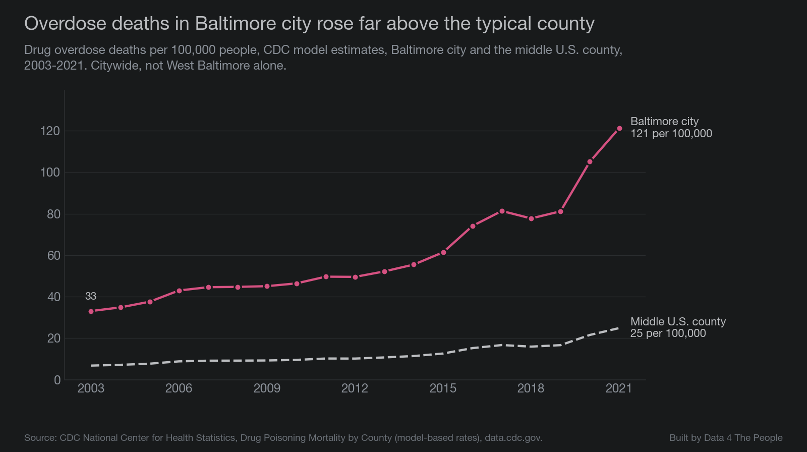

Here is how West Baltimore compares with the country today.

*Census Bureau, CDC PLACES and USALEEP. Health figures are model estimates for adults.*

::: blurb Stories of a Forgotten American Community
The connection between a community's economy and its health seems logical, and our [recent work](https://www.data4thepeople.com/p/income-health-viz) shows the two are closely linked. Yet, in the policy world, we tend to treat a community's economy and its physical and mental health as separate goals.

Maybe we do this because we rarely learn how communities end up in this position. This series tries to fill that gap. We selected 10 communities, out of thousands across the country with low incomes and poor health, five in cities and five in rural areas. And we have gone back over the past century to tell the story of how they got here.

What we have found challenges the way you may think about America. If you tend to believe that people's circumstances are mostly the result of their own choices, this series may challenge that view. What you will see is that decisions made decades ago, some of them openly racist, set these communities on a path that has been very hard to leave. Just like a good investment can compound wealth over many years, a decision, like redlining a neighborhood or tying a county's jobs to a single industry, can compound the other way.

When you read this series, try to put yourself in the shoes of people in these communities. If you don't live here, or in an area like this, you may not live in the shadow of past decisions. But people in these communities do.

Ask yourself one question: What would your life be like if you had grown up here?

Then ask a second: Is it fair to ignore what this community faces now? Or should we do something about decisions made decades ago that held this community back?
:::

::: spacer 5px

::: dropcap
West Baltimore here is nine census tracts west of downtown Baltimore, with about 18,900 people. They take in Sandtown-Winchester, Harlem Park, Upton, Franklin Square and Poppleton. Median household income is about $24,800, 31% of the U.S. figure. More than half of households get SNAP food benefits. Life expectancy is 68.9 years, 9.8 years shorter than for the country as a whole.

Much of West Baltimore's history is written down in laws, maps and court findings. This post walks through them in order, with a link to the source for each one.

## A law by the block

::: spacer 5px

In 1910, Baltimore became "the first city in America to pass an ordinance establishing block-by-block segregation," according to the U.S. Department of Justice ([DOJ, 2016, p. 12](https://www.justice.gov/crt/file/883296/download)). In 1917, the Supreme Court struck down a similar law in Louisville, Ky. ([Buchanan v. Warley, 1917](https://www.law.cornell.edu/supremecourt/text/245/60)). The DOJ found that the ruling's "effect in Baltimore was minimal," because segregation went on through other means ([DOJ, 2016, p. 72](https://www.justice.gov/crt/file/883296/download)).

## The 1937 map

::: spacer 5px

On May 1, 1937, federal officials issued Baltimore's Residential Security Map. A federal court later quoted it: D areas were "characterized by detrimental influences ... undesirable population or an infiltration of it" ([Thompson v. HUD, 2005](https://hallapproved.com/md/cases/federal/district/2005/2306838/)). Most of the land in our tracts was graded D. One tract, in Harlem Park, was graded C ([Mapping Inequality, University of Richmond](https://dsl.richmond.edu/panorama/redlining/)).

The map below shows the 1937 grades with the nine tracts in this story outlined.

*The 1937 grades come from Mapping Inequality. Freeways are today's, from the Census Bureau.*

The City of Baltimore draws the line forward itself. In a 2024 federal grant application, it wrote that residents of these areas "could not access credit" and that "these patterns of red lining are echoed in today's maps" ([City of Baltimore, 2024, p. 8](https://www.mdot.maryland.gov/OPCP/Narrative_2024_West_Baltimore_United_Phase_1_RCP_Construction.pdf)).

## Public housing, placed by race

::: spacer 5px

Between 1937 and 1943, the Housing Authority of Baltimore City built eight low-rent housing projects segregated by law. Five were for Black residents and were placed in existing Black neighborhoods. One of them was Gilmor Homes, in Sandtown ([Thompson v. HUD, 2005](https://hallapproved.com/md/cases/federal/district/2005/2306838/)). The City Council approved the site for the Murphy Homes high-rises in 1952 ([Thompson v. HUD, 2005](https://hallapproved.com/md/cases/federal/district/2005/2306838/)). In October 1965, the city's first plan for scattered-site public housing put 100 units in the Harlem Park urban renewal area. All the families moved out to make room for it were Black ([Thompson v. HUD, 2005](https://hallapproved.com/md/cases/federal/district/2005/2306838/)).

## 1968

::: spacer 5px

After the assassination of Dr. Martin Luther King Jr., looting began on April 6, 1968, along the 1200 to 2000 blocks of Pennsylvania Avenue. The first two of those blocks are inside our tracts. Across the city, six people died, more than 5,700 were arrested, and there were 1,208 fires ([University of Baltimore, Baltimore '68 timeline](https://archives.ubalt.edu/bsr/timeline.htm)).

## A highway to nowhere

::: spacer 5px

In 1966, the city began taking property for the Franklin-Mulberry expressway. The city says 971 homes, 62 businesses, one school and 20 city blocks were torn down, and about 1,500 people were moved out ([City of Baltimore, 2024, pp. 2 to 3](https://www.mdot.maryland.gov/OPCP/Narrative_2024_West_Baltimore_United_Phase_1_RCP_Construction.pdf)). Baltimore Magazine puts the number moved out at more than 2,800. The road opened on Feb. 5, 1979, but it was never connected to I-70. Many people call it the "Highway to Nowhere" ([Baltimore Magazine, 2023](https://www.baltimoremagazine.com/section/businessdevelopment/highway-to-nowhere-baltimore-expressway-demolished-black-neighborhoods/)). The city says West Baltimore communities "have continued to face blight and disinvestment in the decades since" ([City of Baltimore, 2024, p. 3](https://www.mdot.maryland.gov/OPCP/Narrative_2024_West_Baltimore_United_Phase_1_RCP_Construction.pdf)).

The chart below counts the people living inside today's nine tract lines in each census.

*Earlier counts are fitted to today's tract lines. 2020-2024 is a five-year survey estimate.*

The tracts lost about 19% of their people in the 1970s, the decade the highway was cleared and built. Much of Baltimore lost people in those years too, and the 1968 unrest and moves to the suburbs overlap with the highway. No source we found separates them.

## A large rebuilding effort

::: spacer 5px

Starting in the late 1980s, the city, the community group BUILD and the Enterprise Foundation launched a rebuilding effort in Sandtown. It raised more than $130 million through 2000, and almost 600 public housing units in Gilmor Homes were modernized. Researchers who studied it found homeownership rose from under a quarter of families to more than 40% ([The Abell Report, 2013](https://abell.org/wp-content/uploads/2022/02/arn1113.pdf); [Urban Affairs Review, 2015](https://urbanaffairsreview.blogspot.com/2015/11/authors-blog-what-happened-in-sandtown.html)). In 1997, HUD awarded a $31.3 million grant to rebuild Murphy Homes and Julian Gardens ([HUD, 1999](https://archives.hud.gov/news/1999/pr99-182.html)).

The chart below shows the share of people with low incomes, meaning below 200% of the poverty line, and the share of homes standing empty over the same decades. The low-income share held near 70% from 1990 to 2008-2012, then fell to 62% in 2020-2024. The U.S. share was 28%.

*Low income here means below 200% of the federal poverty line. Income for 2010 is from the 2008-2012 survey.*

## A court finding

::: spacer 5px

On Jan. 6, 2005, a federal judge ruled that HUD "failed to consider regionally-oriented desegregation and integration policies" in Baltimore. The court found that scattered-site public housing units were concentrated in a few neighborhoods: 302 in Sandtown-Winchester, 227 in Harlem Park, 173 in Franklin Square and 116 in Upton. It found that most scattered-site units "are located in high poverty Black neighborhoods" ([Thompson v. HUD, 2005](https://hallapproved.com/md/cases/federal/district/2005/2306838/)).

## Prison, police and a death in custody

::: spacer 5px

In 2015, the Justice Policy Institute and the Prison Policy Initiative reported that 458 people from the Sandtown-Winchester and Harlem Park area were in prison, more than from any other Baltimore community. That cost the state about $17 million a year. The report found the same community "also faces the most concentrated challenges related to work, education, health, and housing," but it did not claim one causes the other ([Justice Policy Institute and Prison Policy Initiative, 2015](https://static.prisonpolicy.org/origin/md/report.pdf)). Its area is a little larger than our tracts.

On April 12, 2015, Freddie Gray was injured in police custody after his arrest in Sandtown. He died a week later ([Court of Appeals of Maryland, 2016](https://cases.justia.com/maryland/court-of-appeals/2016-96-15-0.pdf); [Baltimore Brew, 2015](https://baltimorebrew.com/2015/05/01/freddie-grays-death-ruled-a-homicide-six-officers-charged/)). In 2016, the Justice Department found that Baltimore police made about 44% of their stops in two small, mostly Black police districts that hold about 11% to 12% of the city's people. It described one man who was stopped 34 times ([DOJ, 2016](https://www.justice.gov/crt/file/883296/download)). A court entered a consent decree to reform the department on April 7, 2017 ([U.S. District Court for Maryland](https://www.mdd.uscourts.gov/Baltimore-City-Consent-Decree)).

In June 2015, the state canceled the Red Line, a planned east-west rail line through West Baltimore that had a $900 million federal funding commitment ([Baltimore Magazine, 2015](https://www.baltimoremagazine.com/2015/6/25/hogan-says-no-to-red-line)). The state brought the project back in 2023 and chose light rail in 2024. No construction date has been set ([Maryland Transit Administration](https://redlinemaryland.com)).

## Health

::: spacer 5px

The Baltimore City Health Department tracks life expectancy by neighborhood. In its 2017 profiles, covering 2011-2015, life expectancy was 70.0 years in Sandtown-Winchester and Harlem Park, 68.2 in Upton and Druid Heights, and 68.4 in Poppleton, compared with 73.6 for the city ([Baltimore City Health Department, 2017](https://www.baltimorecity.gov/media/document/nhp201747sandtown-winchester-harlemparkrev6-9-17pdf)). That is up from 65.3 in Sandtown-Winchester and Harlem Park in the 2011 profile, which covered 2005-2009 ([Baltimore City Health Department, 2011](https://s3.amazonaws.com/baltimorecity.gov.if-us-east-1/s3fs-public/2025-05/47_sandtown.pdf)). These areas are a little larger than our tracts. The DOJ also reported that 7.4% of children tested in Sandtown-Winchester and Harlem Park had high levels of lead in their blood ([DOJ, 2016](https://www.justice.gov/crt/file/883296/download)).

The chart below compares Baltimore's drug overdose death rate with the middle U.S. county.

*These are CDC model estimates for the whole city, not West Baltimore alone.*

## What the city plans now

::: spacer 5px

In April 2023, the city got a $2 million federal grant to plan what to do with the highway corridor ([Office of Sen. Chris Van Hollen, 2023](https://www.vanhollen.senate.gov/news/press-releases/maryland-congressional-members-mayor-scott-highlight-federal-funding-to-move-forward-with-highway-to-nowhere-redevelopment)). In 2024, it asked for $100 million more toward a $200 million first phase ([City of Baltimore, 2024, p. 1](https://www.mdot.maryland.gov/OPCP/Narrative_2024_West_Baltimore_United_Phase_1_RCP_Construction.pdf)). [Eric: we have not confirmed whether the 2024 request was funded. Worth a check before publishing.]

::: divider

## How we built this

::: spacer 5px

- **The neighborhood.** West Baltimore here is nine 2020 census tracts in Baltimore city: 24510150100, 24510150200, 24510160100, 24510160300, 24510160400, 24510170200, 24510170300, 24510190100 and 24510280600. All nine are in the bottom 20% of U.S. tracts on both median household income and our health index.
- **Then and now.** Census counts from 1970 to 2010 come from [NHGIS (IPUMS)](https://www.nhgis.org/) and are fitted to today's tract lines. 2020-2024 numbers are from the Census Bureau's [American Community Survey](https://www.census.gov/programs-surveys/acs) five-year estimates.
- **The table at the top.** Rates are computed from counts summed across the nine tracts. Median household income is estimated from income ranges, the Census Bureau's method for combined areas. Health measures are [CDC PLACES](https://www.cdc.gov/places/) model estimates for adults, weighted by each tract's adult population. Life expectancy is from the [U.S. Small-Area Life Expectancy Estimates Project](https://www.cdc.gov/nchs/nvss/usaleep/usaleep.html), 2010-2015.
- **City and report figures.** The Health Department, Justice Department and Justice Policy Institute figures cover city-defined neighborhood areas that are a little larger than our tracts.
- **The map.** 1937 grades are from [Mapping Inequality](https://dsl.richmond.edu/panorama/redlining/). Grade shares are our own overlay of that map on 2020 tract lines.
- **Overdose deaths.** CDC National Center for Health Statistics, [Drug Poisoning Mortality by County](https://data.cdc.gov/resource/rpvx-m2md.json?fips=24510). The middle U.S. county is the median of all county rates each year.
