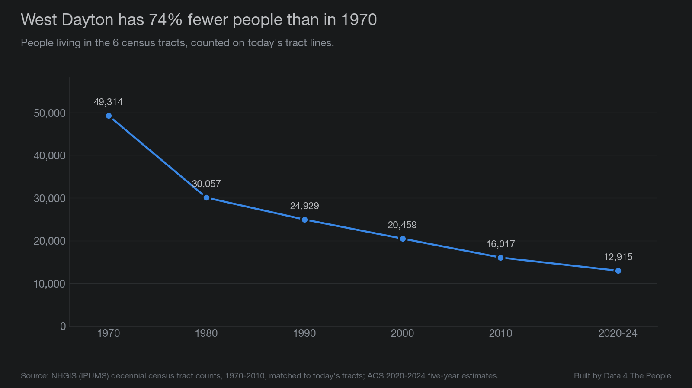
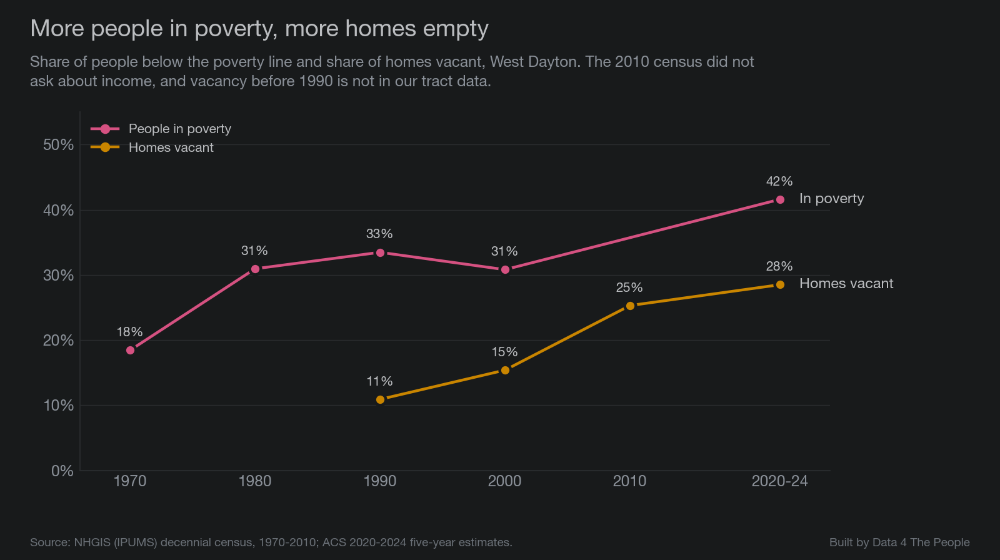
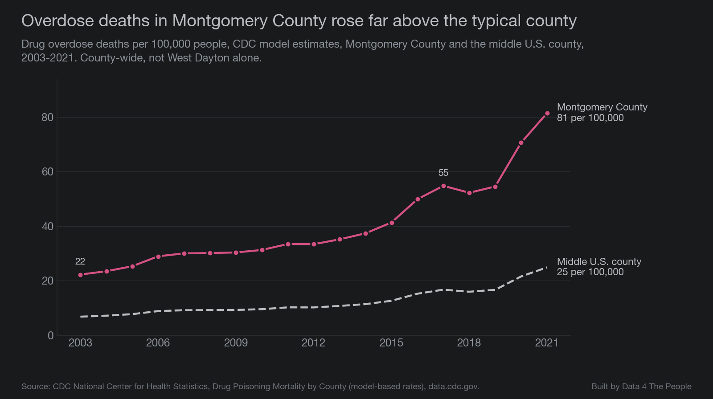

Here is how West Dayton compares with the country today.

::: html 340px

<table style="width:100%;border-collapse:collapse;font-size:15px;line-height:1.35"><thead><tr><th style="text-align:left;padding:0 8px 8px 0;color:#E4E5E7;font-size:16px">Economy</th><th style="text-align:right;padding:0 8px 8px;color:#E4E5E7;font-size:13px;font-weight:600">West Dayton</th><th style="text-align:right;padding:0 0 8px 8px;color:#8A9098;font-size:13px;font-weight:600">U.S.</th></tr></thead><tbody><tr><td style="padding:7px 8px 7px 0;border-top:1px solid #2A2D2F;color:#BBBDC0">Median household income</td><td style="padding:7px 8px;border-top:1px solid #2A2D2F;text-align:right;color:#E4E5E7;font-weight:600;white-space:nowrap">$29,600</td><td style="padding:7px 0 7px 8px;border-top:1px solid #2A2D2F;text-align:right;color:#8A9098;white-space:nowrap">$80,700</td></tr><tr><td style="padding:7px 8px 7px 0;border-top:1px solid #2A2D2F;color:#BBBDC0">People in poverty</td><td style="padding:7px 8px;border-top:1px solid #2A2D2F;text-align:right;color:#E4E5E7;font-weight:600;white-space:nowrap">42%</td><td style="padding:7px 0 7px 8px;border-top:1px solid #2A2D2F;text-align:right;color:#8A9098;white-space:nowrap">12%</td></tr><tr><td style="padding:7px 8px 7px 0;border-top:1px solid #2A2D2F;color:#BBBDC0">Unemployment rate</td><td style="padding:7px 8px;border-top:1px solid #2A2D2F;text-align:right;color:#E4E5E7;font-weight:600;white-space:nowrap">10%</td><td style="padding:7px 0 7px 8px;border-top:1px solid #2A2D2F;text-align:right;color:#8A9098;white-space:nowrap">5%</td></tr><tr><td style="padding:7px 8px 7px 0;border-top:1px solid #2A2D2F;color:#BBBDC0">Households on SNAP</td><td style="padding:7px 8px;border-top:1px solid #2A2D2F;text-align:right;color:#E4E5E7;font-weight:600;white-space:nowrap">41%</td><td style="padding:7px 0 7px 8px;border-top:1px solid #2A2D2F;text-align:right;color:#8A9098;white-space:nowrap">12%</td></tr><tr><td style="padding:7px 8px 7px 0;border-top:1px solid #2A2D2F;color:#BBBDC0">Homes vacant</td><td style="padding:7px 8px;border-top:1px solid #2A2D2F;text-align:right;color:#E4E5E7;font-weight:600;white-space:nowrap">28%</td><td style="padding:7px 0 7px 8px;border-top:1px solid #2A2D2F;text-align:right;color:#8A9098;white-space:nowrap">10%</td></tr></tbody></table>

<table style="width:100%;border-collapse:collapse;font-size:15px;line-height:1.35"><thead><tr><th style="text-align:left;padding:0 8px 8px 0;color:#E4E5E7;font-size:16px">Health</th><th style="text-align:right;padding:0 8px 8px;color:#E4E5E7;font-size:13px;font-weight:600">West Dayton</th><th style="text-align:right;padding:0 0 8px 8px;color:#8A9098;font-size:13px;font-weight:600">U.S.</th></tr></thead><tbody><tr><td style="padding:7px 8px 7px 0;border-top:1px solid #2A2D2F;color:#BBBDC0">Life expectancy</td><td style="padding:7px 8px;border-top:1px solid #2A2D2F;text-align:right;color:#E4E5E7;font-weight:600;white-space:nowrap">69.3 years</td><td style="padding:7px 0 7px 8px;border-top:1px solid #2A2D2F;text-align:right;color:#8A9098;white-space:nowrap">78.7 years</td></tr><tr><td style="padding:7px 8px 7px 0;border-top:1px solid #2A2D2F;color:#BBBDC0">Adults in fair or poor health</td><td style="padding:7px 8px;border-top:1px solid #2A2D2F;text-align:right;color:#E4E5E7;font-weight:600;white-space:nowrap">42%</td><td style="padding:7px 0 7px 8px;border-top:1px solid #2A2D2F;text-align:right;color:#8A9098;white-space:nowrap">20%</td></tr><tr><td style="padding:7px 8px 7px 0;border-top:1px solid #2A2D2F;color:#BBBDC0">Adults with diabetes</td><td style="padding:7px 8px;border-top:1px solid #2A2D2F;text-align:right;color:#E4E5E7;font-weight:600;white-space:nowrap">29%</td><td style="padding:7px 0 7px 8px;border-top:1px solid #2A2D2F;text-align:right;color:#8A9098;white-space:nowrap">12%</td></tr><tr><td style="padding:7px 8px 7px 0;border-top:1px solid #2A2D2F;color:#BBBDC0">Adults with high blood pressure</td><td style="padding:7px 8px;border-top:1px solid #2A2D2F;text-align:right;color:#E4E5E7;font-weight:600;white-space:nowrap">55%</td><td style="padding:7px 0 7px 8px;border-top:1px solid #2A2D2F;text-align:right;color:#8A9098;white-space:nowrap">34%</td></tr><tr><td style="padding:7px 8px 7px 0;border-top:1px solid #2A2D2F;color:#BBBDC0">Adults with frequent mental distress</td><td style="padding:7px 8px;border-top:1px solid #2A2D2F;text-align:right;color:#E4E5E7;font-weight:600;white-space:nowrap">23%</td><td style="padding:7px 0 7px 8px;border-top:1px solid #2A2D2F;text-align:right;color:#8A9098;white-space:nowrap">17%</td></tr></tbody></table>

Sources: Census Bureau, American Community Survey 2020-2024; CDC PLACES 2025 (model estimates for adults); life expectancy 2010-2015 (USALEEP). Built by Data 4 The People.

:::

::: spacer 20px

::: dropcap
West Dayton is six census tracts on the west side of Dayton, Ohio, with about 12,900 people. They run from Wright-Dunbar, next to downtown, out through Westwood and the Miami Chapel area to the city's edge with Trotwood. Most of the people who live here are Black, about 80% in the latest census survey. Median household income is about $29,600, 37% of the U.S. figure. Life expectancy is 69.3 years, 9.4 years shorter than for the country as a whole.

West Dayton took a long series of hits over almost 90 years. This post walks through them in order, with a link to the source for each one.

## The map that came first

::: spacer 5px

In 1937, the federal Home Owners' Loan Corporation graded Dayton's neighborhoods for mortgage risk. Areas graded D, shaded red, were labeled "hazardous." None of the land in today's West Dayton tracts got an A or B grade. Most of the Wright-Dunbar tract was graded D, and so was about half of the Miami Chapel tract ([Mapping Inequality, University of Richmond](https://dsl.richmond.edu/panorama/redlining/map/OH/Dayton)).

The map below shows the 1937 grades with the six tracts in this story outlined.

*The 1937 grades come from Mapping Inequality. Freeways are today's, from the Census Bureau.*

The City of Dayton's own plans describe what followed. Starting in the 1950s, West Dayton became one of the few parts of the city where Black families could buy homes, because redlining kept them out of other neighborhoods until the late 1960s ([West Dayton Neighborhoods Vision, 2019, p. 2](https://www.daytonohio.gov/DocumentCenter/View/6763/West-Dayton-Neighborhoods-Vision-document)). Black families who could not buy in other middle-income areas built Pineview, more than 400 single-family homes, in the 1950s. DeSoto Bass Courts opened in 1945 as the first rental housing in Dayton open to Black residents, and for many years it was the only complex that would rent to Black families ([Renew Miami Chapel Transformation Plan, 2018, pp. 19 to 21](https://www.daytonohio.gov/DocumentCenter/View/5305/Miami-Chapel-Choice-Transformation-Plan)).

The west side also had a busy Black business district. In 1940, West Fifth Street between Bank Street and Broadway held more than 70 businesses. People called it "the Nickel" ([Laird, Dayton Daily News, 2021](https://www.daytondailynews.com/local/deconstructing-segregation-how-highways-contributed-and-what-can-be-done-about-it-today/LIAY4RKK3JBSPCLZ6XAQPRZZNA/)).

## 1966

::: spacer 5px

On Sept. 1, 1966, Lester Mitchell, a Black man, was shot and killed on West Fifth Street by a white man firing from a car. Unrest followed. About 1,000 National Guard troops were sent to the west side, and they stayed five days ([The Dayton Jewish Observer, 2016](https://daytonjewishobserver.org/2016/08/50-years-later/)). About 150 people were arrested ([WHIO-TV, 2021](https://whio.com/news/local/dayton-race-riots-55-years-later-black-business-leader-shot-killed-set-off-days-riots/T3OWCXOHFBAHDCIOF6JZLMIAHM)).

Dayton had two more disorders in 1967. The federal Kerner Commission rated the June one "serious" and the September one "minor" ([Report of the National Advisory Commission on Civil Disorders, 1968](https://archive.org/details/reportofnation00unit)). Rioting came again in 1968 after the assassination of Dr. Martin Luther King Jr. Many merchants on the west side never came back ([The Dayton Jewish Observer, 2016](https://daytonjewishobserver.org/2016/08/50-years-later/)).

Rebuilding money came too. Starting in the mid-1960s, urban renewal built more than 230 homes in Madden Hills. In the 1970s, the federal Model Cities program built more than 60 low- and moderate-income homes south of Germantown Street ([Renew Miami Chapel Transformation Plan, 2018, p. 20](https://www.daytonohio.gov/DocumentCenter/View/5305/Miami-Chapel-Choice-Transformation-Plan)).

## Two freeways

::: spacer 5px

Building I-75 in the 1960s, and later US-35, "meant the demolition of many homes and businesses in multiple west side neighborhoods," local historian Andrew Walsh told the Dayton Daily News. I-75 cut West Fifth Street off from downtown ([Laird, Dayton Daily News, 2021](https://www.daytondailynews.com/local/deconstructing-segregation-how-highways-contributed-and-what-can-be-done-about-it-today/LIAY4RKK3JBSPCLZ6XAQPRZZNA/)). The City says the US-35 freeway, now the C.J. McLin Jr. Parkway, split West Dayton into northern and southern halves ([West Dayton Neighborhoods Vision, 2019, Foreword](https://www.daytonohio.gov/DocumentCenter/View/6763/West-Dayton-Neighborhoods-Vision-document)). [Eric: the 1996 finish date and the count of 283 homes on one 1.4-mile stretch are still waiting on the DDN pull. I left both out.]

A third freeway, I-675, was built through the suburbs. In 1979, the city told the federal government that I-675 would pull businesses and wealthier residents away from Dayton, and it asked for steps to soften that. The regional planning commission recommended nine steps, mostly fair housing across the region. The Dayton Daily News found that few of them were taken. One city planner estimates that a quarter to a third of downtown jobs left between 1985 and 1994, many for the I-675 corridor ([Laird, Dayton Daily News, 2021](https://www.daytondailynews.com/local/deconstructing-segregation-how-highways-contributed-and-what-can-be-done-about-it-today/LIAY4RKK3JBSPCLZ6XAQPRZZNA/)). The same article quotes a Cato Institute analyst who argues that highways were not the cause of the move to the suburbs.

## People leave

::: spacer 5px

Dayton as a whole peaked at 262,332 people in the 1960 census ([U.S. Census Bureau, 1998](https://www2.census.gov/library/working-papers/1998/demo/pop-twps0027/tab19.txt)). The chart below counts the people living inside today's six tract lines in each census.

*Earlier counts are fitted to today's tract lines. 2020-2024 is a five-year survey estimate.*

Westwood, two of the six tracts, lost more than half its people from 1990 to 2020. The City's 2025 plan for Westwood says about a third of its homes are vacant and more than 180 homes have been torn down in recent years ([Westwood Neighborhood Plan, 2025, p. 6](https://www.daytonohio.gov/DocumentCenter/View/22894/Westwood-Neighborhood-Plan)).

## The jobs go

::: spacer 5px

General Motors spun off its parts maker, Delphi, on May 28, 1999, and Delphi filed for bankruptcy on Oct. 8, 2005 ([Delphi 10-K, 1999](https://www.sec.gov/Archives/edgar/data/1072342/000095012400000464/0000950124-00-000464-d1.html); [Delphi 10-K, 2005](https://www.sec.gov/Archives/edgar/data/1072342/000095012406003695/k05246e10vk.htm)). In 2007, Delphi and the Steelworkers agreed that the businesses at the Home Avenue plant, which borders the Miami Chapel tract, would be sold or closed ([Delphi 8-K, 2007](https://www.sec.gov/Archives/edgar/data/1072342/000095012407004582/k18193e8vk.htm)). About 600 people worked there then ([The Vindicator, 2007](https://vindyarchives.com/news/2007/sep/01/delphi-settles-investors-suits)).

GM's Moraine plant, south of the city, employed 4,300 people at its peak. About 2,500 worked there when GM announced the closing on June 3, 2008. The last SUV came off the line on Dec. 23, 2008, and 1,100 workers lost their jobs that day ([Gnau, Dayton Daily News, 2023](https://daytondailynews.com/local/closure-of-gm-moraine-plant-ended-local-manufacturing-era-15-years-ago/IJKOIX7MH5D2ZBBNC2ALBKOEC4/)). Six months later, on June 2, 2009, NCR announced it would move its world headquarters from Dayton to Georgia. About 1,250 people worked at the Dayton headquarters ([NCR 10-Q, 2009](https://www.sec.gov/Archives/edgar/data/70866/000119312509159630/d10q.htm); [WOSU, 2009](https://wosu.org/news/2009-06-02/ncr-headquarters-1-200-jobs-to-leave-ohio)).

The Moraine plant and NCR's headquarters were not in West Dayton. The City's plan says Dayton lost thousands of factory jobs and businesses, and that West Dayton now has more poverty and joblessness than most of the rest of the city ([West Dayton Neighborhoods Vision, 2019, p. 2](https://www.daytonohio.gov/DocumentCenter/View/6763/West-Dayton-Neighborhoods-Vision-document)). The chart below shows the share of West Dayton residents in poverty and the share of homes standing empty over the same decades.

*The 2010 census did not ask about income, so poverty has no 2010 point.*

## Health

::: spacer 5px

The health numbers in the table at the top are today's. We do not have tract health data from earlier decades, so we cannot show how health in West Dayton changed over time. What we can show is the county.

Drug overdose deaths rose across Montgomery County for most of two decades. In early 2017, Montgomery County had 122 of the 281 overdose deaths, or 43%, in a CDC study of 24 Ohio counties ([CDC, MMWR, 2017](https://www.cdc.gov/mmwr/volumes/66/wr/mm6634a3.htm)). The chart below compares the county's overdose death rate with the middle U.S. county.

*These are CDC model estimates for the whole county, not West Dayton alone.*

In January 2018, Premier Health announced it would close Good Samaritan Hospital, north of West Dayton. It said two hospitals five miles apart were not sustainable ([WYSO, Jan. 17, 2018](https://www.wyso.org/news/2018-01-17/premier-health-to-close-good-samaritan-hospital-in-2018)). The hospital had 491 beds and about 1,600 employees ([Healthcare Dive, 2018](https://www.healthcaredive.com/news/premier-health-to-consolidate-its-two-dayton-hospitals/515093/)). A coalition of west side clergy filed a civil rights complaint with the U.S. Department of Health and Human Services. It said the closing would fall hardest on Black residents and women, and that Good Samaritan was the only hospital with labor and delivery care on Dayton's west side ([WYSO, May 3, 2018](https://www.wyso.org/news/2018-05-03/premier-reviewing-west-dayton-civil-rights-complaint-against-good-samaritan-hospital-shutdown)). The emergency room shut on July 19, 2018, as about 40 residents and activists protested, and the hospital closed four days later ([WYSO, July 19, 2018](https://www.wyso.org/news/2018-07-19/good-samaritan-emergency-department-shuts-doors-amid-protest-federal-civil-rights-investigation)). [Eric: HHS later found no violation, per the DDN. That story returned an error for us, so I left the finding out until it is pulled. I think the post should include it once we have it.]

## What the City says now

::: spacer 5px

The City's recent plans name the history directly. The 2025 Westwood plan calls it a community "devastated by prolonged redlining, predatory lending and decades of disinvestment" ([Westwood Neighborhood Plan, 2025, p. 6](https://www.daytonohio.gov/DocumentCenter/View/22894/Westwood-Neighborhood-Plan)). The 2018 Miami Chapel plan lays out a rebuild of DeSoto Bass, which is down to 350 units from more than 524 at its peak ([Renew Miami Chapel Transformation Plan, 2018, p. 21](https://www.daytonohio.gov/DocumentCenter/View/5305/Miami-Chapel-Choice-Transformation-Plan)).

::: divider

## How we built this

::: spacer 5px

- **The neighborhood.** West Dayton here is six 2020 census tracts in Montgomery County, Ohio: 39113165100, 39113003800, 39113003900, 39113004100, 39113000200 and 39113070300. All six are in the bottom 20% of U.S. tracts on both median household income and our health index. Tract 39113070300 is split about evenly between Dayton and Trotwood.
- **Then and now.** Census counts from 1970 to 2010 come from [NHGIS (IPUMS)](https://www.nhgis.org/) and are fitted to today's tract lines. 2020-2024 numbers are from the Census Bureau's [American Community Survey](https://www.census.gov/programs-surveys/acs) five-year estimates.
- **The table at the top.** Rates are computed from counts summed across the six tracts. Median household income is estimated from income ranges, the Census Bureau's method for combined areas. Health measures are [CDC PLACES](https://www.cdc.gov/places/) model estimates for adults, weighted by each tract's adult population. Life expectancy is from the [U.S. Small-Area Life Expectancy Estimates Project](https://www.cdc.gov/nchs/nvss/usaleep/usaleep.html), 2010-2015.
- **The map.** 1937 grades are from [Mapping Inequality](https://dsl.richmond.edu/panorama/redlining/map/OH/Dayton). The tract shares graded D are our own overlay of that map on 2020 tract lines.
- **Overdose deaths.** CDC National Center for Health Statistics, [Drug Poisoning Mortality by County](https://data.cdc.gov/resource/rpvx-m2md.json?fips=39113). The middle U.S. county is the median of all county rates each year.
